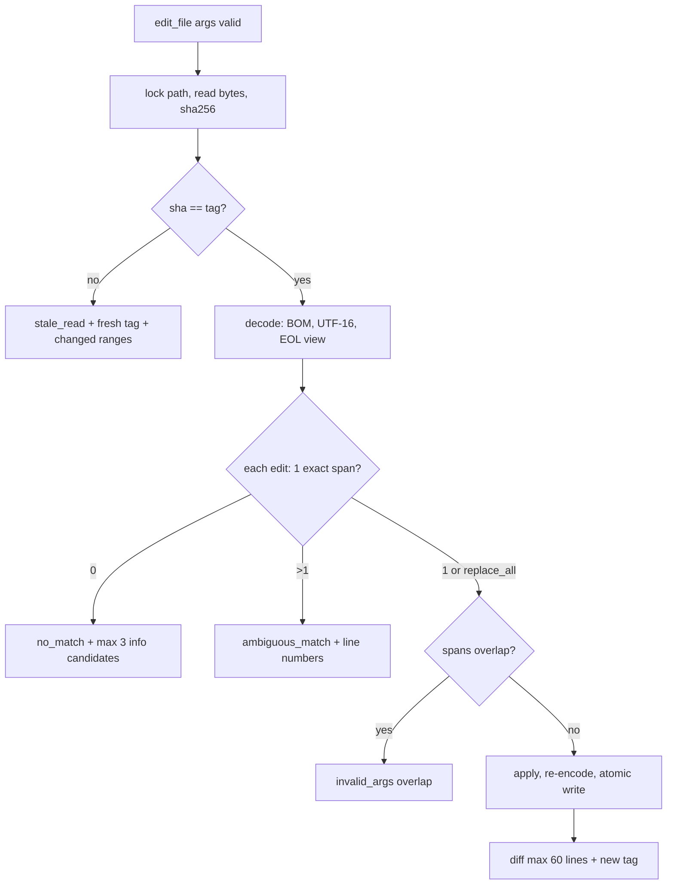

# Damn-Bot — Code Tools (grep, glob, read_file, edit_file, write_file, code intelligence)

Status: spesifikasi. Invariant induk: **P23** (kecepatan + akurasi code tools). Tool ini bagian dari core `internal/codetools` (eager, [SPEC.md](../SPEC.md) §5.1), kecuali code intelligence (modul lazy `codeintel`, §6) dan indeks trigram (modul lazy `codeindex`, §2.9). Keputusan arsitektur: ADR-014 (engine grep sendiri), ADR-015 (tree-sitter WASM + `go/ast` + LSP), ADR-017 (trigram > 50.000 file), ADR-031 (halaman tanpa spill) di [DECISIONS.md](DECISIONS.md). Eksekusi `shell` dan `repo_map`: [EXEC-AND-CODING.md](EXEC-AND-CODING.md). Edge case hermes: [EDGE-CASES-hermes.md](EDGE-CASES-hermes.md). Target diringkas di §11 dan disalin ke [SCORECARD.md](SCORECARD.md) / [MITIGATION-MATRIX.md](MITIGATION-MATRIX.md).

Referensi hermes: commit `868b9f244f5aa3ad238e494048046fe4f29c28ba`; semua sitasi `path:line` relatif ke root hermes.

## 0. Pembanding hermes vs Damn-Bot

| Aspek | hermes (sitasi) | Damn-Bot |
|---|---|---|
| Engine search | Binary `rg` eksternal, satu proses per pencarian lewat shell pipeline (`tools/file_operations_search.py:1044-1058`, `:1038-1040`) | Engine Go in-process: walker paralel + literal prefilter + RE2 (§2); 0 proses spawn (ADR-014) |
| Fallback | `rg` → `grep -rnHE` → error (`tools/file_operations_search.py:999-1009`); `find … -exec grep` untuk dot-dir/TCC (`:1120-1126`); nama file `rg --files` → `find -H` (`:918-950`, `:874-876`) | Tidak ada fallback; satu engine, hasil identik lintas OS |
| `.gitignore` | Default `rg`; fallback grep tidak membaca `.gitignore` (`tools/file_operations_search.py:1092-1095`) | Implementasi sendiri: `.gitignore`, `.ignore`, `.git/info/exclude`, `core.excludesFile` (§2.3), konformansi diuji vs `git check-ignore` |
| Determinisme urutan | Urutan output `rg` paralel (tidak di-sort) [INFERENCE: `--sort` tidak dipasang di `:1051`] | Urutan path byte-order, identik di GOMAXPROCS berapa pun (§2.2) |
| Limit search | Default 50, **tanpa maksimum** (`tools/file_operations_common.py:283`, `:308`); konten match dipotong 500 char (`tools/file_operations_search.py:246`, `:253`); timeout 60 s (`:1038-1040`) | Default 100, maks 500; baris 500 char berpusat di match; timeout 30 s → hasil parsial berlabel |
| Limit read | Default 2.000 baris, maks `max_lines` 2.000 (`tools/file_operations_common.py:281`, `:298-301`); budget 100.000 char (`tools/file_tools.py:50-52`); baris > 2.000 char dipotong (`tools/file_operations.py:501`) | Default 400, maks 2.000; baris dipotong 2.000 char; halaman ≤ 16.000 char (§1 butir 6) |
| Encoding read | UTF-8 `errors="replace"` → U+FFFD (`tools/file_operations.py:1010`); UTF-16 diselamatkan via BOM/paritas, maks 10 MiB, load penuh, decode `'replace'` (`:704`, `:774`) | Deteksi BOM + heuristik; byte invalid ditampilkan `\xNN` + flag header; tidak pernah U+FFFD diam-diam (§4.3) |
| Deteksi biner | Daftar ekstensi (`tools/binary_extensions.py:7-19`) + sniff 1.000 byte (`tools/file_operations.py:968-972`, `:445-448`) | Sniff NUL + rasio invalid di 8 KiB pertama + magic; tanpa daftar ekstensi (§4.4) |
| File besar | Native: streaming chunk (`tools/file_operations.py:930-937`); patch me-load seluruh file (`:1266-1276`) | Streaming + indeks offset baris; tail baca mundur; edit in-memory ≤ 64 MiB, line-range streaming di atasnya (§4.5, §5.4) |
| Pencocokan patch | 9 strategi berurutan: exact → line_trimmed → whitespace_normalized → indentation_flexible → escape_normalized → trimmed_boundary → unicode_normalized → block_anchor → context_aware (`tools/fuzzy_match.py:289-298`); `block_anchor` `SequenceMatcher` ambang 0,50 (1 kandidat) / 0,70 (`:247-256`); `context_aware` ≥ 0,80 per baris (`:261-285`) | **Exact only** (ADR-005, P23). Kandidat terdekat ≤ 3 hanya sebagai informasi, tidak pernah diterapkan (§5.3) |
| Staleness | `write_file` fail-closed (`tools/file_tools.py:898-900`); `patch` hanya `_warning` (`tools/file_tools.py:991`, `:1015-1016`); guard bisa dimatikan `HERMES_DISABLE_FILE_STATE_GUARD=1` (`tools/file_state.py:8`, `:32`) | Tag snapshot wajib untuk `edit_file` dan `write_file` (file eksisting); mismatch → `stale_read` fail-closed; tidak ada saklar mematikan (§5.1) |
| Multi-file patch | V4A dua fase; kegagalan fase apply tidak di-rollback ("state may be inconsistent", `tools/patch_parser.py:301-304`, `:343-344`) | `edit_file` atomic per file; `code_rename` multi-file dengan rollback dari snapshot (§6.3) |
| No-op | "already applied" → sukses `no_change` (`tools/file_operations.py:1589-1593`) | `no_match` + catatan "new_string sudah ada di L…" (informasi); tidak pernah sukses sintetis |
| Atomic write | Temp sama dir → `os.replace`; mode di-`fchmod`, error di-`pass` (`tools/file_operations_native.py:61-88`); tanpa `fsync` di jalur itu [INFERENCE: tidak ada panggilan `fsync` di `:61-88`] | Temp + `fsync` file + `rename` + `fsync` dir; kegagalan preservasi mode/owner dilaporkan di `Meta` (P14) |
| Format ke model | JSON `json.dumps` (`tools/file_tools.py:499`, `:1137`); search ≥ 5 match → `matches_text` + string `matches_format` (`tools/file_operations_common.py:122-153`) | Teks polos ringkas, path relatif, tag per file (§9) |

## 1. Prinsip

1. **Deterministik.** Input sama + isi file sama → output byte-identik, terlepas dari GOMAXPROCS, urutan `getdents`, atau timing. Diuji `TestCodeToolsDeterministic`.
2. **Fail-closed.** Ketidakpastian (tag basi, match ganda, overlap edit, encoding tak terpulihkan) → error terstruktur dari daftar SPEC §4.3, tidak pernah tebakan. Tidak ada fuzzy repair (P4); paket edit-distance tetap dilarang `forbidigo` di `internal/tools`.
3. **Structured output.** `Result.Content` = teks ringkas (§9); fakta mesin di `Result.Meta`; error = envelope `{"ok":false,"error":{code,message,hint}}` (SPEC §4.3).
4. **Token-efficient.** Path relatif terhadap root sesi, tanpa key JSON berulang, tanpa escape `\n`/`\"`, pagination lossless.
5. **Tanpa binary eksternal.** `rg`, `grep`, `find`, `sed`, `git` tidak dipanggil oleh tool (ADR-014). `rg` dan `git` hanya dipakai test/benchmark sebagai oracle.
6. **Halaman, bukan spill.** `read_file`, `grep`, `glob` membaca sumber yang sudah ada di disk, jadi hasilnya dipotong di batas baris/match utuh dengan `next: offset=N` dan **tidak** di-spill ke blob (spill salinan file workspace menciptakan loop persist→read→persist; hermes menghindarinya dengan `read_file=inf`, `tools/budget_config.py:9-10`). Cap halaman `page_chars = 16000`; setelah agregat P5 per turn (24.000 char) terlampaui, cap halaman turun ke 4.000 char. Pengecualian ini tertulis di SPEC P5 dan ADR-031.

## 2. Engine grep

### 2.1 Schema (eager, ≤ 200 tok)

```json
{"name":"grep","description":"Search file contents (RE2, smart-case). Respects .gitignore. mode: matches|files|count. Output includes file tags for edit_file.",
 "parameters":{"type":"object","properties":{
  "pattern":{"type":"string","minLength":1},
  "path":{"type":"string"},
  "glob":{"type":"string"},
  "type":{"type":"string","pattern":"^[a-z0-9+#-]{1,16}$"},
  "case":{"type":"string","enum":["smart","sensitive","insensitive"]},
  "context":{"type":"integer","minimum":0,"maximum":5},
  "mode":{"type":"string","enum":["matches","files","count"]},
  "offset":{"type":"integer","minimum":0},
  "limit":{"type":"integer","minimum":1,"maximum":500}},
 "required":["pattern"],"additionalProperties":false}}
```

Default: `case=smart` (pattern tanpa huruf besar → insensitive), `context=0`, `mode=matches`, `offset=0`, `limit=100`. `limit` dihitung per match (`matches`) atau per file (`files`, `count`). `type` divalidasi runtime terhadap tabel bahasa built-in (`go`, `py`, `js`, `ts`, `rust`, `c`, `cpp`, `java`, `kotlin`, `rb`, `php`, `cs`, `swift`, `sh`, `md`, `json`, `yaml`, `toml`, `sql`, `html`, `css`, dst.) → tak dikenal = `invalid_args` + daftar valid; `type` sengaja bukan `enum` agar schema tetap ≤ 200 tok.

### 2.2 Walker paralel dan urutan deterministik

- Worker pool tunggal berukuran `GOMAXPROCS` melayani dua jenis job: baca direktori (`os.ReadDir`, nama di-sort byte-order) dan scan file.
- Setiap file mendapat nomor urut dari traversal DFS terurut. Hasil scan dikumpulkan lewat **reorder buffer** berjendela `4 × GOMAXPROCS` file, lalu dipancarkan sesuai nomor urut. Output = output scan serial terurut, tetapi kerja tetap paralel. Ini berbeda dari `rg --sort path` yang memaksa single-thread.
- **Early exit per file:** mode `files` berhenti di match pertama; mode `count` scan penuh file itu.
- **Early exit global:** saat prefix nomor urut yang selesai sudah memuat `offset+limit` item, semua job bernomor lebih besar dibatalkan (`context.Cancel`). Item yang dibatalkan tidak pernah memengaruhi output, jadi early exit tetap deterministik.
- Symlink tidak diikuti saat walk (sama dengan default `rg`). Symlink yang disebut eksplisit di `path` di-resolve dan wajib tetap di dalam root (§8).
- Timeout 30 s: hasil sampai prefix terakhir yang lengkap + footer `truncated: timeout`.

### 2.3 Aturan ignore

Urutan prioritas (yang belakangan menang, negasi `!` dihormati):

1. `core.excludesFile` dari `$XDG_CONFIG_HOME/git/config`, `~/.gitconfig`, lalu `.git/config` repo (`include.path` diikuti maks kedalaman 5). Jika tidak diset: `$XDG_CONFIG_HOME/git/ignore` (default `~/.config/git/ignore`).
2. `.git/info/exclude`.
3. `.gitignore` per direktori, berlaku untuk subtree-nya. Scope di-reset di batas repo bersarang (direktori yang berisi `.git`).
4. `.ignore` per direktori (konvensi rg/ag).

Detail aturan:

- Sintaks git penuh: `**`, trailing `/`, anchoring `/`, `\#`, `\!`, trailing space escape, character class.
- `.gitignore` dihormati juga di luar repo git. Ini divergensi sadar dari `rg` (`--no-require-git` default off) [INFERENCE: user mengharapkan eksklusi pada tarball hasil ekstrak].
- `.git/` selalu dilewati.
- **Hidden** (nama diawali `.`) dilewati, kecuali:
  - komponen `path` menyebutnya eksplisit;
  - `glob` diawali `.` atau memuat `/.`.
- Path eksplisit ke direktori yang di-ignore (mis. `path: "node_modules/foo"`) tetap dicari. Eksplisit menang atas ignore, sama dengan `rg`.

Verifikasi: `TestGitignoreConformance`, ≥ 500 kasus (generated + regression), dibandingkan dengan `git check-ignore --no-index` → 0 selisih.

### 2.4 Biner, encoding, ukuran

- **Sniff biner:** 8 KiB pertama. Byte NUL (setelah pengecualian UTF-16 yang terdeteksi BOM) atau > 10% byte bukan UTF-8 valid → biner → dilewati. Jumlahnya dicatat di footer `skipped: N binary`, bukan diam (P14).
- **UTF-16 ber-BOM** di-transcode untuk pencarian; nomor baris tetap sesuai file.
- **Ukuran baca:** file ≤ 16 MiB dibaca utuh ke buffer pool (`sync.Pool`, kelas 64 KiB / 1 MiB / 16 MiB). File > 16 MiB di-scan streaming per chunk 1 MiB dengan carry baris terakhir.
- **mmap tidak dipakai.** `syscall.Mmap` tersedia tanpa CGO, tetapi file yang di-truncate saat termap memicu SIGBUS. Satu-satunya pemulihan (`debug.SetPanicOnFault` + `recover`) melanggar P14 (`recover()` hanya di `internal/boundary`). `rg` sendiri tidak memakai mmap untuk pencarian multi-file [tidak terverifikasi]. Keputusan dinilai ulang hanya jika `BenchmarkGrepLiteral` gagal target dan profil menunjukkan `read` > 30% CPU.
- File tak terbaca (permission, hilang saat walk) → footer `skipped: N unreadable` + ≤ 3 path pertama.

### 2.5 Literal fast-path

1. Pattern di-parse `regexp/syntax` lalu `Simplify`.
2. **Pattern murni literal:** `bytes.Index` atas seluruh buffer file (bukan per baris). Setiap hit diperluas ke batas baris. Tanpa RE2.
3. **Regex:** ekstrak *required literal set*, yaitu literal yang wajib muncul di setiap match (konkatenasi literal; alternasi literal ≤ 8 cabang → set). Prefilter memakai literal terpanjang (`bytes.Index`) atau beberapa literal. Hanya baris kandidat yang dijalankan RE2. Pattern tanpa literal wajib (mis. `\w+\(`) → RE2 per buffer dengan `regexp.FindAllIndex` dibatasi jumlah.
4. **Case-insensitive ASCII:** prefilter dengan byte langka dari literal di kedua case (`bytes.IndexByte` ganda, tabel frekuensi byte statis), lalu verifikasi `bytes.EqualFold`. Literal non-ASCII insensitive → langsung RE2 `(?i)`.
5. Pattern memuat `\n` → mode multiline otomatis (RE2 atas seluruh buffer, `(?s)` tidak ditambahkan diam-diam). Hermes melakukan deteksi serupa (`tools/file_operations_search.py:1059-1061`).

### 2.6 Output

- **Panjang baris:** maks 500 char per baris output. Baris lebih panjang ditampilkan sebagai jendela 500 char berpusat di kolom match, dengan `…` di sisi yang dipotong + `[col N]`.
- **Context:** `context` 0–5 baris sebelum/sesudah. Blok yang bersinggungan digabung; pemisah antar-blok `--`.
- **Pengelompokan:** per file, path relatif + tag snapshot (§5.1). Tag dihitung dari isi penuh file yang dipancarkan (hash dilanjutkan sampai EOF walau scan berhenti).
- **Mode:**
  - `matches` → `N:isi` untuk match, `N-isi` untuk context;
  - `files` → satu path per baris;
  - `count` → `path:N`.
- **Pagination:** footer `next: offset=K` jika masih ada item. `total` tidak dihitung saat early exit (`more: yes`), sehingga tidak ada scan ekstra.
- Halaman dipotong di item utuh terakhir yang muat `page_chars` (§1 butir 6).

### 2.7 Kinerja (target di §10)

Literal ≤ 1,2× `rg`, regex ≤ 1,5× `rg` (ADR-014). Gagal target = gate CI merah, bukan alasan memakai `rg`.

### 2.8 Interaksi dengan indeks

Sebelum walk, grep bertanya ke `codeindex` (jika modul sudah aktif untuk workspace ini). Kandidat file dari indeks diproses walker yang sama, jadi output identik dengan tanpa indeks (§2.9).

### 2.9 Indeks trigram (modul lazy `codeindex`, ADR-017)

**Aktivasi.** Walker grep/glob menghitung file terindeks setelah ignore. Hitungan > 50.000 → `codeindex.Start` di background. Alternatifnya `damnbot doctor index build`. Di bawah ambang: 0 goroutine, 0 fd (P16).

**Build:**

- Worker `max(1, GOMAXPROCS/4)`, prioritas rendah.
- File biner dan file > 16 MiB tidak diindeks; keduanya selalu di-scan langsung.
- Ditulis ke `<data_dir>/index/<sha256(realpath root)[0:16]>/` via direktori temp + `rename` (atomic). Isi: `meta.json` (versi format, waktu build, stat per file), `paths.bin`, `trigrams.bin` (tabel trigram terurut + posting list delta-varint).
- Cap disk 0,5× byte teks terindeks; lebih → build dibatalkan + WARN + event `system_notice`, lalu workspace jatuh ke walk.

**Query:**

1. Regex → trigram query AND/OR (gaya `codesearch/index/regexp`).
2. Kandidat = (posting) ∪ (dirty set) ∪ (file yang stat `(size, mtime_ns, ino)` berbeda dari indeks).
3. Setiap kandidat **diverifikasi terhadap isi file nyata** dengan engine §2.5. Indeks hanya pernah mengurangi file yang di-scan; ia tidak pernah menjadi sumber match.

Query tanpa trigram (mis. `.`, `\w`) → walk penuh.

**Invalidasi:**

- **Linux** (inotify) dan **Windows** (`ReadDirectoryChangesW`) via `fsnotify`: event menandai dirty set.
- **Watcher tidak sehat** (`ENOSPC` dari batas `max_user_watches`, overflow `IN_Q_OVERFLOW`) dan **macOS/BSD** (backend kqueue `fsnotify` membuka satu fd per file, sehingga tidak dipakai): mode *stat sweep*. Setiap query men-stat semua file terindeks secara paralel sebelum memakai posting.
- Aturan korektnes: file hanya boleh dikecualikan oleh indeks jika stat-nya sama persis dengan stat saat diindeks **dan** watcher sehat sejak build atau sweep dilakukan pada query ini.

**Status:** footer grep `index: building 43%` / `index: ready` / `index: off (reason)`.

## 3. glob

```json
{"name":"glob","description":"List files matching a doublestar pattern. Respects .gitignore. sort: path|mtime (newest first).",
 "parameters":{"type":"object","properties":{
  "pattern":{"type":"string","minLength":1},"path":{"type":"string"},
  "sort":{"type":"string","enum":["path","mtime"]},
  "offset":{"type":"integer","minimum":0},"limit":{"type":"integer","minimum":1,"maximum":2000}},
 "required":["pattern"],"additionalProperties":false}}
```

- **Matcher:** `github.com/bmatcuk/doublestar/v4` (`**`, `{a,b}`, `[...]`). Pattern tanpa `/` dicocokkan ke basename di semua kedalaman (`*.go` = `**/*.go`).
- **Walker dan ignore:** sama dengan §2.2–§2.3. Prefix literal pattern (`internal/tools/**`) dipakai untuk memangkas walk.
- **Sort:** default `path` (byte-order). `mtime` = terbaru dulu, tie-break path. `mtime` butuh stat semua match sebelum dipotong; jumlahnya dicatat `Meta.stat_calls`.
- **Batas:** default 200, maks 2.000. Footer `next: offset=K` / `count` total.
- Direktori tidak dicantumkan kecuali pattern berakhir `/`.
- glob **tidak** mengembalikan tag: hashing semua file hasil glob mahal dan model belum melihat isinya.

## 4. read_file

### 4.1 Schema

```json
{"name":"read_file","description":"Read a text file with line numbers. offset<0 reads from end. outline=true lists symbols. Header has tag for edit_file.",
 "parameters":{"type":"object","properties":{
  "path":{"type":"string","minLength":1},"offset":{"type":"integer"},
  "limit":{"type":"integer","minimum":1,"maximum":2000},"outline":{"type":"boolean"}},
 "required":["path"],"additionalProperties":false}}
```

- **`offset`:** 1-based. Negatif = dari akhir (`-100` = mulai 100 baris terakhir). `0` → `invalid_args`.
- **`limit`:** default 400, maks 2.000.
- **Output:** satu baris per line `N|isi` tanpa padding, format yang sama dengan hermes (`tools/file_operations.py:501`). Baris > 2.000 char dipotong + `… [+K chars]`.
- **Header:** path relatif, tag, rentang, total baris, encoding, EOL (contoh §9.2).
- **Halaman** dipotong di baris utuh terakhir yang muat `page_chars`, lalu `next: offset=N`.

### 4.2 Deteksi encoding

| Urutan | Kondisi | Encoding | Dipertahankan saat tulis |
|---|---|---|---|
| 1 | BOM `EF BB BF` | UTF-8 BOM | BOM |
| 2 | BOM `FF FE` / `FE FF` | UTF-16 LE / BE | BOM + endianness |
| 3 | Tanpa BOM, 8 KiB pertama: ≥ 40% byte posisi ganjil = 0 dan < 5% posisi genap = 0 (atau sebaliknya) | UTF-16 LE / BE tanpa BOM | endianness, tanpa BOM |
| 4 | Lainnya | UTF-8 | — |

Encoding legacy (Latin-1, Shift-JIS, CP1252) tidak ditebak. File seperti itu tampil sebagai UTF-8 dengan byte invalid (§4.3), atau biner jika > 10% invalid.

### 4.3 UTF-8 invalid

- Byte invalid ditampilkan sebagai escape `\xNN`. Header memuat `invalid_utf8=K`.
- Backslash literal di baris yang mengandung byte invalid ditampilkan `\\`, sehingga representasinya injektif.
- Baris lain tampil apa adanya.
- U+FFFD **tidak pernah** dihasilkan. Kontras: hermes memakai `errors="replace"` (`tools/file_operations.py:1010`) dan mengubah UTF-16 ke UTF-8 saat tulis ulang (`:774`).
- Edit baris yang mengandung byte invalid hanya lewat mode line-range (§5.2). `old_string` dicocokkan terhadap byte mentah, jadi teks `\xNN` dari model tidak cocok → `no_match` + hint mode line-range. Baris yang tidak disentuh dipertahankan byte-exact.

### 4.4 Deteksi biner dan media

- Magic byte dicek dulu: PNG, JPEG, GIF, WebP, PDF, ZIP/OOXML, ELF, Mach-O, PE, SQLite, gzip, wasm.
- **Gambar** → lampiran jika `capabilities.vision`. Selain itu `vision_analyze` (modul `media`, [SPEC.md](../SPEC.md) §9.5).
- **Dokumen** (PDF, Office, EPUB) → ekstraksi teks oleh modul `media` (parity `read_extract.py` hermes, lihat [FEATURE-PARITY.md](FEATURE-PARITY.md)). Engine teks tidak membaca format tersebut.
- **Biner lain** (sniff §2.4) → bukan error. Hasilnya `ok:true` dengan teks satu baris `binary: ELF 64-bit, 1,2 MB` (deskripsi dari magic) agar model tidak mengulang baca.

### 4.5 Streaming dan file besar

- **Tanpa batas ukuran.** SPEC §5.1 tidak membatasi ukuran file untuk `read_file`. File tidak pernah di-load penuh untuk dibaca.
- **Indeks offset baris:** `[]uint64` offset tiap 1.000 baris + total baris. Dibangun saat file pertama kali disentuh, di-cache per `(dev, ino, size, mtime_ns)` (§7).
  - File ≤ 8 MiB: indeks dibangun sinkron dalam pass yang sama dengan hashing tag.
  - File > 8 MiB: dibangun async (satu goroutine, dibatalkan jika file berubah).
- **Halaman acak:** seek ke checkpoint terdekat, scan ≤ 999 baris, baca `limit` baris.
- **Tail** (`offset < 0`): baca mundur per chunk 64 KiB dari EOF sampai cukup baris.
  - Indeks belum siap pada file > 8 MiB → nomor ditampilkan relatif dari akhir (`-100|…`) + header `numbering=from-end`. Mode line-range `edit_file` menerima nomor negatif yang sama.
  - Setelah indeks siap, nomor absolut.

### 4.6 Outline (`outline: true`)

- **Isi:** daftar simbol `L<start>-<end> <kind> <name>` bersarang (indent 2 spasi), maks 400 entri. Isi simbol dibaca dengan `offset=<start>`; lebih dari 400 entri → `next: offset=K` (offset entri).
- **Parser:**
  - Go → `go/parser` (`ParseFile` mode `SkipObjectResolution`) + `go/ast`.
  - Bahasa lain → query `tags.scm` tree-sitter WASM (§6.2) bila grammar tersedia.
  - Tanpa grammar → regex heuristik per bahasa (deklarasi `def`/`class`/`function`/`fn`/`func`/`struct`/`interface`), dilabeli `outline=heuristic` di header.
- File yang gagal di-parse → outline parsial dari node yang valid + `parse_errors=K`.
- **Cache:** outline di-cache per `(path, size, mtime_ns, sha)` (§7).

## 5. Anchored edit

### 5.1 Tag snapshot

- **Isi tag:** 8 hex pertama `sha256(byte file)` untuk file ≤ 8 MiB. Untuk file > 8 MiB: 8 hex `sha256(dev, ino, size, mtime_ns, ctime_ns)`, disebut *stat-tag*, dengan aturan racy (§5.5).
- **Tool yang mengembalikan tag:** `read_file` (header), `grep` (header per file, mode `matches`/`files`), `edit_file`/`write_file` (tag baru di hasil), `code_rename` (per file). `glob` tidak.
- **State per sesi:** runtime menyimpan `tag → (path, sha256 penuh, stat, snapshot isi ≤ 2 MiB)`. Validasi memakai sha256 penuh, jadi tabrakan 32-bit tidak relevan.
- **Tag lintas sesi:** tag yang tidak dikenal sesi ini (mis. halusinasi atau dari sesi lain) → `stale_read`, hint "read the file first".

### 5.2 Schema `edit_file`

```json
{"name":"edit_file","description":"Apply exact edits atomically. Needs tag from read_file/grep. Each edit: old_string+new_string[+replace_all] or start_line+end_line+new_text.",
 "parameters":{"type":"object","properties":{
  "path":{"type":"string","minLength":1},
  "tag":{"type":"string","pattern":"^[0-9a-f]{8}$"},
  "edits":{"type":"array","minItems":1,"maxItems":50,"items":{"type":"object","properties":{
    "old_string":{"type":"string","minLength":1},"new_string":{"type":"string"},"replace_all":{"type":"boolean"},
    "start_line":{"type":"integer"},"end_line":{"type":"integer"},"new_text":{"type":"string"}},
   "additionalProperties":false}}},
 "required":["path","tag","edits"],"additionalProperties":false}}
```

`anyOf` tidak dipakai karena SPEC §4.4 membatasinya ke schema MCP. Validasi mode per item dilakukan runtime. Tepat satu dari dua bentuk berikut wajib dipenuhi, selain itu `invalid_args` dengan path `/edits/<i>`:

- `{old_string, new_string, replace_all?}`;
- `{start_line, end_line, new_text}`, dengan `1 ≤ s ≤ e ≤ lines_total`, atau keduanya negatif dari akhir. `new_text` mengganti baris s..e secara inklusif. Insert dilakukan dengan menyertakan baris jangkar di `new_text`.

### 5.3 Semantik

1. **Lock dan baca.** Lock per-path (mutex in-process + `flock` advisory pada file temp) → baca byte → hash.
2. **Cek tag.** sha256 ≠ sha tag → **`stale_read`** (fail-closed). Message memuat:
   - tag baru;
   - ringkasan rentang baris yang berubah (diff baris Myers atas hash baris antara snapshot dan isi sekarang, ≤ 10 rentang + `+a -b`);
   - jika snapshot sudah ter-evict: `changes: unknown`.
   Hint: edit string boleh dicoba ulang dengan tag baru; edit line-range wajib baca ulang.
3. **Decode ke tampilan logis.** BOM dilepas, UTF-16 → UTF-8, EOL baris → `\n`. Hanya pemetaan ini yang dilakukan; semuanya lossless dan invertible. Ini representasi, bukan normalisasi pencocokan.
4. **Resolusi semua edit terhadap isi asli**, bukan berantai (urutan item tidak memengaruhi hasil):
   - String, `0` match → **`no_match`** + ≤ 3 kandidat terdekat **sebagai informasi**:
     - skor = jumlah baris `old_string` (trim) yang ada di jendela berukuran sama, berjangkar baris pertama/terakhir; tanpa edit distance;
     - setiap kandidat diberi label alasan: `whitespace differs (tab vs spaces)`, `unicode NFC vs NFD` (via `golang.org/x/text/unicode/norm`), `escaped quotes differ`, `k/n lines similar`, `new_string already present`.
     Kandidat **tidak pernah diterapkan**.
   - String, `> 1` match tanpa `replace_all` → **`ambiguous_match`** + semua nomor baris (maks 20 + `…`).
   - Span dua edit beririsan, termasuk span identik → `invalid_args` "edits i and j overlap at L…". Span bersebelahan diizinkan.
   - Edit no-op (`old_string == new_string`, atau `new_text` = isi sekarang) → `invalid_args`.
5. **Terapkan dan encode balik:**
   - `\n` di teks baru → EOL baris pertama region yang diganti; fallback EOL dominan file.
   - Baris di luar region byte-exact.
   - BOM dan UTF-16 dikembalikan.
6. **Tulis** (§5.4), lalu kembalikan:
   - diff unified ringkas: context 2 baris, ≤ 60 baris, lebih → dipotong + `diff_stat`;
   - tag baru;
   - `Meta{replacements, diff_stat, eol, encoding, owner_preserved, mode_preserved}`.

Redaksi (SPEC §14.3): `old_string`/`new_text` yang memuat sentinel redaksi → `invalid_args`, karena menulis sentinel ke file akan merusak secret asli.



### 5.4 Penulisan atomic dan preservasi

- **Urutan tulis:**
  1. Temp `.<name>.damnbot-<rand>` dibuat dengan `O_CREAT|O_EXCL` di direktori **target ter-resolve**.
  2. `fchmod` ke mode lama sebelum byte pertama.
  3. Tulis, lalu `fsync(file)`.
  4. Re-stat target. Bila `(size, mtime_ns, ino)` berubah sejak langkah 1 §5.3 → hapus temp, `stale_read`.
  5. `rename`, lalu `fsync(dir)`.
  - Windows: `MoveFileExW(MOVEFILE_REPLACE_EXISTING|MOVEFILE_WRITE_THROUGH)`, tanpa fsync dir.
- **Owner:** `fchown` ke uid/gid lama jika berbeda. Gagal (`EPERM`) → `Meta.owner_preserved=false` + log WARN, tidak ditelan (P14).
- **xattr** (termasuk label SELinux, Linux/macOS) disalin via `golang.org/x/sys/unix`. Gagal → `Meta.xattr_preserved=false`.
- **Symlink:** target yang diedit, symlink tetap ada. Target wajib di dalam root (§8).
- **Hardlink** (`nlink > 1`): `rename` akan memutus link, jadi file ditulis **in-place** (`O_TRUNC` + write + `fsync`) setelah snapshot isi lama masuk `file_snapshots` (SPEC §4.3 langkah 9) + `Meta.inplace=hardlink`.
- **Ukuran file:**
  - ≤ 64 MiB: diproses in-memory.
  - \> 64 MiB: hanya mode line-range, via salin streaming (prefix → teks baru → suffix). Edit string → `too_large` + hint line-range.
- **Crash safety:** `kill -9` di titik mana pun → file berisi versi lama **atau** baru, tidak pernah parsial. Temp yatim dibersihkan saat start sesi berikutnya (pola nama).

### 5.5 Perubahan di luar agent

| Kejadian | Perilaku |
|---|---|
| Isi berubah (editor user, `git checkout`, formatter) | Tag lama → `stale_read` + rentang berubah; cache read diinvalidasi oleh stat/fsnotify |
| Disimpan ulang dengan byte identik (editor save via rename, inode baru) | Tag konten tetap valid → edit lanjut (tidak ada stale palsu) |
| File dihapus / di-rename | `not_found`; tag dilepas |
| File > 8 MiB (stat-tag) berubah | Stat berbeda → `stale_read`. Racy: jika `mtime` ≤ 2 s dari saat tag dibuat, edit memaksa hash penuh dan membandingkan dengan hash yang dihitung indeks async; belum tersedia → `stale_read` |
| Berubah di antara validasi dan `rename` | Re-stat langkah 4 §5.4 → `stale_read`. Sisa jendela race = mikrodetik antara re-stat dan `rename`; tidak ada lock lintas-editor di POSIX (didokumentasikan, bukan diklaim nol) |

### 5.6 `write_file`

Schema: `{path*, content* (maxLength 1000000), tag (pattern ^[0-9a-f]{8}$)}`.

- **Membuat file baru:** `tag` tidak boleh ada; bila ada → `not_found`. Direktori induk dibuat (di dalam root). Hasilnya UTF-8 tanpa BOM, EOL `files.new_eol` (default `lf`).
- **Menimpa file eksisting:**
  - tanpa `tag` → `stale_read` hint "read_file first";
  - tag basi → `stale_read` seperti §5.3.
  - Encoding/BOM/EOL dominan/mode/owner file lama dipertahankan. `content` dianggap tampilan logis.
- **Output:** `+a -b` + diff ≤ 60 baris + tag baru.

Tag dari halaman parsial cukup, karena tag mengikat isi penuh. Hermes mensyaratkan baseline baca penuh (`tools/file_tools.py:541-545`). Damn-Bot memilih syarat konkurensi saja; risiko model menimpa bagian yang belum dibaca diarahkan ke `edit_file` lewat stable tier.

## 6. Code intelligence (modul lazy `codeintel`)

### 6.1 Komponen

| Komponen | Sumber | Start | Biaya idle |
|---|---|---|---|
| Go parser | `go/parser`, `go/ast` (stdlib) | in-process, sinkron | 0 |
| tree-sitter | Grammar WASM di `github.com/tetratelabs/wazero` (compiler mode di amd64/arm64, interpreter di arsitektur lain); modul terkompilasi di-cache di `<cache_dir>/wazero` (`NewCompilationCacheWithDir`) | grammar dimuat saat bahasa pertama kali diminta | 0 goroutine sebelum dipakai (P16) |
| LSP client | JSON-RPC stdio ke server terpasang: `gopls`, `pyright-langserver`/`pylsp`, `typescript-language-server`, `rust-analyzer`, `clangd`, dll. Command override di `[modules.codeintel.lsp.<lang>] command = [...]` | start saat tool `code_*` pertama untuk bahasa itu; maks 3 server bersamaan; idle 10 menit → shutdown | 0 proses sebelum dipakai |

Grammar di build default **tidak di-embed**. Grammar diunduh dari rilis Damn-Bot yang di-pin SHA-256 di manifest embedded `grammars.lock` → `<cache_dir>/grammars/<lang>-<sha>.wasm`. Alternatifnya `damnbot doctor grammars install --offline <bundle.tar.gz>` (tar + gzip stdlib; tanpa dependency zstd, M-03). SHA mismatch → file dihapus + `module_unavailable`. Tanpa jaringan dan tanpa bundle → outline heuristik (§4.6).

### 6.2 Grammar `grammars_embedded` (12)

python, javascript, typescript, tsx, rust, c, cpp, java, ruby, php, bash, c_sharp. Grammar lain yang tersedia via unduhan: kotlin, swift, lua, scala, zig, html, css, json, yaml, toml, markdown, sql. Tiap grammar dibundel dengan query `tags.scm`.

### 6.3 Tool deferred (grup katalog `code`: "symbols, definitions, references, diagnostics, rename")

| Tool | Argumen (`*` required) | Backend | Catatan |
|---|---|---|---|
| `code_symbols` | `query*` ≤ 200; `path`; `kind` string; `limit` 1–200 (default 50) | LSP `workspace/symbol` jika server jalan; selain itu tags tree-sitter/`go/ast` atas file hasil walk §2 | Output `path:L kind name` |
| `code_definition` | `path*`; `line*` ≥ 1; `column*` ≥ 1 | LSP `textDocument/definition`; fallback resolusi nama berbasis tags dengan label `heuristic` | Kolom = code point 1-based (dikonversi ke UTF-16 untuk LSP) |
| `code_references` | `path*`; `line*`; `column*`; `limit` 1–500 (default 100) | LSP `textDocument/references`; fallback grep word-boundary dengan label `heuristic` | Format sama dengan grep (§9.1) + tag per file |
| `code_diagnostics` | `path*` | LSP `publishDiagnostics` / pull diagnostics; tanpa server → `module_unavailable` + nama server yang perlu dipasang | Diagnostik otomatis pasca-edit didefinisikan di [EXEC-AND-CODING.md](EXEC-AND-CODING.md) |
| `code_rename` | `path*`; `line*`; `column*`; `new_name*`; `tag*` | LSP `textDocument/rename` → `WorkspaceEdit` | Lihat aturan di bawah |

Aturan `code_rename`:

- Approval menampilkan daftar file yang akan diubah.
- Setiap file target di-hash saat `WorkspaceEdit` diterima dan diverifikasi ulang sebelum tulis.
- Semua temp ditulis dulu, lalu `rename` berurutan. Kegagalan di tengah → rollback file yang sudah di-rename dari snapshot → error `exec_failed`. Kontras dengan V4A hermes yang tidak rollback (`tools/patch_parser.py:301-304`).

Semua schema `additionalProperties:false`, ≤ 120 tok per tool [INFERENCE, diukur `TestSchemaTokens`]. `repo_map` dimiliki [EXEC-AND-CODING.md](EXEC-AND-CODING.md).

### 6.4 Tradeoff ukuran binary

| Varian / komponen | Kontribusi | Status angka | Gate |
|---|---|---|---|
| Core fs tools (walker, gitignore, encoding, edit engine, doublestar, fsnotify) | ≤ 0,6 MB (baris `codetools` SPEC §3.2.4) | budget | `make size-check` (laporan `go tool nm -size` per paket `internal/codetools/...`) |
| `codeintel` default (wazero ≈ 2,0 MB [INFERENCE], LSP client ≈ 0,3 MB [INFERENCE], outline + tags runtime ≈ 0,2 MB [INFERENCE]) | ≤ 3,0 MB | budget (ADR-015) | `make size-check`, tag `nomod_codeintel` |
| `codeindex` | ≤ 0,4 MB | budget | tag `nomod_codeindex` |
| `-tags goolm,grammars_embedded` (12 grammar WASM + tags query) | ≤ +16 MB di atas full build | budget; ≈ 0,5–2 MB/grammar [INFERENCE] | `make size-check TAGS+=grammars_embedded` (Makefile menghasilkan `-tags goolm,grammars_embedded`, ENGINEERING E-39) |
| Grammar cache disk (unduhan) | ≤ 2 MB per grammar + cache kompilasi wazero ≤ 8 MB per grammar [INFERENCE] | diukur F-fase codeintel | `TestGrammarCacheSize` |

## 7. Indeks dan cache

| Struktur | Kunci | Isi | Cap memori | Invalidasi |
|---|---|---|---|---|
| File index workspace | path relatif | stat + flag ignore/biner | ≤ 24 MB (≈ 80.000 file × ≤ 300 B) | fsnotify (Linux/Windows); dir-mtime sweep 5 s + stat saat pakai (macOS/BSD, atau watcher tidak sehat) |
| Read cache | `(dev, ino, size, mtime_ns)` → `sha256` | byte file ≤ 2 MiB + indeks baris | 16 MB LRU | stat setiap pakai; entri "racy" (mtime ≤ 2 s dari waktu isi) di-hash ulang |
| Line-offset index | sama | checkpoint per 1.000 baris | 4 MB LRU | sama |
| Snapshot store (diff `stale_read`) | tag | isi saat tag dibuat (≤ 2 MiB/file) | 16 MB LRU per sesi | evict → `changes: unknown` |
| Outline cache | `(path, size, mtime_ns, sha)` | outline terformat | 4 MB LRU | stat |
| Trigram (`codeindex`) | trigram | posting list (dibaca `pread`, bukan resident) | resident ≤ 32 MB | §2.9 |

Ringkasan:

- **Total cap code-tools:** ≤ 96 MB, di bawah puncak P18 (300 MB).
- **Lepas saat idle:** semua cache dilepas setelah 10 menit tanpa pemakaian tool file.
- **Pembuatan malas:** struktur dibuat saat tool pertama dipakai; proses yang belum memanggil tool file tidak punya watcher maupun goroutine cache.
- **Korektnes tidak bergantung pada fsnotify.** Setiap hit cache memvalidasi stat. fsnotify hanya mempercepat invalidasi daftar file dan indeks.
- **Fallback watcher:** `inotify_add_watch` → `ENOSPC` (batas `fs.inotify.max_user_watches`) → watcher ditutup, mode sweep aktif, WARN satu kali + `system_notice` berisi saran `sysctl`.

## 8. Keamanan

- **Path sandbox** [SPEC.md](../SPEC.md) §14.2 berlaku untuk `path` semua tool di dokumen ini sebelum I/O (pipeline SPEC §4.3 langkah 5).
- **Anti-TOCTOU symlink:**
  - Linux ≥ 5.6: buka via `openat2(RESOLVE_BENEATH|RESOLVE_NO_MAGICLINKS)` (`golang.org/x/sys/unix`).
  - Kernel lama/macOS: buka lalu verifikasi path nyata fd (`/proc/self/fd/N` readlink, `F_GETPATH` di macOS, `GetFinalPathNameByHandle` di Windows) berprefix root. Gagal → `outside_workspace`.
- **Symlink keluar root:** symlink di dalam root yang menunjuk keluar root → `outside_workspace` untuk baca dan tulis. Walker grep/glob tidak mengikuti symlink (§2.2).
- **Tulis di luar root:** `outside_workspace` secara default. Frontend interaktif menawarkan approval "write outside workspace: <path>" yang **tetap ditanya di semua mode**, termasuk `auto`. `allow_session` hanya untuk path persis. Headless/cron → selalu `outside_workspace`. Tercantum di SPEC §14.1 (baris "Read/write di luar workspace") dan §14.2.
- **`deny_paths`:** menang atas root dan approval, tidak dapat di-override. grep/glob melewati path yang ditolak dan hanya mencatat jumlahnya di footer (`skipped: N denied`), tanpa nama.
- **Approval tulis di workspace:** sesuai SPEC §14.1 (`ask` → tanya, `auto-edit`/`auto` → auto). Tool read-only tidak pernah butuh approval.
- **Redaksi** (SPEC §14.3) diterapkan ke output `read_file`/`grep` sebelum ke model. Interaksinya dengan edit dibahas di §5.3.
- **Isi file adalah data.** Isi file tidak dibungkus `<untrusted>` (file workspace = konteks user), kecuali file di direktori blob hasil `web_fetch`/MCP yang sudah berlabel.

## 9. Format output ke model

Semua path relatif terhadap root sesi. Root tambahan (`add_dirs`) diberi prefix `@<n>/`.

### 9.1 grep

```text
grep "Sync\(" · 5 matches · 3 files
internal/ctxdb/blob.go #3f9a12c0
41:	if err := f.Sync(); err != nil {
88:	return d.Sync()
internal/codetools/write.go #b71e04d2
119-	}
120:	if err := tmp.Sync(); err != nil {
121-		return fmt.Errorf("sync temp: %w", err)
internal/codetools/dir_unix.go #0c4e9a11
17:	return unix.Fsync(fd)
skipped: 2 binary
```

Mode `files`: satu path + tag per baris. Mode `count`: `path #tag 12`. Footer opsional: `next: offset=100`, `more: yes`, `index: ready`.

Hermes untuk kueri yang sama mengembalikan JSON:

- ≥ 5 match: `{"total_count":5,"matches_format":"path-grouped: each file path on its own line, followed by indented '<line>: <content>' rows for matches in that file","matches_text":"internal/ctxdb/blob.go\n  41: …"}` (`tools/file_operations_common.py:140-151`);
- < 5 match: array `{"path":…,"line":…,"content":…}` per match (`:152-154`).

Biaya ekstra hermes: string `matches_format` ≈ 30 tok per panggilan, escape `\n`/`\"` di setiap baris kode, path berulang per match (< 5 match), key `total_count`/`truncated`/`total_count_is_lower_bound`. Estimasi Damn-Bot ≈ 0,5–0,65× token hermes untuk 5–50 match [INFERENCE]; target terukur ≤ 0,6× (CT-11, §10).

### 9.2 read_file

```text
internal/ctxdb/blob.go #3f9a12c0 · L1-120/412 · utf-8 lf
1|package ctxdb
2|
3|import (
…
120|}
next: offset=121
```

Header variasi: `utf-16le bom crlf`, `invalid_utf8=3`, `numbering=from-end`, `outline=heuristic`. Hermes mengirim `{"content":"1|package ctxdb\n2|…","total_lines":412,"file_size":…}` via `json.dumps` (`tools/file_tools.py:499`, `:756`). Setiap `"` di kode menjadi `\"` dan setiap baris membawa `\n` escape.

### 9.3 Outline

```text
internal/ctxdb/blob.go #3f9a12c0 · outline · go/ast · 14 symbols
L12-30 type BlobStore struct
L32-58 func (*BlobStore) Put
L60-91 func (*BlobStore) Get
```

### 9.4 edit_file sukses

```text
edited internal/ctxdb/blob.go #3f9a12c0→#91cc0a7e · 1 edit · +3 -1
@@ -41,2 +41,4 @@
 	if err := f.Sync(); err != nil {
-		return err
+		return fmt.Errorf("blob sync: %w", err)
+	}
+	if err := d.Sync(); err != nil {
```

### 9.5 Error (envelope SPEC §4.3)

```json
{"ok":false,"error":{"code":"stale_read","message":"internal/ctxdb/blob.go changed since #3f9a12c0 (now #5d02e1aa): L40-52, L118 (+6 -2)","hint":"string edits may retry with tag 5d02e1aa; line edits must re-read L40-52"}}
{"ok":false,"error":{"code":"no_match","message":"edit 1: old_string not found in internal/x.go","hint":"nearest (NOT applied): L88-90 whitespace differs (tab vs 4 spaces); L140-142 3/3 lines similar"}}
{"ok":false,"error":{"code":"ambiguous_match","message":"edit 2: 3 matches at L12, L48, L97","hint":"add surrounding lines or set replace_all"}}
```

## 10. Benchmark dan suite akurasi

### 10.1 Korpus (di-generate/di-pin, checksum di `bench/corpora.lock`)

| ID | Isi | Ukuran |
|---|---|---|
| C1 | hermes-agent commit `868b9f244f5aa3ad238e494048046fe4f29c28ba` | 20.076 file ter-track, ≈ 225 MB |
| C2 | Sintetis kernel-size, `bench/gen-corpus --seed 1 --files 80000`. Isi: ≈ 5.000 direktori, campuran 12 bahasa, `.gitignore` berlapis, 1% biner, 0,1% file > 1 MB, 50 file minified baris tunggal | ≈ 1,1 GB |
| C3 | Sintetis kecil, `--seed 3 --files 1000` | ≈ 12 MB |

**Mesin dan prosedur ukur:**

- Mesin referensi dan ambang runner CI ×1,5 mengikuti SPEC §17 / OPEN-QUESTIONS Q14.
- Page cache hangat (1 run warm-up), 20 run per kueri.
- Oracle `ripgrep 15.1.0` dijalankan dengan `--no-config` dan output ke `/dev/null`.
- Pembanding grep memakai API engine dengan `Limit=-1` (tanpa early exit, output terformat ke `io.Discard`), sehingga Damn-Bot tidak diuntungkan oleh limit.
- `codeindex` dimatikan untuk perbandingan dengan rg.

### 10.2 Target kinerja

| ID | Metrik | Target | Verifikasi |
|---|---|---|---|
| CT-01 | grep literal vs `rg` (C1, C2, C3; 40 kueri) | p50 dan p95 ≤ 1,2× | `BenchmarkGrepLiteral/{C1,C2,C3}` + `bench/compare-rg` (job `bench-codetools`, nightly; RC = gate) |
| CT-02 | grep regex vs `rg` (40 kueri, termasuk tanpa literal wajib) | p50 dan p95 ≤ 1,5× | `BenchmarkGrepRegex/{C1,C2,C3}` + `bench/compare-rg` |
| CT-03 | glob vs `rg --files` (+ filter glob setara) | p50 dan p95 ≤ 1,2× | `BenchmarkGlob/{C1,C2,C3}` |
| CT-04 | grep end-to-end tool di C3 (cold process-cache, page cache hangat) | p95 ≤ 15 ms | `BenchmarkGrepToolC3` (PR perf job) |
| CT-05 | read_file 400 baris dari file 1 MB (offset acak) | p95 ≤ 3 ms | `BenchmarkReadPage1MB` |
| CT-06 | tail 100 baris file 100 MB (indeks dingin) | p95 ≤ 10 ms | `BenchmarkReadTail100MB` |
| CT-07 | outline file Go 1 MB (`go/ast`) | p95 ≤ 50 ms | `BenchmarkOutlineGo1MB` |
| CT-08 | outline Python 1 MB (tree-sitter WASM, modul terkompilasi ter-cache) | p95 ≤ 150 ms | `BenchmarkOutlineTreeSitter1MB` |
| CT-09 | edit_file 1 MB termasuk `fsync` file + dir (ext4, NVMe) | p95 ≤ 20 ms | `BenchmarkEdit1MB` |
| CT-10 | vs tool hermes end-to-end di C1 (`search_files`, `read_file`, `patch`; 60 operasi) | Damn-Bot ≥ 2× lebih cepat p50 per kategori | F0 harness `scorecard code-tools` ([SCORECARD.md](SCORECARD.md)) |
| CT-11 | Token output grep vs hermes (50 kueri golden, tokenizer o200k_base) | Σ token Damn-Bot ≤ 0,6× Σ hermes | `TestGrepOutputTokens` (golden hermes direkam dari C1 via F0) |
| CT-12 | grep dengan `codeindex` siap di C2 (40 kueri literal) | p95 ≤ 100 ms | `BenchmarkGrepIndexedC2` |
| CT-13 | Build `codeindex` C2 | ≤ 120 s; disk ≤ 0,5× byte teks | `BenchmarkIndexBuildC2` (nightly) |
| CT-14 | Memori puncak heap selama grep C2 tanpa indeks | ≤ 96 MB | `TestCodeToolsMemCap` (`runtime/metrics`) |

### 10.3 Target akurasi

| ID | Metrik | Target | Verifikasi |
|---|---|---|---|
| CT-20 | Suite akurasi edit: ≥ 325 kasus `testdata/editsuite/*.txtar` (+ read-back sha256 setelah tulis, TOOL-03) | 100% outcome sesuai ekspektasi; 0 edit di lokasi salah; 0 perubahan encoding/EOL/BOM/permission/owner yang tidak diminta | `TestEditAccuracySuite` (PR) |
| CT-21 | Parity match-set grep vs `rg --no-config` (C1, C3; 200 kueri) | 0 selisih (path, baris) | `TestGrepParityRg` |
| CT-22 | Determinisme output grep/glob (GOMAXPROCS 1, 2, 4, 8, 16; 100 run) | byte-identik | `TestCodeToolsDeterministic` |
| CT-23 | Konformansi ignore vs `git check-ignore` | ≥ 500 kasus, 0 selisih | `TestGitignoreConformance` |
| CT-24 | `codeindex` vs walk (C2, 500 kueri + 1.000 mutasi acak via fsnotify dan mode sweep) | 0 false negative, 0 false positive | `TestTrigramEquivalence` |
| CT-25 | Crash saat tulis (`kill -9` acak, 200 iterasi) | file = versi lama atau baru, 0 parsial | `TestAtomicWriteKill9` |
| CT-26 | Escape symlink/TOCTOU (swap symlink saat open, 1.000 iterasi) | 0 akses di luar root | `TestSymlinkEscapeRace` |
| CT-27 | Schema 5 tool file eager (`read_file`, `write_file`, `edit_file`, `glob`, `grep`) | masing-masing ≤ 200 tok, deskripsi ≤ 160 char | `TestSchemaTokens` (bagian dari P1 `TestFixedOverhead`) |
| CT-28 | Lazy `codeintel`/`codeindex` | 0 goroutine/fd/proses sebelum pemakaian pertama | `TestLazyModules` (P16) |
| CT-29 | Akurasi deteksi biner (§4.4): korpus 300 file (100 biner bermagic/tanpa magic, 50 UTF-16 LE/BE ± BOM, 50 UTF-8 dengan ≤ 10% byte invalid, 50 minified, 50 teks biasa) | 0 biner diperlakukan teks; 0 teks (termasuk UTF-16) dilewati sebagai biner; footer `skipped: N binary` = jumlah biner persis | `TestBinarySniffCorpus` |

Komposisi `TestEditAccuracySuite` (325 kasus): CRLF/EOL campuran 30, UTF-8 BOM 15, UTF-16 LE/BE ± BOM 20, Unicode NFC/NFD 15, tab vs spasi 25, match ganda/`ambiguous_match`/`replace_all` 30, file berubah sejak baca (`stale_read`, termasuk save byte-identik) 30, symlink dalam/luar root 15, permission/owner/xattr 15, baris raksasa ≥ 1 MB 10, file kosong 10, tanpa newline akhir 15, byte UTF-8 invalid 15, multi-edit overlap/urutan 30, line-range termasuk negatif 25, file > 64 MiB 5, hardlink 5, Latin-1/CP1252 tak ditebak (byte-exact, line-range only) 15 (GAP-TOOL-03). Setiap kasus memuat byte input, args, dan ekspektasi (kode error **atau** byte output persis + stat mode/owner).

## 11. Ringkasan angka

| ID | Metrik | Target | Verifikasi |
|---|---|---|---|
| P23 | Code tools cepat + akurat | CT-01…CT-36 semua lulus (ID berblok: CT-01..14 kinerja, CT-20..29 akurasi, CT-30..36 limit; CT-15..19 sengaja tidak dipakai — 30 ID) | job `bench-codetools` + `TestEditAccuracySuite` (gate RC; akurasi gate PR) |
| CT-01 | grep literal vs rg | ≤ 1,2× p50/p95 | `BenchmarkGrepLiteral` |
| CT-02 | grep regex vs rg | ≤ 1,5× p50/p95 | `BenchmarkGrepRegex` |
| CT-03 | glob vs `rg --files` | ≤ 1,2× p50/p95 | `BenchmarkGlob` |
| CT-04 | grep C3 | p95 ≤ 15 ms | `BenchmarkGrepToolC3` |
| CT-05 | read 400 baris / 1 MB | p95 ≤ 3 ms | `BenchmarkReadPage1MB` |
| CT-06 | tail 100 baris / 100 MB | p95 ≤ 10 ms | `BenchmarkReadTail100MB` |
| CT-07 | outline Go 1 MB | p95 ≤ 50 ms | `BenchmarkOutlineGo1MB` |
| CT-08 | outline tree-sitter 1 MB | p95 ≤ 150 ms | `BenchmarkOutlineTreeSitter1MB` |
| CT-09 | edit 1 MB + fsync | p95 ≤ 20 ms | `BenchmarkEdit1MB` |
| CT-10 | vs hermes C1 | ≥ 2× lebih cepat p50 | F0 `scorecard code-tools` |
| CT-11 | token grep vs hermes | ≤ 0,6× | `TestGrepOutputTokens` |
| CT-12 | grep terindeks C2 | p95 ≤ 100 ms | `BenchmarkGrepIndexedC2` |
| CT-13 | build indeks C2 | ≤ 120 s; disk ≤ 0,5× teks | `BenchmarkIndexBuildC2` |
| CT-14 | heap puncak grep C2 | ≤ 96 MB | `TestCodeToolsMemCap` |
| CT-20 | akurasi edit | ≥ 325 kasus, 100%, 0 lokasi salah, 0 perubahan tak diminta, read-back verify | `TestEditAccuracySuite`, `TestWriteReadBack` |
| CT-21 | parity match-set vs rg | 0 selisih / 200 kueri | `TestGrepParityRg` |
| CT-22 | determinisme | byte-identik, 5 nilai GOMAXPROCS × 100 run | `TestCodeToolsDeterministic` |
| CT-23 | konformansi ignore | ≥ 500 kasus, 0 selisih | `TestGitignoreConformance` |
| CT-24 | indeks vs walk | 0 FN / 0 FP | `TestTrigramEquivalence` |
| CT-25 | crash saat tulis | 0 file parsial / 200 kill | `TestAtomicWriteKill9` |
| CT-26 | escape symlink | 0 / 1.000 iterasi | `TestSymlinkEscapeRace` |
| CT-27 | schema tool file | ≤ 200 tok/tool, deskripsi ≤ 160 char | `TestSchemaTokens` |
| CT-28 | lazy codeintel/codeindex | 0 goroutine/fd/proses idle | `TestLazyModules` |
| CT-29 | deteksi biner | 0 salah klasifikasi / 300 file | `TestBinarySniffCorpus` |
| CT-30 | Limit grep | default 100, maks 500 match; baris ≤ 500 char; context 0–5; timeout 30 s | `TestGrepLimits` |
| CT-31 | Limit glob | default 200, maks 2.000 | `TestGlobLimits` |
| CT-32 | Limit read | default 400, maks 2.000 baris; baris ≤ 2.000 char; halaman ≤ 16.000 char (4.000 setelah agregat turn) | `TestReadLimits`, `TestPageCap` |
| CT-33 | Edit | ≤ 50 edit/call; diff ≤ 60 baris; in-memory ≤ 64 MiB; kandidat `no_match` ≤ 3 | `TestEditLimits` |
| CT-34 | Ambang | sniff 8 KiB; biner > 10% invalid; full-hash tag ≤ 8 MiB; racy 2 s; trigram > 50.000 file | `TestBinarySniff`, `TestStatTagRacy`, `TestIndexActivation` |
| CT-35 | Cap cache | file index 24 MB, read 16 MB, line-index 4 MB, snapshot 16 MB, outline 4 MB, trigram resident 32 MB; total ≤ 96 MB; release idle 10 menit | `TestCodeToolsMemCap`, `TestCacheIdleRelease` |
| CT-36 | Ukuran binary | core fs ≤ 0,6 MB; `codeintel` ≤ 3,0 MB; `codeindex` ≤ 0,4 MB; `grammars_embedded` ≤ +16 MB | `make size-check` |
