# ENGINEERING — standar kode, arsitektur paket, library, CI, test, review

Status: spesifikasi normatif. Berlaku untuk semua kode Go di repo Damn-Bot (binary `damnbot`, Go 1.26.x dengan pin direktif `go 1.26.9` di `go.mod`, `bench/go.mod`, `tools/go.mod` (ADR-051; sebutan Go 1.26.8 di dokumen ini = catatan pengukuran historis, bukan pin), `CGO_ENABLED=0`). Induk: [SPEC.md](../SPEC.md) §2 (P6, P13, P14, P16, P21), §3, §16; [DECISIONS.md](DECISIONS.md) ADR-001/002/008/009/011/014/015/016; [BASELINE-hermes.md](BASELINE-hermes.md). Setiap aturan bernomor `E-xx` punya angka dan alat verifikasi. Melanggar aturan = CI merah, kecuali disebut "laporan".

Referensi hermes: commit `868b9f244f` (`git log -1` = 2026-10-17 04:38 −0700); semua sitasi `path:line` relatif ke root `hermes-agent`. Pengukuran ulang: 2026-10-17, Go 1.26.8 linux/amd64, mesin workstation penulis (bukan mesin referensi Q14).

---

## 1. Pembanding faktual pola kode hermes

### 1.1 Ukuran file dan fungsi

| Metrik | Nilai hermes | Perintah / sumber |
|---|---:|---|
| `agent/auxiliary_client.py` | 8.392 baris | `wc -l agent/auxiliary_client.py` |
| `agent/context_compressor.py` | 5.823 baris | `wc -l agent/context_compressor.py` |
| File `.py` non-test | 2.840 file / 991.249 baris | `git ls-files '*.py' \| grep -v -E '(^\|/)tests?/\|(^\|/)test_[^/]*\.py$' \| xargs cat \| wc -l` (BASELINE §1 memakai filter lain: 972.645) |
| File non-test > 800 baris | 289 | sama, `xargs wc -l \| awk '$1>800'` |
| Fungsi > 80 baris | 716 dari 47.997 | skrip `ast` (§1.7), `end_lineno − lineno + 1` |
| Kompleksitas siklomatik maks | 102 (`plugins/platforms/discord/adapter.py:6347` `_define_discord_view_classes`, 616 baris) | skrip `ast` (§1.7), McCabe aproksimasi: +1 per `if/for/while/except/with/assert/ifexp/comprehension/match_case` dan per operand `and/or` tambahan; fungsi bersarang ikut dihitung |
| Fungsi dengan kompleksitas > 15 | 2.475 | skrip `ast` (§1.7) |
| Fungsi agent inti terpanjang | `agent/turn_final_response.py:56` `finish_text_response`, 321 baris, kompleksitas 68 | skrip `ast` (§1.7) |

Top-10 file non-test terbesar (`git ls-files '*.py' | grep -v <filter test> | xargs wc -l | sort -rn`):

| # | File | Baris |
|---:|---|---:|
| 1 | `agent/auxiliary_client.py` | 8.392 |
| 2 | `plugins/platforms/discord/adapter.py` | 7.408 |
| 3 | `plugins/platforms/telegram/adapter.py` | 7.326 |
| 4 | `plugins/platforms/slack/adapter.py` | 6.949 |
| 5 | `agent/context_compressor.py` | 5.823 |
| 6 | `hermes_cli/gateway.py` | 5.710 |
| 7 | `gateway/run.py` | 5.245 |
| 8 | `gateway/platforms/base.py` | 4.911 |
| 9 | `gateway/platforms/api_server.py` | 4.611 |
| 10 | `agent/conversation_compression.py` | 4.500 |
| | **Total top-10** | **60.875** |

### 1.2 Satu class dipecah lewat MRO

`SessionDB` (`hermes_state.py:460-465`) mewarisi 15 mixin langsung (`SessionSessionsMixin`, `SessionFtsSetupMixin`, … `SessionProfileRepairMixin`); `SessionMessagesMixin` mewarisi lagi `SessionDetachedResultsMixin` (`hermes_state_messages.py:121`) → 16 class mixin (`git grep -h -E '^class \w+Mixin' -- 'hermes_state*.py' | wc -l`). Keluarga `hermes_state*.py` = 55 file / 24.520 baris (`ls hermes_state*.py | wc -l`; `cat hermes_state*.py | wc -l`; sama dengan BASELINE §1). Satu objek DB berstate dengan permukaan method gabungan; urutan MRO menentukan method mana yang menang. Damn-Bot: `internal/ctxdb` = paket dengan tipe kecil per tanggung jawab dan interface sisi konsumen (§2.3), tanpa embedding struct untuk "mewarisi" perilaku (E-07).

### 1.3 Ranjau siklus import

| Metrik | Nilai | Perintah |
|---|---:|---|
| Baris komentar `circular import` / `import cycle` / `avoid circular` / `circular dependency` / `lazy import` (non-test) | 149 baris di 134 file | `git grep -i -E 'circular import\|import cycle\|avoid (a )?circular\|circular dependenc\|lazy import' -- '*.py' ':!tests' \| wc -l` (`-l` untuk file) |
| Statement `import` berindentasi ≥ 4 spasi (di dalam fungsi/blok) di `agent/ tools/ hermes_cli/ gateway/` | 14.734 | `git grep -E '^\s{4,}(from \S+ )?import ' -- 'agent/*.py' 'tools/*.py' 'hermes_cli/*.py' 'gateway/*.py' \| wc -l` |

Contoh: `agent/background_review.py:976` ("local: avoids a circular import at load"), `agent/conversation_compression.py:1822` ("context_compressor → turn_context → this module would form an import cycle"), `agent/context_compressor_telemetry.py:4` ("must never import that module at module level (import cycle)"). Python mengizinkan siklus saat runtime; Go menolaknya saat compile, sehingga "import cycles = 0" dijamin compiler dan yang di-gate Damn-Bot adalah **arah lapisan** (E-03).

### 1.4 Error handling

| Metrik | Nilai | Sumber |
|---|---:|---|
| `except Exception` di `agent/ tools/ hermes_cli/` | 4.795 (bare `:` 3.069) | BASELINE §5, diukur ulang sama |
| `except BaseException` | 118 (bare 63) | BASELINE §5 |
| Klasifikasi error via string: `"<lit>" in str(e\|exc\|err\|error)` (non-test) | 41 | `git grep -E '"[^"]+" in str\((e\|exc\|err\|error)\)' -- '*.py' ':!tests' \| wc -l` |
| `str(e…).lower()` (non-test) | 88 | `git grep -E 'str\((e\|exc\|err\|error)\)\.lower\(\)' -- '*.py' ':!tests' \| wc -l` |

Contoh klasifikasi string: `tools/terminal_tool.py:1280` (`if "timeout" in str(e).lower(): return … exit_code=124`) — exception backend apa pun yang pesannya memuat "timeout" dianggap timeout perintah; `agent/auxiliary_client.py:3314` (`"timed out" in str(exc).lower()`), `agent/auxiliary_client.py:7571` (`"max_tokens" in str(exc)`), `gateway/hosted_room_driver.py:380` (`"no such table" in str(exc).lower()`), `gateway/platforms/api_server.py:2839` (`"allowlist" in str(exc)`).

### 1.5 State global

| Metrik | Nilai | Perintah |
|---|---:|---|
| `ContextVar(` (non-test) | 121 di 90 file | `git grep -E 'ContextVar\(' -- '*.py' ':!tests' \| wc -l` |
| Statement `global` | 450 | `git grep -E '^\s+global ' -- '*.py' ':!tests' \| wc -l` |
| Container/lock mutable level modul (`= {}`, `[]`, `dict()`, `set()`, `threading.Lock()`, `OrderedDict()`) | 982 | `git grep -E '^_?[A-Za-z_]+\s*(:\s*[^=]+)?=\s*(\{\}\|\[\]\|dict\(\)\|set\(\)\|threading\.(R)?Lock\(\)\|OrderedDict\(\))' -- '*.py' ':!tests' \| wc -l` |
| `threading.Thread(` | 313 | `git grep -E 'threading\.Thread\(' -- '*.py' ':!tests' \| wc -l` |
| `time.sleep(` | 382 | `git grep -E 'time\.sleep\(' -- '*.py' ':!tests' \| wc -l` |

### 1.6 Test vs source, duplikasi fitur

| Metrik | Nilai | Sumber |
|---|---:|---|
| Test / source | 1.442.817 / 972.645 = **1,48** | BASELINE §1 |
| Test / source (ukur ulang, filter §1.1) | 1.446.430 / 991.249 = 1,46 | `… \| xargs cat \| wc -l` |
| File test | 6.837 | `git ls-files '*.py' \| grep -E <filter test> \| wc -l` |
| File test terbesar | `tests/tui_gateway/test_tui_gateway_server.py` **23.074 baris** | `… \| xargs wc -l \| sort -rn` |
| File test > 1.500 baris | 69 | `awk '$1>1500'` |
| Definisi fungsi `*retry*`/`*backoff*` | 169 di 110 file | `git grep -E '^\s*(async )?def \w*(retry\|backoff)\w*\(' -- '*.py' ':!tests'` |
| Definisi fungsi `*approv*` | 221 di 83 file | `git grep -E '^\s*(async )?def \w*approv\w*\(' -- '*.py' ':!tests'` |

Duplikasi retry: `agent/retry_utils.py:121` (`jittered_backoff`) ada, tetapi `tools/terminal_tool.py:1283-1286` menulis backoff sendiri (`wait_time = 2 ** (retry_count + 1)` + `time.sleep`), `agent/auxiliary_client.py:3795`/`:3804` punya `_retry_same_provider_sync`/`_async`, `agent/conversation_loop.py:1505` `_run_api_retry_loop`. Duplikasi approval: `tools/approval.py:142` (`resolve_gateway_approval`), `acp_adapter/permissions.py:128` (`make_approval_callback`), `agent/terminal_approval_batch.py:293` (`terminal_approval_batch`), `gateway/platforms/base_exec_approval.py:65` (`approval_timeout_seconds`), `agent/file_safety.py:327` (`is_write_approval_required`). Lapisan retry/fallback ~26: BASELINE §5 `[tidak terverifikasi]`.

Dependency langsung Python: blok `dependencies` `pyproject.toml:19` memuat 45 baris requirement (termasuk duplikat marker versi Python; `sed -n 19,221p pyproject.toml | grep -c -E '^\s*"[A-Za-z][^"]*[<>=~]'`) + 55 extras (BASELINE §1).

### 1.7 Skrip ukur fungsi (reproduksi)

```python
# Jalankan dari root hermes-agent. Hitung panjang & kompleksitas aproksimasi per fungsi non-test.
import ast, re, subprocess
files = subprocess.run(["git", "ls-files", "*.py"], capture_output=True, text=True).stdout.split()
src = [f for f in files if not re.search(r"(^|/)tests?/|(^|/)test_[^/]*\.py$", f)]
BRANCH = (ast.If, ast.For, ast.AsyncFor, ast.While, ast.ExceptHandler, ast.With, ast.AsyncWith,
          ast.IfExp, ast.Assert, ast.comprehension, ast.match_case)

def complexity(fn: ast.AST) -> int:
    c = 1
    for n in ast.walk(fn):  # termasuk fungsi bersarang (aproksimasi atas)
        if isinstance(n, BRANCH):
            c += 1
        elif isinstance(n, ast.BoolOp):
            c += len(n.values) - 1
    return c

rows = []
for f in src:
    try:
        tree = ast.parse(open(f, encoding="utf-8").read())
    except SyntaxError:
        continue
    for n in ast.walk(tree):
        if isinstance(n, (ast.FunctionDef, ast.AsyncFunctionDef)):
            rows.append((n.end_lineno - n.lineno + 1, complexity(n), f, n.lineno, n.name))
print(len(rows), sum(r[0] > 80 for r in rows), sum(r[1] > 15 for r in rows), max(rows, key=lambda r: r[1]))
```

---

## 2. Arsitektur paket Go

### 2.1 Layout

```
cmd/damnbot/                composition root: parse flag, load config, wiring DI, os.Exit
internal/
  loop/                     state machine turn; hanya interface (Provider, Toolset, Assembler, Compactor, Store, Approver, Ledger)
  loop/event/               tipe event transcript (leaf, tanpa perilaku)
  plan/                     plan mode (kebijakan tool read-only + artefak rencana)
  provider/                 adapter protokol (OpenAI-compatible di core; lainnya modul providers-extra)
  provider/registry/        data provider deklaratif (embedded TOML) + loader
  netx/                     satu-satunya pembuat http.Client/dialer; SSE parser, WS, retry, circuit breaker
  netx/jsonrpc/             framing JSON-RPC 2.0 stdio/HTTP (dipakai acp, mcp, LSP di codeintel)
  schema/                   validator JSON-Schema subset (ADR-008) + tokenizer JSON tanpa reflect
  tools/                    pipeline dispatch: lookup → validate → policy → approve → journal → run → spill
  codetools/                engine grep/glob/read/edit (ADR-014, CODE-TOOLS.md)
  exec/                     runner, PTY/ConPTY, process group, backend lokal (ADR-016)
  codeintel/                go/ast + tree-sitter wazero + LSP client (modul lazy, ADR-015)
  ctxdb/                    SQLite store, FTS5, migrasi; satu-satunya importir driver SQLite (bersama subpaketnya, ADR-074)
  ctxdb/<consumer>store/    storage konsumen: ledgerstore (F1), memstore, skillstore, journalstore (F2), gwstore (F4) (ADR-074)
  assemble/                 perakitan tier prompt (SPEC §6)
  compaction/               prune deterministik + summary (P8)
  memory/  skills/          memory & skill + karantina (ADR-007)
  journal/                  action journal + undo
  budget/                   ledger token/USD + guard (P2, P11)
  heal/                     supervisor, watchdog, repair (SELF-HEALING.md)
  config/                   TOML → struct immutable
  sandbox/  redact/         path sandbox; redaksi secret
  hooks/                    protokol hook executable damnbot.hook/v1 (ADR-009)
  modules/                  registry lazy; modules/host = API stabil untuk modul
  mcp/                      client+server MCP (modul)
  gateway/                  core gateway (frontend) ; gateway/telegram, gateway/<platform> (modul adapter)
  tui/  acp/  web/          frontend
  importer/                 `damnbot import hermes`
  i18n/                     katalog string embedded
  boundary/                 satu-satunya recover() + peluncur goroutine (E-12)
  archtest/                 test arsitektur (tanpa kode produksi)
```

### 2.2 Aturan dependensi

| ID | Aturan | Angka | Verifikasi |
|---|---|---|---|
| E-01 | Arah import mengikuti graf §2.2.1; edge di luar matriks dilarang | 0 edge ilegal | `go test ./internal/archtest -run TestImportGraph` (membaca `go list -deps -json ./...`, membandingkan dengan matriks `archtest/allowed.go`); `depguard` rule per paket (cepat, di editor) |
| E-02 | `loop` hanya mengimpor `loop/event`, `boundary`, stdlib | 2 paket internal | `TestImportGraph` |
| E-03 | Frontend (`tui`, `acp`, `web`, `gateway`) tidak mengimpor `ctxdb`, `provider`, `exec`, `codetools` | 0 | `depguard` rule `frontend`, `TestImportGraph` |
| E-04 | Hanya `internal/ctxdb/...` (paket `ctxdb` dan subpaketnya) mengimpor `modernc.org/sqlite`/`database/sql`; storage konsumen ada di `internal/ctxdb/<consumer>store` (ADR-074) | 1 pohon paket | `depguard` rule `sqlite` |
| E-05 | Hanya `netx` memanggil `&http.Client{}`, `http.DefaultClient`, `net.Dial*`, `http.Transport{}` | 1 paket | analyzer `nohttpclient` (SPEC §16) |
| E-06 | Modul (`mcp`, `codeintel`, `gateway/<platform>`, semua modul fitur) hanya mengimpor `modules/host`, `netx` (termasuk `netx/jsonrpc`), `schema` | 0 edge lain | `TestImportGraph` rule `module`; tipe event, i18n, spawn proses, LLM, storage diakses lewat interface/tipe di `modules/host` |
| E-07 | Tidak ada embedding struct lintas paket untuk mewarisi method (anti-pola §1.2) | 0 | `TestNoCrossPackageEmbedding` (go/types: field embedded bertipe struct dari paket internal lain → gagal; embedding interface dan tipe stdlib diizinkan) |
| E-08 | `cmd/damnbot` satu-satunya composition root; paket `internal/` tidak memanggil konstruktor paket saudara selain yang ada di matriks | 0 | `TestImportGraph` |

#### 2.2.1 Graf

```mermaid
flowchart TD
    CMD["cmd/damnbot (composition root, boleh impor semua)"]
    subgraph FRONT["Frontend"]
        TUI["tui"]
        ACP["acp"]
        WEB["web"]
        GW["gateway"]
    end
    subgraph MODS["Modul lazy"]
        MCP["mcp"]
        CI["codeintel"]
        GWP["gateway/telegram, gateway/*"]
    end
    subgraph CORE["Core"]
        LOOP["loop"]
        PLAN["plan"]
        TOOLS["tools"]
        PROV["provider"]
        PREG["provider/registry"]
        ASM["assemble"]
        CMP["compaction"]
        MEM["memory"]
        SKL["skills"]
        JRN["journal"]
        BUD["budget"]
        HEAL["heal"]
        IMP["importer"]
        CT["codetools"]
        EXE["exec"]
        HOOK["hooks"]
        REG["modules"]
        HOST["modules/host"]
        DB["ctxdb"]
        CFG["config"]
        NET["netx (+ netx/jsonrpc)"]
    end
    subgraph LEAF["Leaf"]
        EV["loop/event"]
        SCH["schema"]
        SBX["sandbox"]
        RED["redact"]
        I18N["i18n"]
        BND["boundary"]
    end
    CMD --> FRONT
    CMD --> HEAL
    CMD --> IMP
    TUI --> LOOP
    ACP --> LOOP
    ACP --> NET
    WEB --> LOOP
    GW --> LOOP
    GW --> HOST
    FRONT --> I18N
    MCP --> HOST
    MCP --> NET
    CI --> HOST
    CI --> NET
    GWP --> HOST
    GWP --> NET
    LOOP --> EV
    LOOP --> BND
    PLAN --> EV
    TOOLS --> SCH
    TOOLS --> SBX
    TOOLS --> CT
    TOOLS --> EXE
    TOOLS --> JRN
    TOOLS --> BUD
    TOOLS --> HOOK
    TOOLS --> REG
    REG --> HOST
    REG --> BND
    HOST --> SCH
    HOST --> EV
    PROV --> NET
    PROV --> PREG
    PROV --> SCH
    PROV --> BUD
    ASM --> EV
    CMP --> EV
    CMP --> BUD
    MEM --> RED
    SKL --> SCH
    JRN --> EV
    CT --> SBX
    EXE --> SBX
    EXE --> RED
    HOOK --> EXE
    HEAL --> DB
    HEAL --> CFG
    IMP --> DB
    IMP --> MEM
    IMP --> SKL
    IMP --> CFG
    DB --> EV
    DB --> RED
    CFG --> SCH
    NET --> RED
```



Penyimpanan untuk `journal`, `memory`, `skills`, `assemble`, `compaction`, `budget` dideklarasikan sebagai interface kecil di paket konsumen (E-09, ≤ 5 method) dan diimplementasikan di `internal/ctxdb` atau subpaket `internal/ctxdb/<consumer>store` (`ledgerstore` untuk `budget`, `memstore`, `skillstore`, `journalstore`; ADR-074); `cmd/damnbot` yang menyambungkan. Logika protokol gateway/approval (poller → worker, spool, outbox, konsumen approval) milik `internal/gateway`; `ctxdb` (subpaket `ctxdb/gwstore`, budget dari baris `gateway` SPEC §3.2.4, ADR-074) hanya menyediakan primitif storage (tabel spool/outbox/approval/inbound + metode transaksional bertipe) yang dikonsumsi `internal/gateway` lewat interface sisi konsumen (E-09, ≤ 5 method); adapter `gateway/<platform>` tetap di bawah E-06 (ADR-053). Panah tidak tergambar = dilarang.

### 2.3 Interface, state, DI

| ID | Aturan | Angka | Verifikasi |
|---|---|---|---|
| E-09 | Interface dideklarasikan di paket **konsumen**, kecil | ≤ 5 method per interface (pengecualian bernama: `modules.Module` 4, `loop.Store` ≤ 6 dengan ADR) | `interfacebloat` (max 5); `iface` (unused/identical) |
| E-10 | Tanpa state global mutable | 0 temuan `gochecknoglobals` di luar allowlist; allowlist ≤ 10 baris `//nolint:gochecknoglobals // <alasan>` | `gochecknoglobals`; `TestGlobalAllowlist` mencocokkan semua nolint itu dengan `archtest/globals.allow` |
| E-11 | DI eksplisit lewat konstruktor `New(deps Deps, …)`; tanpa service locator, tanpa `init()` selain `modules.Register` | 0 `init()` lain | `gochecknoinits` + exclusion path `internal/modules/...` dan `gateway/<platform>`; analyzer `noinitsideeffects` (P16) |
| E-12 | `context.Context` parameter pertama untuk setiap fungsi yang melakukan I/O, blocking, atau spawn | 0 temuan | `revive:context-as-argument`, `contextcheck`, `noctx`, `containedctx` (ctx tidak disimpan di struct) |
| E-13 | Config immutable setelah load | 0 mutasi | Field `config.Config` diekspos lewat nilai (bukan pointer ke map/slice internal); `TestConfigImmutable`: deep-copy sebelum 30 scenario loop, `cmp.Diff` sesudahnya = kosong; reload = snapshot baru via `atomic.Pointer[config.Config]` hanya di `cmd/damnbot` |

Allowlist global (E-10), lengkap:
1. `modules` registry: ditulis hanya di `init()` lewat `modules.Register`, dibekukan oleh `modules.Freeze()` di baris pertama `main`; `Register` setelah freeze mencatat error yang dilaporkan `modules.Validate()` saat start (tanpa panic).
2. Data `provider/registry` dan `i18n`: `//go:embed` + parse sekali lewat `sync.OnceValues`; hasil read-only.
3. Sentinel error `var ErrX = errors.New(...)` (diizinkan bawaan `gochecknoglobals`).
4. Regex literal `var reX = regexp.MustCompile("…")` (bawaan `gochecknoglobals`).
5. Variabel `//go:embed` (aset web, SQL migrasi, schema literal).
6. Asersi compile-time `var _ I = (*T)(nil)`.

### 2.4 Batas ukuran

| ID | Batas | Angka | Verifikasi | Hermes |
|---|---|---:|---|---:|
| E-14 | File Go non-test | ≤ 800 baris fisik (`wc -l`) | `TestFileLength` (archtest); file `// Code generated … DO NOT EDIT.` dikecualikan | 289 file > 800; maks 8.392 |
| E-15 | Fungsi | ≤ 80 baris, tidak menghitung komentar; literal tabel data dipindah ke variabel level paket | `funlen` (`lines: 80`, `statements: -1`, `ignore-comments: true`) | 716 fungsi > 80; maks 616 |
| E-16 | Kompleksitas siklomatik | ≤ 15 | `gocyclo` (`min-complexity: 15`) | maks 102; 2.475 fungsi > 15 |
| E-17 | Kompleksitas kognitif | ≤ 20 | `gocognit` (`min-complexity: 20`) | tidak diukur |
| E-18 | Nesting | ≤ 4 | `nestif` (`min-complexity: 4`) | tidak diukur |
| E-19 | LOC Go non-test per paket | tabel di bawah; total ≤ 190.000 (P21, ADR-033) | `scc --no-gen --by-file` per direktori, job `loc-budget`; `TestBudgetTableSum` (jumlah tabel di bawah = baris Total core, V-20/ADR-054) | `agent/` 141.805 |

Batas LOC paket core (pemecahan baris core, codetools, exec, dan heal SPEC §3.2.4 — gabungan budget SPEC untuk keempat baris itu = 47.000 (ADR-033); baris modul fitur memakai angka §3.2.4 apa adanya):

| Paket | LOC maks | Paket | LOC maks |
|---|---:|---|---:|
| `loop` + `loop/event` | 1.500 | `ctxdb` (tanpa file `.sql`; ADR-049, ADR-087) | 3.100 |
| `plan` | 600 | `assemble` | 1.000 |
| `provider` (core OpenAI-compatible + `providertest`) | 2.000 | `compaction` | 900 |
| `provider/registry` (Go; data TOML tidak dihitung) | 400 | `memory` + `skills` (storage di `ctxdb/memstore`/`ctxdb/skillstore`, ADR-074) | 1.200 |
| `netx` + `netx/jsonrpc` | 1.800 | `journal` (storage di `ctxdb/journalstore`, ADR-074) | 500 |
| `schema` | 1.200 | `budget` (storage di `ctxdb/ledgerstore`, ADR-074) | 400 |
| `tools` | 1.800 | `heal` | 1.500 |
| `codetools` | 4.500 | `config` | 1.200 |
| `exec` (unix + windows; ADR-081) | 3.500 | `modules` + `modules/host` | 1.000 |
| `exec/classify` (label risiko + `shell_allow` argv-persis, ADR-081) | 1.500 | | |
| `sandbox` + `redact` | 1.300 | `hooks` | 700 |
| `boundary` | 150 | `i18n` (Go) | 300 |
| `ctxdb/ledgerstore` (F1, ADR-074) | 300 | `ctxdb/memstore` (F2, ADR-074) | 600 |
| `ctxdb/skillstore` (F2, ADR-074) | 400 | `ctxdb/journalstore` (F2, ADR-074) | 400 |
| **Total core** | **33.750** | | |

Total core per paket = 33.750 ≤ 47.000 (budget gabungan SPEC §3.2.4 untuk core + codetools + exec + heal; ADR-049 menaikkan `ctxdb` 2.500 → 2.800, total core 31.150 → 31.450; ADR-081 menaikkan `exec` 3.000 → 3.500 dan menambah `exec/classify` 1.500 (`internal/exec/classify`), total core 31.450 → 33.450; Σ `exec` 5.000 ≤ baris exec SPEC §3.2.4 7.000, sisa 2.000 untuk background `process_*` F5; ADR-087 menaikkan `ctxdb` 2.800 → 3.100 untuk probe proses darwin/windows (NEW-15) dan fairness writer lintas proses, total core 33.450 → 33.750). ADR-074 memindahkan storage konsumen ke baris `ctxdb/<consumer>store` yang dipotong dari baris konsumennya (`budget` 700 → 400 + `ctxdb/ledgerstore` 300; `memory` + `skills` 2.200 → 1.200 + `ctxdb/memstore` 600 + `ctxdb/skillstore` 400; `journal` 900 → 500 + `ctxdb/journalstore` 400), tanpa mengubah total; `ctxdb/gwstore` 900 dihitung dari budget `gateway` SPEC §3.2.4 (F4, ADR-053), bukan tabel core. Longest-prefix `loc.budget` membuat setiap subdirektori `ctxdb/<consumer>store` dan `exec/classify` menjadi grup terpisah dari induknya. Rencana total seluruh modul SPEC §3.2.4 = 184.900 ≤ 190.000 (P21, ADR-033, ADR-036). Baris core SPEC §3.2.4 kini 30.000 + exec 7.000 + heal/obs 5.500 + codetools 4.500 = 47.000 (gabungan). Jika per paket melebihi tabel ini tetapi masih di dalam baris SPEC, revisi tabel ini lewat PR biasa; melebihi baris SPEC butuh ADR (SPEC §20).

---

## 3. Pola wajib

### 3.1 Error

| ID | Aturan | Angka | Verifikasi |
|---|---|---|---|
| E-20 | Error dibungkus `fmt.Errorf("op: %w", err)` saat melintasi batas paket | 0 temuan | `wrapcheck`, `errorlint` (`errorf: true`) |
| E-21 | Klasifikasi hanya via sentinel (`errors.Is`) atau tipe (`errors.As`) | 0 `strings.Contains/HasPrefix/EqualFold/Index(err.Error(), …)`, 0 `switch err.Error()` | analyzer `nostringclassify` (go/analysis, di `tools/analyzers`), aktif di seluruh repo termasuk test |
| E-22 | Error tidak ditelan | 0 temuan | `errcheck` (`check-blank: true`, `check-type-assertions: true`), `nilerr`, `nilnesserr`, `rowserrcheck`, `sqlclosecheck`; `TestErrorsSurface` (P14) |
| E-23 | Tanpa `panic` di kode library | 0 `panic(` di `internal/` | `forbidigo` pattern `^panic$`; pengecualian: `regexp.MustCompile` literal level paket (E-10 #4) |
| E-24 | `recover()` hanya di `internal/boundary` | 1 paket | `forbidigo` `^recover$` + exclusion path `internal/boundary` |

Contoh pola (bandingkan `tools/terminal_tool.py:1280`):

```go
package exec

import (
	"context"
	"errors"
	"fmt"
)

// ErrTimeout: deadline perintah milik Damn-Bot habis. Exit code 124 hanya untuk kasus ini.
var ErrTimeout = errors.New("exec: command deadline exceeded")

// BackendError membawa klasifikasi typed dari backend (ssh, docker, …); tidak pernah dari teks pesan.
type BackendError struct {
	Backend string
	Kind    BackendKind // BackendConnect, BackendAuth, BackendTransport
	Err     error
}

func (e *BackendError) Error() string { return fmt.Sprintf("exec: backend %s: %v", e.Backend, e.Err) }
func (e *BackendError) Unwrap() error { return e.Err }

// classify memetakan error ke kode tool result; urutan penting: deadline kita dulu.
func classify(ctx context.Context, err error) (code string, exitCode int) {
	var be *BackendError
	switch {
	case errors.Is(err, ErrTimeout), errors.Is(ctx.Err(), context.DeadlineExceeded):
		return "timeout", 124
	case errors.As(err, &be) && be.Kind == BackendConnect:
		// Timeout koneksi SSH = kegagalan backend, bukan timeout perintah (beda dengan hermes).
		return "backend_unavailable", -1
	default:
		return "exec_failed", -1
	}
}
```

### 3.2 Logging, konkurensi, goroutine

| ID | Aturan | Angka | Verifikasi |
|---|---|---|---|
| E-25 | Logging hanya `log/slog`; key `snake_case`, pesan statis, method `*Context` bila ctx ada | 0 import `log` (kecuali `log/slog`); 0 `fmt.Print*`/`print`/`println` | `depguard` deny `log`; `forbidigo` `^fmt\.Print`, `^print(ln)?$`; `sloglint` (`no-mixed-args`, `static-msg`, `key-naming-case: snake`, `context: scope`) |
| E-26 | Goroutine hanya lewat `boundary.Go(ctx, name, fn)` atau `boundary.Group` (errgroup + recover + log) | 0 statement `go` di luar `internal/boundary` | analyzer `nobarego` |
| E-27 | Setiap group konkuren dibatasi | 100% `errgroup.Group` / `boundary.Group` memanggil `SetLimit(n)` dengan `n` konstanta bernama atau nilai config | analyzer `boundedgroup` |
| E-28 | Kapasitas channel eksplisit | 0 `make(chan T)` tanpa kapasitas kecuali diberi `//damnbot:unbuffered <alasan>`; kapasitas = konstanta bernama | analyzer `chancap` |
| E-29 | Setiap goroutine berhenti saat `ctx` dibatalkan | 0 goroutine bocor | `go.uber.org/goleak`: `goleak.VerifyTestMain(m)` di `TestMain` setiap paket yang (langsung atau via `boundary`) meluncurkan goroutine; `TestGoleakPresent` (archtest) memastikan kehadirannya |
| E-30 | `time.Sleep` dilarang | 0 di luar `internal/netx/retry` (produksi) dan 0 di test | `forbidigo` `^time\.Sleep$` dengan exclusion `internal/netx/retry`; test memakai `testing/synctest` (stdlib, `go doc testing/synctest` terverifikasi di Go 1.26.8) |
| E-31 | `os.Exit`/`log.Fatal` hanya di `cmd/damnbot` | 0 di `internal/` | `forbidigo` `^os\.Exit$` exclusion `cmd/` |
| E-32 | Backoff/retry hanya `internal/netx/retry` (P6) | 1 implementasi (hermes: 169 fungsi retry/backoff) | `forbidigo` + `TestRetryMatrix` |

### 3.3 Generics, reflect, hot path

| ID | Aturan | Angka | Verifikasi |
|---|---|---|---|
| E-33 | Deklarasi generik hanya bila menghapus duplikasi nyata | Setiap fungsi/tipe generik non-test punya ≥ 2 instansiasi berbeda di kode non-test | `TestGenericsInstantiated` (archtest, `types.Info.Instances`) |
| E-34 | Tanpa `reflect` di hot path | 0 import `reflect` di `netx`, `provider`, `tools`, `schema`, `loop`, `codetools` | `depguard` rule `hotpath` |
| E-35 | Parser SSE (framing `data:`/`event:`/`id:`/`retry:`) zero-alloc | 0 allocs/op per event setelah warmup | `TestSSEZeroAlloc` (`testing.AllocsPerRun` = 0) + `BenchmarkSSEParse -benchmem` |
| E-36 | Decoder delta streaming provider (content, tool_calls, usage) tanpa `encoding/json` reflektif; hasil berupa slice ke buffer frame yang valid sampai event berikutnya | 0 allocs/op per event delta | `TestDeltaDecodeZeroAlloc`, `BenchmarkDeltaDecode -benchmem`; event tak dikenal jatuh ke `encoding/json` (jalur dingin, dicatat counter) |
| E-37 | Jalur sukses dispatch (lookup + validasi schema args 1 KB) | ≤ 2 allocs/op, ≤ 20 µs | `TestDispatchAllocs`, `BenchmarkDispatch` |
| E-38 | Tanpa `unsafe` | 0 import di repo | `depguard` deny `unsafe` |

`encoding/json/v2` di Go 1.26.8 masih eksperimen: `go doc encoding/json/v2` → `cannot find package`; dengan `GOEXPERIMENT=jsonv2` paket ditemukan; `$GOROOT/src/encoding/json/v2/arshal.go` ber-tag `//go:build goexperiment.jsonv2`. Build rilis tidak memakai `GOEXPERIMENT` (`TestReleaseBuildFlags` memeriksa `go version -m damnbot` tidak memuat `GOEXPERIMENT`). Migrasi ke `encoding/json/jsontext` = ADR saat v2 GA.

---

## 4. Pemilihan library

### 4.1 Kriteria

| ID | Kriteria | Ambang | Verifikasi |
|---|---|---|---|
| E-39 | Pure Go | `CGO_ENABLED=0 go build -tags goolm ./...` lulus di **8 target rilis kanonik**: linux/{amd64,arm64,arm}, darwin/{amd64,arm64}, windows/{amd64,arm64}, android/arm64 (daftar tunggal yang dirujuk SPEC §16, SCORECARD §1.5, GAP-REL-04). Tag `goolm` wajib di semua job (build, test, lint, size-check, deadcode, perf). Karena `-tags` di command line **menimpa** `-tags` dari `GOFLAGS` (tidak digabung), tag tidak pernah dipasang lewat `GOFLAGS`: Makefile membangun satu daftar `TAGS ?= goolm` dan target lain hanya menambah (`TAGS += minimal`, `TAGS += nomod_<id>`, `TAGS += grammars_embedded`, `TAGS += perf`), lalu memanggil `go … -tags "$(subst $(space),$(comma),$(TAGS))"`; hasilnya selalu `-tags goolm,minimal`, `-tags goolm,nomod_<id>`, `-tags goolm,grammars_embedded`, `-tags goolm,perf` (V-10/ADR-054; bentuk tag di ADR-010/015 dibaca sesuai E-39). File guard `//go:build !goolm` sengaja gagal compile sehingga build tanpa tag tidak mungkin (M-04, backend Olm pure Go mautrix). Modul ber-CGO di luar binary utama (`desktop/go.mod`, ADR-011) tidak termasuk | job `build-matrix` (8 target), `TestGoolmGuard` |
| E-40 | Lisensi | MIT, BSD-2/3-Clause, Apache-2.0, ISC; MPL-2.0 hanya bila terisolasi di modul lazy dan tidak dimodifikasi; daftar eksplisit modul MPL (langsung + transitif) di `deps.mpl`: `maunium.net/go/mautrix`, `go.mau.fi/util` (transitif mautrix) — modul MPL transitif lain yang muncul = PR merah sampai ditambahkan lewat ADR; GPL/AGPL/LGPL/zlib/lainnya ditolak tanpa ADR. **Binary `damnbot` 100% non-copyleft-kuat: `go.mau.fi/whatsmeow` dan `go.mau.fi/libsignal` (GPL-3.0) tidak pernah di-link** — WhatsApp Web lewat bridge eksternal (ADR-034); gate hanya memeriksa binary utama (repo bridge punya gate sendiri) | `go-licenses check ./... --allowed_licenses=MIT,BSD-2-Clause,BSD-3-Clause,Apache-2.0,ISC,MPL-2.0` + `TestMPLIsolation` (modul MPL ⊆ `deps.mpl`, hanya diimpor paket `gateway/matrix`) + `TestNoGPLInBinary` (`go version -m` binary rilis tanpa `whatsmeow`/`libsignal`/modul GPL) |
| E-41 | Terawat | rilis atau commit default branch ≤ 12 bulan saat ADR | `go list -m -f '{{.Version}} {{.Time}}' <mod>@latest` dan `@master`/`@main` |
| E-42 | Dampak ukuran terukur | Δ binary dicatat di ADR; harus muat budget modul §3.2.4 | probe §4.3; `make size-check` |
| E-43 | Transitif ringan | modul ter-link (`go version -m`) dicatat; > 5 transitif butuh justifikasi ADR | probe §4.3 |
| E-44 | Bersih kerentanan | 0 temuan reachable | `govulncheck ./...` |
| E-45 | Budget dependency | ≤ 28 `require` langsung (non-`// indirect`) di `go.mod` utama (ADR-033) (runtime + test); tool dev di `tools/go.mod` terpisah | `TestDirectDeps` (parse `require` langsung non-`// indirect` `go.mod` utama; ukuran P21, V-11/ADR-054) + `deps.allow` |

### 4.2 Keputusan per kebutuhan

Versi = `go list -m -versions` / `@latest` pada 2026-10-17 (jaringan tersedia). Δ = ukuran probe stripped − base (§4.3). "dep" = modul non-stdlib ter-link di probe (`go version -m`).

| Kebutuhan | Kandidat (versi, tanggal rilis, lisensi, Δ, dep) | Pilihan | Alasan |
|---|---|---|---|
| SQLite + FTS5 | `modernc.org/sqlite` v1.60.1 (2026-09-29, BSD-3, +4,26 MB, 8); `github.com/ncruces/go-sqlite3` v0.35.6 (2026-09-23, MIT, +6,46 MB dengan `ext/fts5`, 4); `github.com/mattn/go-sqlite3` v1.14.52 (2026-09-05, MIT, butuh CGO) | modernc (ADR-002 tetap) | mattn melanggar E-39. ncruces: lebih besar 2,2 MB, FTS5 tidak aktif default (`no such module: fts5` sampai `fts5.Register` per koneksi), open DB 1,6–2,2 ms vs modernc 0,8–1,7 ms; append p50 sama (≈ 37–38 µs), FTS query ≈ 19–21 µs keduanya (benchmark §4.3, 3 run, indikatif). Tidak ada alasan revisi ADR-002 |
| TUI | `charm.land/bubbletea/v2` v2.1.0 (2026-10-08, MIT) + `charm.land/lipgloss/v2` v2.0.6 + `charm.land/bubbles/v2` v2.2.1 (+1,73 MB, 19); `github.com/rivo/tview` v0.42.0 (2025-08-27, MIT, +1,26 MB, 9) | bubbletea/lipgloss/bubbles **v2** (path `charm.land/...`) | ADR-006/SPEC §13.1; model Elm cocok dengan stream `loop.Event`; `teatest` v2 tersedia (`charm.land/x/exp/teatest/v2`, pseudo-versi 2026-10-12). Muat budget tui 2,5 MB. SPEC menulis path v1 `charmbracelet/*` → diselaraskan |
| PTY Unix | `github.com/creack/pty` v1.1.24 (2024-10-31; commit master 2026-06-01, MIT, +0,09 MB, 1) | creack/pty | ADR-016; lolos E-41 lewat commit |
| ConPTY Windows | `github.com/UserExistsError/conpty` v0.1.4 (2024-07-09, tanpa commit baru, MIT); sendiri via `golang.org/x/sys/windows` | sendiri (≈ 250 LOC di `exec`) | conpty gagal E-41; x/sys sudah dependency |
| JSON | `encoding/json` (stdlib); `encoding/json/v2` (eksperimen, §3.3); `github.com/goccy/go-json` v0.11.2 (2026-09-30, MIT, +1,14 MB) | stdlib + decoder delta sendiri (E-36) | goccy: +1,14 MB, `unsafe` internal, perilaku edge berbeda dari stdlib; v2 belum GA |
| JSON Schema | sendiri (ADR-008); `github.com/santhosh-tekuri/jsonschema/v6` v6.0.3 (2026-06-28, Apache-2.0, +0,96 MB, 2); `github.com/google/jsonschema-go` v0.4.3 (2026-04-17, MIT, +0,59 MB, 1) | sendiri | Subset P3 cukup; error path presisi untuk model; kebenaran via JSON-Schema-Test-Suite (data, tanpa dependency) |
| Regex | `regexp` (RE2, stdlib; probe +0,25 MB bila belum ter-link) | stdlib | waktu linear; ADR-014 |
| Glob | `github.com/bmatcuk/doublestar/v4` v4.10.3 (2026-10-11, MIT, +0,01 MB, 1) | doublestar | CODE-TOOLS.md §3 |
| Gitignore | `github.com/sabhiram/go-gitignore` (commit terakhir 2021-09-23, MIT, +0,27 MB ≈ biaya `regexp`); `github.com/go-git/go-git/v5` `plumbing/format/gitignore` v5.19.3 (2026-10-04, Apache-2.0, +0,15 MB, 6); sendiri | sendiri | sabhiram gagal E-41; go-git menarik 6 modul untuk satu matcher; CODE-TOOLS.md §2.3 butuh `.ignore`, `core.excludesFile`, reset di repo bersarang, konformansi `git check-ignore` |
| File watch | `github.com/fsnotify/fsnotify` v1.10.1 (2026-05-04, BSD-3, +0,05 MB, 2) | fsnotify | standar de facto; macOS memakai sweep (CODE-TOOLS.md §2.9) |
| Tree-sitter | `github.com/tetratelabs/wazero` v1.12.0 (2026-05-28, Apache-2.0, +2,32 MB, 2); `github.com/tree-sitter/go-tree-sitter` v0.25.0 (CGO) | wazero | ADR-015; CODE-TOOLS.md §6 memperkirakan ≈ 2,0 MB → terukur 2,32 MB, masih dalam 3,0 MB codeintel |
| LSP types | `go.lsp.dev/protocol` v1.0.1 (2026-06-27, BSD-3, +2,20 MB, 4: `go-json-experiment/json`, `jsonrpc2`, `uri`); sendiri | sendiri (tipe untuk ≤ 12 method dipakai CODE-TOOLS §6) | +2,20 MB = 73% budget codeintel untuk tipe saja |
| TOML | `github.com/BurntSushi/toml` v1.6.0 (2025-12-18, MIT, +0,18 MB, 1); `github.com/pelletier/go-toml/v2` v2.4.3 (2026-07-05, MIT, +0,30 MB, 1) | BurntSushi | `toml.Primitive` dipakai kontrak modul (SPEC §3.2.1); `MetaData.Undecoded()` untuk menolak key tak dikenal |
| HTTP/SSE | `net/http` + parser SSE sendiri di `netx` | stdlib | E-35; satu titik retry (P6) |
| WebSocket | `github.com/coder/websocket` v1.8.15 (2026-06-15, ISC, +0,18 MB, 1); `github.com/gorilla/websocket` v1.5.3 (2024-06-14; commit terakhir 2025-03-19, BSD-3, +0,14 MB) | coder/websocket | API `context`-first (E-12); gorilla gagal E-41 |
| Telegram | Bot API langsung via `netx` (ADR-020); `github.com/go-telegram/bot` v1.27.0 (2026-09-11, MIT, +0,72 MB, 0 transitif); `gopkg.in/telebot.v4` v4.0.0-beta.10 (2026-06-16, MIT, +1,35 MB) | langsung | Library membawa loop polling/retry sendiri (melanggar P6/E-32) dan offset in-memory; Damn-Bot butuh offset `getUpdates` di `ctxdb` untuk 0 pesan hilang/dobel (SELF-HEALING.md); telebot masih beta |
| Keychain | `github.com/zalando/go-keyring` v0.2.8 (2026-03-23, MIT, +0,51 MB, 2); `github.com/99designs/keyring` v1.2.2 (2022-12-19, MIT, +0,68 MB, 7) | zalando | 99designs gagal E-41 dan transitif 7; fallback file terenkripsi (CROSS-CUTTING §1.2) memakai `golang.org/x/crypto` |
| Service install | `github.com/kardianos/service` v1.3.0 (2026-07-06, **zlib**, +0,46 MB); penulis unit sendiri | sendiri (systemd user unit, launchd plist, Windows SCM via `golang.org/x/sys/windows/svc`) | zlib di luar E-40; unit = template teks kecil yang di-golden-test |
| MCP | `github.com/modelcontextprotocol/go-sdk` v1.8.0 (2026-09-04, MIT, +2,19 MB, 9 termasuk `google/jsonschema-go`, `x/oauth2`, `segmentio/encoding`); `github.com/mark3labs/mcp-go` v1.3.0 (2026-10-14, MIT, +1,60 MB, 7); sendiri | sendiri di atas `netx/jsonrpc` | SDK resmi > budget mcp 1,0 MB dan membawa validator schema kedua (konflik ADR-008). SDK resmi dipakai di modul test terpisah `interop/go.mod` sebagai server/client referensi (tidak dihitung E-45) |
| ACP | `github.com/coder/acp-go-sdk` v0.13.5 (2026-06-02, Apache-2.0, +0,14 MB konstruktor saja = batas bawah); sendiri | sendiri (SPEC §3.2.4 acp: tanpa dependency, 2.500 LOC, ADR-033) | SDK pra-1.0; framing berbagi `netx/jsonrpc` dengan MCP/LSP; transcript golden SPEC §16 |
| Web UI | `embed` + `html/template` + ES module vanilla (ADR-011); SPA (React/Vite) | embed + vanilla | ADR-011; 0 toolchain Node |
| Self-update | `github.com/creativeprojects/go-selfupdate` v1.6.0 (2026-07-08, MIT, +2,18 MB, 17 termasuk `go-github`, `gitlab client-go`, `gitea sdk`, `go-retryablehttp`); `github.com/minio/selfupdate` v0.6.0 (2022-10-19; commit 2025-10-21, Apache-2.0, +0,07 MB, 4); sendiri | sendiri (≈ 350 LOC, `crypto/ed25519` minisign-compatible + SHA-256, alur CROSS-CUTTING §1.5 dan §6) | creativeprojects: 17 transitif + retry sendiri (P6); minio: dukungan verifikasi ed25519 bawaan `[tidak terverifikasi]` |
| CLI | `flag` stdlib (Δ 0, sudah di base); `github.com/spf13/cobra` v1.10.2 (2025-12-03, Apache-2.0, +0,56 MB, 2); `github.com/alecthomas/kong` v1.16.1 (2026-08-09, MIT, +1,89 MB, 1) | `flag` + dispatcher subcommand sendiri (`FlagSet` per subcommand) | 0 MB; total `init()` probe median 15 run: base 0,51 ms, cobra 0,67 ms, kong 1,32 ms — selisih di bawah noise, keputusan karena ukuran |
| Shell parser | `mvdan.cc/sh/v3` v3.14.1 (2026-09-06, BSD-3, +0,45 MB, 1) | mvdan/sh | SPEC §3.2.4 core |
| SSH | `golang.org/x/crypto/ssh` v0.58.0 (BSD-3, +0,43 MB) | x/crypto | SPEC §3.2.4 exec-backends |
| YAML (import hermes) | `gopkg.in/yaml.v3` v3.0.1 (2022-05-27); `go.yaml.in/yaml/v3` v3.0.5 (2026-07-26, MIT + Apache-2.0) | `go.yaml.in/yaml/v3` | yaml.v3 gagal E-41; fork resmi API sama |
| Test | `testing` + `github.com/google/go-cmp` v0.7.0 (2025-01-14; commit 2026-06-18, BSD-3); `github.com/stretchr/testify` v1.12.1 (2026-08-17, MIT) | testing + go-cmp | Satu gaya assert; `testify/mock` mendorong test wiring (§6) |
| Leak check | `go.uber.org/goleak` v1.3.0 (2023-10-24; commit 2026-09-15, MIT) | goleak | E-29 |
| Fuzzing | `testing.F` native | native | 0 dependency |
| Matrix E2EE | `maunium.net/go/mautrix` dengan build tag `goolm` (pure Go); default cgo/libolm ditolak | mautrix + `goolm` | E-39 guard `//go:build !goolm` (M-04); MPL-2.0 terisolasi (`deps.mpl`) |
| WhatsApp Web | `go.mau.fi/whatsmeow` (MPL-2.0) → wajib `go.mau.fi/libsignal` (**GPL-3.0**) | **tidak di-link**; bridge eksternal `damnbot-wa-bridge` (ADR-034) | GPL bertentangan dengan ADR-021/E-40 |
| Markdown (gateway) | `github.com/yuin/goldmark` (MIT, +0,86 MB, 0 transitif); parser sendiri | goldmark | ADR-033 Q33, GAP-GW-04 |
| Dokumen | `github.com/ledongthuc/pdf` (BSD-3, +0,36 MB) untuk baca PDF; OOXML baca/tulis + PDF tulis sendiri; excelize/pdfcpu/unidoc ditolak | ledongthuc/pdf + sendiri | ADR-033 Q33, GAP-TOOL-01 |
| Programmatic tool calling | `go.starlark.net` (BSD-3, +0,80 MB) di proses anak `__starlark` | starlark | ADR-033 Q33, GAP-COST-10, M-07 |

### 4.3 Metode ukur

Probe = `main` yang memakai `net/http`, `encoding/json`, `flag`, `fmt` (base: 6.148.258 B) + pemakaian minimal API kandidat (mis. `sql.Open` + `CREATE VIRTUAL TABLE … USING fts5`). Build `CGO_ENABLED=0 go build -trimpath -ldflags="-s -w"` linux/amd64 Go 1.26.8; Δ = ukuran − base; dep = jumlah baris `dep` di `go version -m`. Δ adalah biaya terisolasi: dependency bersama (`x/sys`, `regexp`) membuat Δ marginal lebih kecil di binary penuh. Benchmark SQLite: DB file WAL, 2.000 transaksi append (1 row tabel + 1 row FTS), 200 query `MATCH`, 3 run. Init: `GODEBUG=inittrace=1`, jumlah `ms clock`. Angka final diukur ulang di mesin referensi (OPEN-QUESTIONS Q14) oleh `make size-check`.

### 4.4 Kebijakan dependency

| ID | Aturan | Verifikasi |
|---|---|---|
| E-46 | Semua dependency di-pin di `go.mod`/`go.sum`; `go mod tidy` tidak menghasilkan diff | job `supply-chain` (CROSS-CUTTING §1.4): `go mod tidy && git diff --exit-code go.mod go.sum` |
| E-47 | Integritas modul | `go mod verify` (job `supply-chain`) |
| E-48 | Dependency baru = ADR berisi Δ ukuran (probe §4.3), dep transitif, LOC yang dihemat, lisensi, tanggal rilis | `TestDirectDeps`: `require` langsung ⊆ `deps.allow`; `deps.allow` hanya berubah bersama `docs/DECISIONS.md` (`adrgate`, §7) |
| E-49 | SBOM CycloneDX per rilis | `cyclonedx-gomod app -main ./cmd/damnbot -licenses -json` (v1.12.0) di job `release`; artefak dilampirkan |
| E-50 | Lisensi dan atribusi (M-05) | `THIRD_PARTY_NOTICES.md` = gabungan (a) `go-licenses report --template third_party/notices.tmpl` berisi **teks lisensi lengkap** setiap modul Go + file `NOTICE` Apache-2.0 (wazero, yaml) dan (b) `third_party/manual/*.txt` untuk aset non-Go: atribusi hermes (MIT, ADR-018), grammar tree-sitter WASM + runtime-nya, data i18n. File di-embed di binary (`damnbot doctor licenses`) dan disertakan di setiap arsip rilis/image. Untuk modul MPL-2.0: notice menyebut lokasi source Form (URL modul + versi di `go.sum`, MPL §3.2). Bagian (a) dibangkitkan ulang di CI dan dibandingkan (diff = 0); bagian (b) dicek keberadaannya per aset embedded; verifikasi: job `supply-chain`, `TestNoticesComplete` (setiap modul `go version -m` + setiap aset embedded non-Go punya entri dengan teks lisensi) |

Rencana `require` langsung `go.mod` utama (koreksi M-03, ADR-033/034): **23 runtime** — `modernc.org/sqlite`, `github.com/BurntSushi/toml`, `mvdan.cc/sh/v3`, `golang.org/x/{sys,sync,net,crypto,image,text}` (6; `x/text` untuk `unicode/norm` CODE-TOOLS §5.3), `charm.land/{bubbletea,lipgloss,bubbles}/v2` (3), `github.com/creack/pty`, `github.com/bmatcuk/doublestar/v4`, `github.com/fsnotify/fsnotify`, `github.com/tetratelabs/wazero`, `github.com/coder/websocket`, `github.com/zalando/go-keyring`, `go.yaml.in/yaml/v3`, `maunium.net/go/mautrix`, `go.starlark.net`, `github.com/ledongthuc/pdf`, `github.com/yuin/goldmark` — + **3 test**: `github.com/google/go-cmp`, `go.uber.org/goleak`, `charm.land/x/exp/teatest/v2` = **26 ≤ 28**, sisa slot 2. `go.mau.fi/whatsmeow` dihapus (ADR-034). Tidak ada decoder zstd: bundle grammar memakai `.tar.gz` (stdlib, CODE-TOOLS §6.2). Modul di luar E-45 (punya `go.mod` sendiri, tidak masuk binary): `bench/go.mod` (harness `bench/budget`, tokenizer o200k_base, `bench/h2h`, `bench/speed`), `interop/go.mod` (MCP SDK referensi), `tools/go.mod` (tool dev), `desktop/go.mod` (wrapper webview CGO, ADR-011).

Tool dev di `tools/go.mod` (pin versi, `go tool` directive): `golangci-lint/v2` v2.15.0, `mvdan.cc/gofumpt` v0.12.0, `honnef.co/go/tools` v0.8.2, `golang.org/x/vuln` v1.9.0, `golang.org/x/tools` v0.52.0 (`deadcode`), `golang.org/x/perf` (pseudo-versi 2026-10-09, `benchstat`), `github.com/google/go-licenses/v2` v2.0.1, `github.com/CycloneDX/cyclonedx-gomod` v1.12.0, `github.com/boyter/scc/v3` v3.7.0.

---

## 5. Tooling CI

### 5.1 Linter (golangci-lint v2.15.0, `linters.default: none`)

Daftar eksplisit (nama diverifikasi dengan `golangci-lint help linters` v2.15.0): `errcheck` (check-blank, check-type-assertions), `govet` (enable-all kecuali `fieldalignment`), `staticcheck`, `unused`, `ineffassign`, `errorlint`, `wrapcheck`, `nilerr`, `nilnesserr`, `gosec`, `revive` (rule `context-as-argument`, `error-return`, `error-strings`, `exported`, `unexported-return`, `var-naming`), `gocritic` (tag `diagnostic`, `performance`), `unparam`, `bodyclose`, `noctx`, `contextcheck`, `containedctx`, `rowserrcheck`, `sqlclosecheck`, `depguard`, `forbidigo`, `gochecknoglobals`, `gochecknoinits`, `gocyclo` (15), `gocognit` (20), `funlen` (80), `nestif` (4), `interfacebloat` (5), `iface`, `exhaustive` (switch atas enum `StopReason`, `ErrorCode`, status modul), `sloglint`, `usetesting`, `copyloopvar`, `intrange`, `modernize`, `dupl` (threshold 100 token, termasuk `_test.go`), `misspell`, `nolintlint` (`require-explanation: true`, `require-specific: true`). Formatter: `gofumpt` v0.12.0 + `goimports`. `lll` **tidak** diaktifkan: gofumpt menormalkan format; string panjang di golden/test akan menjadi noise.

`forbidigo` pattern: `^panic$`, `^recover$` (kecuali `internal/boundary`), `^fmt\.Print`, `^print(ln)?$`, `^log\.(Print|Fatal|Panic)`, `^time\.Sleep$` (kecuali `internal/netx/retry`), `^os\.Exit$` (kecuali `cmd/`), paket edit-distance di `loop`/`tools`/`modules` (P4).

Analyzer khusus (`tools/analyzers`, `go/analysis`, dijalankan via `go vet -vettool`): `nostringclassify` (E-21), `noinitsideeffects` (P16), `nohttpclient` (E-05), `nobarego` (E-26), `boundedgroup` (E-27), `chancap` (E-28). Setiap analyzer punya test `analysistest` dengan ≥ 5 kasus positif dan ≥ 5 negatif.

| ID | Gate | Angka | Job |
|---|---|---|---|
| E-51 | Temuan lint | 0 (tanpa baseline/`new-from-rev`) | `lint` |
| E-52 | `//nolint` | 100% bernama linter + alasan; ≤ 1 per 1.000 LOC | `nolintlint` + `TestNolintDensity` |
| E-53 | Kode mati | 0 fungsi tak terjangkau | `deadcode -test ./...` untuk GOOS linux, darwin, windows (gabungan) |
| E-54 | Kerentanan | 0 temuan reachable, semua severity (lebih ketat dari CROSS-CUTTING §1.4 yang mensyaratkan high/critical; `govulncheck` tidak memfilter severity) | `govulncheck ./...` (PR + harian terhadap `main`) |

### 5.2 Test, fuzz, coverage, benchmark

| ID | Gate | Angka | Job |
|---|---|---|---|
| E-55 | Unit + integrasi | 100% lulus, `go test -race -shuffle=on ./...`. Asersi budget waktu dinding (mis. I11 ≤ 200 ms/txn, duty lock) hanya ditegakkan di `make test-timing` (`DAMNBOT_TIMING=1`, **tanpa** `-race`, ADR-048); di bawah `-race` skenario yang sama tetap berjalan dengan semua cek kebenaran, hanya asersi waktunya yang dilewati. `make test-timing` juga menjalankan benchmark sekali (`-bench=. -benchtime=1x`) agar benchmark yang memakai helper budget ikut dieksekusi tanpa `-race`; budget absolut benchmark (`BenchmarkAppend*`, F2) **tidak** ditegakkan di `test-timing` melainkan di job `perf` (ADR-073). Satu pintu asersi waktu: helper `timingEnforced`/`checkBudget` (`internal/ctxdb/timing_test.go`; pindah ke paket non-test `internal/testutil/timing`, build tag `!race`, di Deliverable F1 #0 sebelum paket non-ctxdb pertama membutuhkan asersi waktu, ADR-073); meta-test CI gate `timing`: operasi nyata 300 ms terhadap budget 200 ms lewat helper itu harus membuat `make test-timing` gagal (ADR-048), diuji pada pohon minimal `./internal/metaviolation/...` (F1 #0, ADR-073) | `test` (matrix ubuntu/macos/windows = Deliverable F1 #0, ADR-073: 6 target berrunner linux amd64/arm64, darwin arm64/amd64, windows amd64/arm64; linux/arm + android/arm64 build + unit di QEMU tetap F9; SPEC §16) + `test-timing` + `vet-cross` (sejak F0, ADR-073: `make vet-cross` = `go vet -tags goolm ./...` untuk windows/amd64, windows/arm64, darwin/amd64, darwin/arm64; gate murah sampai runner macOS/Windows aktif) |
| E-56 | Goroutine leak | 0 (goleak di semua paket wajib, E-29) | `test` |
| E-57 | Fuzz | 60 s per target per PR, 0 crash; corpus di `testdata/fuzz` di-commit | `fuzz` (3 shard paralel) |
| E-58 | Coverage paket kritis | ≥ 80%: `loop`, `tools`, `schema`, `provider`, `ctxdb`, `assemble`, `compaction`, `journal`, `budget`, `heal`; ≥ 70%: paket lain | `coverage`: `go test -coverpkg=./internal/... -coverprofile`, `go tool cover -func` per paket, skrip gate |
| E-59 | Regresi benchmark; budget absolut benchmark | ns/op naik > 5% dengan p < 0,05 (benchstat, `-count=10`, base vs head) = gagal; allocs/op naik berapa pun = gagal. Budget absolut: ambang ×1,5 hanya untuk waktu absolut (ADR-077) | `bench` di runner tetap `bench-ref` (PR yang menyentuh paket ber-benchmark); budget absolut di job `perf` (Deliverable F1 #0, ADR-073; `-run '^$' -bench`, runner tetap) untuk `BenchmarkShellSpawn*`, `BenchmarkClassify`, `BenchmarkIterationOverhead`, benchmark codetools, dan `BenchmarkAppend*` (F2) |
| E-60 | Ukuran binary | P13 (full ≤ 52 MB, minimal ≤ 22 MB, per modul §3.2.4) | `size` |
| E-61 | LOC | E-19 + test:source (E-70) | `loc-budget` (scc v3.7.0 `--no-gen`) |

Target fuzz (minimal 9): `FuzzSSEParse` (`netx`), `FuzzDeltaDecode` (`provider`), `FuzzToolArgs` (`schema`, P3), `FuzzConfigTOML` (`config`), `FuzzEditApply` (`codetools`, mesin edit/patch: hasil = input atau error, tidak pernah tulis parsial), `FuzzJSONRPCFrame` (`netx/jsonrpc`, dipakai ACP dan MCP), `FuzzMCPMessage` (`mcp`), `FuzzTelegramUpdate` (`gateway/telegram`), `FuzzCDPMessage` (browser) + `FuzzWebhookPayload` (gateway) dari SPEC §16.

### 5.3 Build & waktu

| ID | Target | Angka | Verifikasi |
|---|---|---|---|
| E-62 | Clean build `go build ./cmd/damnbot` (GOCACHE kosong, modul sudah diunduh) | ≤ 90 s di mesin referensi Q14 | job `buildtime` nightly; PR: ≤ 135 s (×1,5, SPEC §17) |
| E-63 | Incremental build (ubah 1 file `internal/loop`) | ≤ 10 s | job `buildtime` |
| E-64 | Wall time CI PR (semua job wajib, paralel) | ≤ 12 menit p90 30 hari; job PR tidak lagi memuat meta-test (ADR-073) | laporan mingguan dari API GitHub Actions; job > 12 menit 3× berturut → issue otomatis |
| E-65 | `go build` dengan `CGO_ENABLED=0 -tags goolm` (+ tag tambahan digabung, E-39) | 8 target kanonik E-39 | `build-matrix` |

Urutan job PR (paralel): `lint` (≤ 4 menit) · `test` ×6 target berrunner + 2 QEMU (≤ 8 menit, SPEC §16; matrix lintas OS di F1 #0, QEMU di F9, ADR-073) · `test-timing` (budget waktu dinding tanpa `-race`, ADR-048; benchmark `-bench=. -benchtime=1x`, ADR-073) · `vet-cross` (ADR-073) · `fuzz` ×3 shard (≤ 4 menit) · `coverage` · `supply-chain` (tidy, verify, go-licenses, deps.allow) · `size` · `loc-budget` · `vuln` · `deadcode` · `bench` (kondisional) · `perf` (F1 #0, ADR-073) · `pr-meta` (§7).

Meta-test gate ada di workflow terpisah `meta.yml` (ADR-073, ADR-085) yang berjalan di **setiap** PR dan push `main`: job menghitung file berubah (`git diff --name-only` terhadap base) dan menjalankan `make meta-test` bila ada path gate yang berubah — `Makefile`, `scripts/**`, `.github/**`, `.golangci.yml`, `loc.budget`, `deps.allow`, `deps.mpl`, `go.mod`, `go.sum`, `tools/go.mod`, `tools/go.sum`, `internal/archtest/**`, `internal/testutil/**`, `internal/metaviolation/**`, `internal/ctxdb/timing_test.go`, `internal/ctxdb/race_*_test.go`, `internal/analyzers/**` — selain itu lulus dengan pesan "no gate paths changed". Statusnya selalu terlapor dan menjadi required check (E-78). Nightly (cron) menjalankan semua gate tanpa syarat terhadap `main`. Setiap job baru Deliverable F1 #0 punya ≥ 1 kasus di `scripts/ci-meta-test.sh`.

---

## 6. Disiplin test

| ID | Aturan | Angka | Verifikasi | Hermes |
|---|---|---|---|---|
| E-66 | Test perilaku, bukan wiring: assert output teramati (event, file, row DB, byte di wire), bukan urutan panggilan | 0 framework mock | `depguard` deny `github.com/golang/mock`, `go.uber.org/mock`, `github.com/stretchr/testify` | — |
| E-67 | Kasus serupa table-driven | 0 temuan `dupl` (100 token) di `_test.go` | `dupl` | — |
| E-68 | Output model-facing (tool result, error ke model, prompt tier, schema, katalog) di-golden | 100% tool punya golden sukses + ≥ 1 golden error | `TestGoldenCoverage` (iterasi registry) ; update via `go test -update`, diff golden wajib terlihat di PR | — |
| E-69 | Provider palsu deterministik (`internal/provider/providertest`): skrip respons, SSE replay, latensi dari fake clock | 0 call jaringan di `go test ./...` tanpa tag | `TestNoNetwork`: `netx` di mode test menolak dial non-loopback | — |
| E-70 | Rasio LOC test:source (Go, `scc --no-gen`) | 0,8–1,2; gate hanya bila Go non-test ≥ 5.000 LOC, di bawahnya laporan saja (ADR-050) | `loc-budget` | 1,48 |
| E-71 | File test | ≤ 1.500 baris | `TestFileLength` | maks 23.074; 69 file > 1.500 |
| E-72 | Tanpa sleep di test | 0 `time.Sleep` | `forbidigo` (E-30); waktu via `testing/synctest` atau clock injeksi | — |
| E-73 | Flake | ≤ 0,1% eksekusi test | nightly `flake`: `go test -count=20 -shuffle=on ./...`; flake = test yang gagal di sebagian (bukan semua) run ÷ total eksekusi | — |
| E-74 | Karantina flake | ≤ 5 `t.Skip("flaky: #<issue>")` sekaligus; diperbaiki/dihapus ≤ 5 hari kerja | `TestFlakyQuarantine` (hitung skip berlabel) | — |
| E-75 | Chaos (SELF-HEALING.md): `kill -9` acak (P19), disk penuh, DB locked, network partition, proses anak hang | 0 korupsi, 0 aksi mutating terulang | nightly `chaos` | — |
| E-76 | Regresi hermes | 1 subtest `TestEdgeCases/<EC-ID>` per entri EDGE-CASES-hermes.md (atau `n/a` + alasan di laporan `edgecases.json`) | gate F9 (SPEC §16) | — |
| E-77 | Test DB memakai SQLite temp nyata, bukan fake store | 100% test `ctxdb` | review + `TestNoFakeStore` (tidak ada tipe yang mengimplementasi `loop.Store` di `_test.go` paket `ctxdb`) | — |

Struktur test: `TestXxx` per perilaku, subtest `t.Run(name)` per kasus tabel, `t.Parallel()` default (`paralleltest` tidak diwajibkan; `tparallel` aturan konsistensi). Helper memanggil `t.Helper()` (`thelper` tidak diaktifkan; review).

---

## 7. Code review & Definition of Done

### 7.1 Checklist reviewer

1. Perilaku baru punya test yang gagal sebelum perubahan (red-green); test meng-assert output teramati (E-66).
2. Invariant P1–P29 tidak berubah, atau ada ADR yang mengubahnya.
3. Budget: LOC paket (E-19), ukuran modul (P13), token (P1), latensi (P17) — angka laporan CI dibaca, bukan diasumsikan.
4. Error: `%w`, typed/sentinel, tanpa klasifikasi string, tidak ditelan (E-20–E-24).
5. Konkurensi: goroutine via `boundary`, `SetLimit`, kapasitas channel bernama, ctx dihormati, goleak (E-26–E-29).
6. Arah import sesuai §2.2; interface di sisi konsumen ≤ 5 method.
7. Tidak ada dependency baru tanpa ADR (E-48); tidak ada global baru di luar allowlist (E-10).
8. Output model-facing berubah → golden diperbarui dan diff dibaca; dampak token dicatat.
9. Pesan error user memakai katalog ber-ID (CROSS-CUTTING §9).
10. Tidak ada kode mati, flag fitur mati, atau komentar usang hasil perubahan ini.

### 7.2 Definition of Done per PR

| ID | Syarat | Verifikasi otomatis |
|---|---|---|
| E-78 | Semua job PR §5 hijau, termasuk job workflow `meta` (selalu melapor status, ADR-085) | branch protection `required_status_checks` |
| E-79 | ≥ 1 review approve dari CODEOWNER direktori yang disentuh | branch protection `require_code_owner_reviews`; `TestCodeownersComplete`: setiap direktori `internal/*`, `cmd/*` punya baris di `.github/CODEOWNERS` |
| E-80 | Judul PR (= commit squash) Conventional Commits | job `pr-meta`: regex `^(feat\|fix\|perf\|refactor\|test\|docs\|build\|ci\|chore)(\([a-z0-9/-]+\))?!?: .{1,72}$` |
| E-81 | `CHANGELOG.md` bagian `Unreleased` berubah bila PR menyentuh `.go` non-test di `cmd/` atau `internal/` | `pr-meta`; dikecualikan tipe `refactor`, `test`, `ci`, `build` dengan label `no-changelog` |
| E-82 | ADR wajib bila: default perilaku berubah (`internal/config/defaults*.go`), `deps.allow` berubah, tabel invariant SPEC §2 atau budget §3.2.4/§17 berubah | job `pr-meta` (`adrgate`): diff menyentuh path pemicu ⇒ `docs/DECISIONS.md` wajib ikut berubah |
| E-83 | Docs ikut diperbarui bila perilaku user-visible berubah (CLI, config, tool schema) | `TestCLIDocsMatchHelp` (setiap bentuk perintah `damnbot …` di SPEC.md + `docs/*.md` ada di parser, kecuali daftar pengecualian dokumen SPEC §20 — SPEC §22.2–§22.4 historis, OPEN-QUESTIONS, GAP-SWEEP, REVIEW-1.0, paragraf DECISIONS *(Historis …)*, file `testdata/docs_exclusions.txt`; cakupan persis SPEC §10; output `damnbot help` vs `docs/` golden), `TestConfigDocSync` |
| E-84 | Ukuran PR: ≤ 600 baris non-test diubah, kecuali label `large-change` + 2 approver | `pr-meta` |

---

## 8. Ringkasan angka

| Dimensi (scorecard) | Metrik | Target Damn-Bot | Hermes (terukur) | Verifikasi |
|---|---|---|---|---|
| LOC per fitur | LOC non-test ÷ 837 baris penyebut gate FEATURE-PARITY (SPEC §8; `grep -E '^[|] [A-Z]+-[0-9]{3} ' docs/FEATURE-PARITY.md`, lalu `grep -vc dropped-with-approval` = 837 dari 854; pola `[|]` agar sel GFM tidak menjadi alternasi, V-29/ADR-054) | ≤ 227 (190.000 ÷ 837) | ≈ 1.162 (972.645 ÷ 837, Python saja, tanpa `apps/desktop` 850.355) | `loc-budget` |
| LOC total | Go non-test | ≤ 190.000 + ≤ 10.000 JS/CSS | 972.645 Python | `scc --no-gen` |
| File terbesar | baris non-test | ≤ 800 | 8.392 | `TestFileLength` |
| File test terbesar | baris | ≤ 1.500 | 23.074 | `TestFileLength` |
| Fungsi terpanjang | baris | ≤ 80 | 616 | `funlen` |
| Kompleksitas siklomatik maks | per fungsi | ≤ 15 | 102 (aproksimasi) | `gocyclo` |
| Kompleksitas kognitif maks | per fungsi | ≤ 20 | tidak diukur | `gocognit` |
| Import cycle | jumlah | 0 (compiler) + 0 edge ilegal | 149 komentar siklus/lazy-import, 14.734 import dalam blok | `go build`, `TestImportGraph` |
| Klasifikasi error via string | jumlah | 0 | 41 (`in str(e)`) + 88 (`str(e).lower()`) | `nostringclassify` |
| Error ditelan | temuan | 0 | 4.795 `except Exception` | `errcheck`, `TestErrorsSurface` |
| State global mutable | baris di luar allowlist | 0 (allowlist ≤ 10) | 982 container/lock level modul; 121 `ContextVar`; 450 `global` | `gochecknoglobals`, `TestGlobalAllowlist` |
| Implementasi retry | jumlah | 1 (`netx/retry`) | 169 fungsi retry/backoff di 110 file | `forbidigo`, `TestRetryMatrix` |
| Temuan lint | jumlah | 0 | n/a | `lint` |
| Goroutine leak | jumlah | 0 | n/a | goleak |
| Dependency langsung | `require` go.mod | ≤ 28 (rencana 26 = 23 runtime + 3 test, termasuk `go.starlark.net`, `github.com/ledongthuc/pdf`, `github.com/yuin/goldmark`; tanpa `whatsmeow`, ADR-034) | 45 baris requirement + 55 extras | `TestDirectDeps` |
| Dependency CGO | jumlah | 0 | n/a | `build-matrix` |
| Rasio test:source | LOC | 0,8–1,2 (gate mulai Go non-test ≥ 5.000, ADR-050) | 1,48 | `loc-budget` |
| Coverage | per paket | ≥ 80% kritis / ≥ 70% lain | tidak diukur | `coverage` |
| Flake rate | eksekusi | ≤ 0,1% | tidak diukur | nightly `flake` |
| Fuzz | target × durasi | ≥ 9 × 60 s/PR, 0 crash | tidak ada | `fuzz` |
| Hot path alloc | allocs/op per event SSE/delta | 0 | n/a | `TestSSEZeroAlloc`, `TestDeltaDecodeZeroAlloc` |
| Regresi benchmark | ns/op | ≤ 5% (p < 0,05); allocs/op tidak naik | n/a | `bench` (benchstat) |
| Clean build | detik | ≤ 90 (ref) / ≤ 135 (runner) | n/a | `buildtime` |
| Incremental build | detik | ≤ 10 | n/a | `buildtime` |
| CI PR | wall time p90 | ≤ 12 menit | tidak diukur | laporan Actions |
| Kerentanan reachable | jumlah | 0 | diukur F0 (SCORECARD) | `govulncheck` |
| Kode mati | fungsi tak terjangkau | 0 | tidak diukur | `deadcode` |
| Lisensi di luar allowlist | jumlah | 0 | n/a | `go-licenses` |
