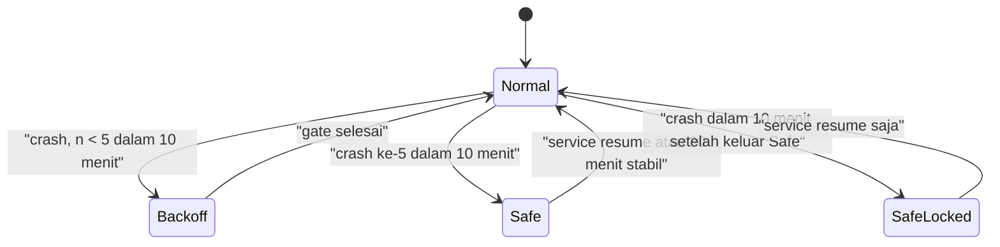

# Damn-Bot — Self-Healing & Resiliensi Operasional

Status: spesifikasi 1.0. Invariant pemilik: **P22**. Dokumen terkait: [SPEC.md](../SPEC.md) (P5, P6, P9, P14, P16, P17, P19; §3.3, §4.3, §9.7, §11), [EXEC-AND-CODING.md](EXEC-AND-CODING.md) (P24, process group), [CODE-TOOLS.md](CODE-TOOLS.md) (P23, tag guard `edit_file`), [SCORECARD.md](SCORECARD.md), [MITIGATION-MATRIX.md](MITIGATION-MATRIX.md), [EDGE-CASES-hermes.md](EDGE-CASES-hermes.md), [FEATURE-PARITY.md](FEATURE-PARITY.md), [PROVIDERS.md](PROVIDERS.md).

**P22 — Self-healing tanpa diam.** Setiap kegagalan yang dapat dipulihkan otomatis dipulihkan dalam batas angka dokumen ini; setiap tindakan pemulihan menghasilkan event `system_notice{payload.healing}` + log ≥ WARN + notifikasi owner (rate-limited); tidak ada mutasi non-idempoten yang diulang tanpa konfirmasi user. Verifikasi: chaos suite §9 (`TestChaos*`, nightly) + unit test per mekanisme (PR).

---

## 0. Tujuan & ruang lingkup

Tujuan: `damnbot serve` (dan proses interaktif sejauh relevan) bertahan dari crash proses, hang, power loss/BSOD, korupsi DB/config, disk penuh, jaringan putus, update gagal, dan restart platform chat — tanpa kehilangan data, tanpa efek ganda, tanpa pemulihan diam-diam.

Di luar lingkup: HA multi-host (satu host, satu `data_dir`; P19 menolak network FS), replikasi DB, pemulihan hardware.

### 0.1 Pembanding hermes

| Aspek | hermes | Damn-Bot |
|---|---|---|
| Restart supervisor | systemd `Restart=always`, `RestartSec=5` tetap, `StartLimitIntervalSec=0` (`hermes_cli/gateway.py:3267`, `:3277-3278`) — tanpa backoff eksponensial | Backoff 1 s→300 s, jitter ±20% (§1.3) |
| Exit code restart | 75 = restart terencana, 78 = config fatal (`gateway/restart.py:13`, `:17`) | 75 terencana, 70 hang watchdog, 78 fatal tanpa restart (§1.2) |
| Crash-loop breaker | 3 boot terputus-restart dalam 60 s, rantai gap ≤ 300 s (`gateway/restart_loop_guard.py:26-32`); efek: hanya melewati auto-resume sesi (`:101-117`); I/O gagal → fail open (`:9`) | ≥ 5 crash/10 menit → SAFE MODE eksplisit (§1.4) |
| Watchdog | Heartbeat file 30 s + loop watchdog timeout 10 s + stack dump via `faulthandler` (`gateway/shutdown_watchdog.py:1-8`, `:33-37`, `:44`) — satu event loop, tidak per subsistem | Heartbeat per subsistem, ambang per jenis operasi (§2) |
| Drain/restart | File marker `.drain_request.json`, kedaluwarsa 3.600 s (`gateway/drain_control.py:1-12`, `:85`) | Drain via sinyal + `sd_notify`, tanpa marker file lintas restart (§1.2) |
| SQLite durability | `synchronous=FULL` + `checkpoint_fullfsync` **hanya macOS** (`hermes_state_wal.py:104-121`); OS lain mewarisi default [INFERENCE dari `hermes_state_wal.py:124-128`] | `synchronous=FULL` di semua OS & koneksi (§3.1) |
| IOERR pembaca WAL | Retry 3 × 50 ms untuk open read-only (`hermes_state.py:181-189`, #100436) | Satu writer per proses, pembaca `query_only`; retry hanya `SQLITE_BUSY` via `busy_timeout` (SPEC §11) |
| Korupsi DB | Klasifikasi error malformed + karantina file (`hermes_state.py:44`, `hermes_state_dbfile.py:696`), `integrity_check` saat repair (`hermes_state_repair.py:745`) | `quick_check` setelah unclean shutdown, `integrity_check` harian, auto-restore last-good (§3.5) |
| Telegram offset | Dikelola PTB `start_polling(drop_pending_updates=…)` (`plugins/platforms/telegram/adapter.py:1790`); persistensi offset terkait commit DB [tidak terverifikasi] | Offset di `module_state` hanya setelah inbound commit (§5.1) |
| Flood control | Tidur inline ≤ 5 s, lebih lama gagal tertutup (`plugins/platforms/telegram/adapter.py:195`) | `retry_after` dijadwalkan di outbox `next_at`, tanpa tidur inline (§5.3) |
| Journal efek tool | [tidak terverifikasi] — tidak ditemukan tabel setara | `turn_journal` write-ahead sebelum dispatch (§3.3) |

---

## 1. Supervisor

### 1.1 Perintah

```text
damnbot service install [--system --user <name>] [--no-linger-check] [--dry-run]
damnbot service uninstall
damnbot service status     # state unit, PID, uptime, mode (normal|safe|degraded), 10 entri crash ledger terakhir
damnbot service resume     # keluar dari SAFE MODE, reset counter crash-loop
```

`install` menulis file unit, menjalankan enable + start, lalu menunggu `ready` ≤ 10 s (gagal → cetak 30 baris log terakhir, exit 1). `uninstall` stop + disable + hapus file; data tidak disentuh. Semua path di unit absolut (hasil `os.Executable()` + `EvalSymlinks`).

### 1.2 Kontrak proses

| Exit code | Arti | Supervisor | Masuk crash ledger |
|---|---|---|---|
| 0 | Stop terminasi bersih (SIGTERM/SCM Stop) | tidak restart | tidak |
| 2 | Panic Go tak tertangkap / SIGQUIT watchdog systemd | restart | ya (`panic`) |
| 70 (`EX_SOFTWARE`) | Watchdog internal mendeteksi hang (§2) | restart | ya (`hang`) |
| 75 (`EX_TEMPFAIL`) | Restart terencana (update, reload yang butuh restart, `schema_newer` saat binary di disk sudah lebih baru — SPEC §11.11.7) | restart | tidak |
| 78 (`EX_CONFIG`) | Fatal tanpa pemulihan: `user_version` DB > binary dan rollback tidak tersedia | **tidak** restart | ya (`fatal`) |
| hilang (kill -9, OOM, power loss) | Marker `run/serve.alive` masih ada saat start berikutnya | restart | ya (`unclean`, atau `os_reset` bila `boot_id` berbeda) |

- Graceful stop: berhenti menerima inbound, tunggu turn aktif ≤ 30 s, lalu cancel (`stop_reason=cancelled`), flush writer, `wal_checkpoint(TRUNCATE)`, hapus marker, exit 0. `TimeoutStopSec`/`ExitTimeOut` = 45 s.
- Child process tool dibunuh via process group / Job Object (ADR-016, P24); supervisor `KillMode=mixed` hanya backstop.
- `boot_id`: identitas boot kernel opaque, definisi tunggal SPEC §11.11.1 (Linux `/proc/sys/kernel/random/boot_id`; macOS `sysctl kern.bootsessionuuid`; Windows registry `BootId`); tidak pernah diturunkan dari jam dinding. `os_reset` tidak dihitung crash-loop (bukan bug perangkat lunak), tetap memicu `quick_check` (§3.5).

### 1.3 Backoff restart

Satu sumber kebenaran: **gate start di dalam binary** (`internal/supervise`), bukan fitur supervisor (systemd < 254 tidak punya backoff eksponensial, launchd/Windows tidak punya jitter). Supervisor dikonfigurasi restart cepat (≈ 1 s); gate menambah sisa delay sebelum subsistem apa pun dibuka (0 koneksi selama menunggu, P16).

```text
n      = jumlah crash berturut dalam rantai (reset bila proses sehat ≥ 10 menit)
target = min(300 s, 2^(n-1) s × U(0,8; 1,2))       # 1, 2, 4, 8, 16, … ≤ 300 s
gate   = max(0, target − delay_supervisor)
```

Selama gate, unit systemd menerima `EXTEND_TIMEOUT_USEC` + `WATCHDOG=1` tiap 10 s; status `damnbot service status` menampilkan `backoff 7,4 s (crash #4)`. Crash ledger: `<state_dir>/supervise/boots.jsonl`, maks 50 entri (rotasi), sengaja **bukan** di DB (DB bisa menjadi penyebab crash). Tiap entri: `{ts, boot_id, pid, version, kind, exit, subsystem}`. Ledger gagal ditulis → log ERROR + start tetap lanjut dalam SAFE MODE (fail-safe, kebalikan fail-open hermes `gateway/restart_loop_guard.py:9`).

### 1.4 Crash-loop breaker & SAFE MODE

Pemicu: ≥ 5 entri `kind ∈ {unclean, panic, hang}` dengan `boot_id` sama dalam 10 menit terakhir → start ke-5 masuk SAFE MODE.



| Aspek SAFE MODE | Perilaku |
|---|---|
| Modul aktif | core (store, config, log), `gateway.telegram` (hanya notifikasi + perintah), `doctor`; semua modul lain `Start` ditolak `module_unavailable{reason:"safe_mode"}` |
| Turn | Tidak ada turn otomatis; cron/kanban watcher/`auto` mati; tool tidak pernah dieksekusi otomatis (approval efektif `ask`, tanpa allowlist) |
| Inbound Telegram | Owner: `/status`, `/logs`, `/doctor`, `/resume` dieksekusi; pesan lain di-commit ke `gateway_inbound` dengan `event_id NULL` dan dibalas sekali "safe mode aktif" — diproses setelah keluar SAFE MODE (tidak hilang, tidak ganda) |
| TUI/web | Banner merah persisten: penyebab, 5 crash terakhir, path stack dump, perintah `damnbot service resume` |
| Keluar | `damnbot service resume` / `/resume` owner, atau 30 menit tanpa crash → coba Normal satu kali; crash lagi ≤ 10 menit → `SafeLocked` (hanya resume manual) |

### 1.5 Linux — systemd user unit

```ini
# ~/.config/systemd/user/damnbot.service — dibangkitkan `damnbot service install`
[Unit]
Description=Damn-Bot daemon (damnbot serve)
After=network-online.target
Wants=network-online.target
StartLimitIntervalSec=0

[Service]
Type=notify
NotifyAccess=main
ExecStart=/home/alice/.local/bin/damnbot serve --supervisor=systemd
Environment=DAMNBOT_SUPERVISOR=systemd
Restart=on-failure
RestartSec=1
RestartPreventExitStatus=78
TimeoutStartSec=420
TimeoutStopSec=45
WatchdogSec=30
WatchdogSignal=SIGQUIT
KillMode=mixed
KillSignal=SIGTERM
LimitNOFILE=8192
StandardOutput=journal
StandardError=journal

[Install]
WantedBy=default.target
```

- `StartLimitIntervalSec=0`: rate limiter generik systemd dimatikan karena breaker §1.4 lebih spesifik (pilihan sama dengan hermes `hermes_cli/gateway.py:3267`, tetapi Damn-Bot menambah backoff).
- `WatchdogSec=30` + `SIGQUIT`: backstop bila watchdog internal sendiri macet; runtime Go mencetak semua stack goroutine ke journal lalu exit 2. `WATCHDOG=1` dikirim tiap 10 s hanya bila sampler §2 berjalan. `sd_notify` diimplementasikan langsung (datagram unix ke `$NOTIFY_SOCKET`, ≤ 60 LOC, tanpa dependency).
- **Boot tanpa login**: user unit hanya berjalan selama sesi login kecuali linger aktif. `install` memeriksa `loginctl show-user $USER -p Linger`; `no` → cetak dan tawarkan `loginctl enable-linger $USER` (bisa butuh polkit/sudo). Tanpa linger: status `installed (runs only while logged in)`.
- **System unit** (`--system --user alice`, butuh root): `/etc/systemd/system/damnbot.service`, perbedaan terhadap user unit:

```ini
[Service]
User=alice
Group=alice
Environment=HOME=/home/alice XDG_DATA_HOME=/home/alice/.local/share XDG_STATE_HOME=/home/alice/.local/state XDG_CONFIG_HOME=/home/alice/.config
ExecStart=/home/alice/.local/bin/damnbot serve --supervisor=systemd

[Install]
WantedBy=multi-user.target
```

### 1.6 macOS — launchd LaunchAgent

```xml
<?xml version="1.0" encoding="UTF-8"?>
<!DOCTYPE plist PUBLIC "-//Apple//DTD PLIST 1.0//EN" "http://www.apple.com/DTDs/PropertyList-1.0.dtd">
<!-- ~/Library/LaunchAgents/dev.damnbot.serve.plist — dibangkitkan `damnbot service install` -->
<plist version="1.0">
<dict>
  <key>Label</key><string>dev.damnbot.serve</string>
  <key>ProgramArguments</key>
  <array>
    <string>/Users/alice/.local/bin/damnbot</string>
    <string>serve</string>
    <string>--supervisor=launchd</string>
  </array>
  <key>EnvironmentVariables</key>
  <dict>
    <key>DAMNBOT_SUPERVISOR</key><string>launchd</string>
    <key>PATH</key><string>/opt/homebrew/bin:/usr/local/bin:/usr/bin:/bin:/usr/sbin:/sbin</string>
  </dict>
  <key>RunAtLoad</key><true/>
  <key>KeepAlive</key>
  <dict>
    <key>SuccessfulExit</key><false/>
  </dict>
  <key>ThrottleInterval</key><integer>1</integer>
  <key>ExitTimeOut</key><integer>45</integer>
  <key>ProcessType</key><string>Standard</string>
  <key>SoftResourceLimits</key>
  <dict><key>NumberOfFiles</key><integer>8192</integer></dict>
  <key>StandardOutPath</key><string>/Users/alice/Library/Logs/damnbot/launchd.out.log</string>
  <key>StandardErrorPath</key><string>/Users/alice/Library/Logs/damnbot/launchd.err.log</string>
</dict>
</plist>
```

- `KeepAlive.SuccessfulExit=false`: restart hanya bila exit ≠ 0. Exit 78 juga ≠ 0 → di launchd gate start membaca ledger dan, bila entri terakhir `fatal` dengan versi binary sama, tidur sampai `damnbot service resume` (tanpa CPU, tanpa koneksi) alih-alih exit berulang.
- `ThrottleInterval=1`: apakah launchd menghormati nilai < 10 s [tidak terverifikasi]; bila tidak, delay efektif = `max(ThrottleInterval, target)` dan `gate` mengurangi delay supervisor yang terukur dari ledger (selisih `ts` crash ke start).
- LaunchAgent berjalan hanya setelah login user. Mac headless: `--system --user alice` → `/Library/LaunchDaemons/dev.damnbot.serve.plist` dengan key tambahan `UserName=alice`, `GroupName=staff`, `EnvironmentVariables.HOME`.
- Instal: `launchctl bootstrap gui/$UID <plist>`; uninstall: `launchctl bootout gui/$UID/dev.damnbot.serve`.

### 1.7 Windows — Service (admin) / Task Scheduler (non-admin)

Service via `golang.org/x/sys/windows/svc` (+ `svc/mgr`, `svc/eventlog`; modul `golang.org/x/sys` sudah dipakai ADR-016, tidak menambah dependency langsung P21). Service berjalan sebagai akun user (bukan LocalSystem) agar `%LOCALAPPDATA%` dan kredensial benar; `install` meminta password akun sekali dan menyerahkannya ke SCM (tidak disimpan Damn-Bot).

```go
// Konfigurasi yang dibuat `damnbot service install` (internal/supervise/windows.go)
cfg := mgr.Config{
    DisplayName:      "Damn-Bot",
    Description:      "Damn-Bot daemon (damnbot serve)",
    StartType:        mgr.StartAutomatic,
    DelayedAutoStart: true,                 // tunggu jaringan & profil user siap
    ServiceStartName: `.\alice`,            // akun user, bukan LocalSystem
    Password:         password,             // diteruskan ke SCM, tidak dipersist
}
s, err := m.CreateService("damnbot", exePath, cfg, "serve", "--supervisor=windows-service")
// Recovery: restart 1 s untuk 3 kegagalan pertama; counter SCM reset tiap 600 s.
// Backoff eksponensial + breaker tetap ditangani gate §1.3.
err = s.SetRecoveryActions([]mgr.RecoveryAction{
    {Type: mgr.ServiceRestart, Delay: 1 * time.Second},
    {Type: mgr.ServiceRestart, Delay: 1 * time.Second},
    {Type: mgr.ServiceRestart, Delay: 1 * time.Second},
}, 600)
err = s.SetRecoveryActionsOnNonCrashFailures(true) // exit code ≠ 0 dihitung gagal
```

**Fallback tanpa admin**: Task Scheduler, trigger logon user (padanan `sc.exe` dari konfigurasi service di atas dicetak `damnbot service install --dry-run`). Task Scheduler tidak andal me-restart task berdasarkan exit code (interval minimum `RestartOnFailure` 1 menit [tidak terverifikasi untuk semantik exit code]), maka task menjalankan `damnbot supervise`: parent tipis (tanpa modul, tanpa DB) yang menjalankan child `damnbot serve`, menerapkan §1.2–§1.4, dan meneruskan Ctrl-Break untuk stop. Task Scheduler hanya me-restart parent bila parent mati. Keterbatasan (ditampilkan `service status`): berjalan hanya selama user login; tidak ada watchdog SCM.

```xml
<?xml version="1.0" encoding="UTF-16"?>
<!-- schtasks /Create /TN "Damn-Bot" /XML damnbot-task.xml — dibangkitkan `damnbot service install` -->
<Task version="1.4" xmlns="http://schemas.microsoft.com/windows/2004/02/mit/task">
  <RegistrationInfo><Description>Damn-Bot daemon (damnbot supervise)</Description></RegistrationInfo>
  <Triggers>
    <LogonTrigger><Enabled>true</Enabled><UserId>DESKTOP-01\alice</UserId></LogonTrigger>
  </Triggers>
  <Principals>
    <Principal id="Author">
      <UserId>DESKTOP-01\alice</UserId>
      <LogonType>InteractiveToken</LogonType>
      <RunLevel>LeastPrivilege</RunLevel>
    </Principal>
  </Principals>
  <Settings>
    <MultipleInstancesPolicy>IgnoreNew</MultipleInstancesPolicy>
    <DisallowStartIfOnBatteries>false</DisallowStartIfOnBatteries>
    <StopIfGoingOnBatteries>false</StopIfGoingOnBatteries>
    <ExecutionTimeLimit>PT0S</ExecutionTimeLimit>
    <RestartOnFailure><Interval>PT1M</Interval><Count>999</Count></RestartOnFailure>
    <StartWhenAvailable>true</StartWhenAvailable>
    <Hidden>true</Hidden>
  </Settings>
  <Actions Context="Author">
    <Exec>
      <Command>C:\Users\alice\AppData\Local\Programs\damnbot\damnbot.exe</Command>
      <Arguments>supervise --supervisor=task-scheduler</Arguments>
    </Exec>
  </Actions>
</Task>
```

---

## 2. Watchdog internal

Satu goroutine core `internal/watchdog` (sampler, **tick adaptif**: 1 s bila ada op in-flight, 10 s bila idle — ADR-033 Q50/GAP-COST-16; deteksi hang tidak terdampak karena hang hanya terjadi pada op aktif) di proses `serve` dan proses interaktif. Subsistem tidak punya goroutine heartbeat sendiri: mereka membungkus operasi dalam `op := hb.Begin(kind)` / `op.End()` (dua `atomic.Int64` store, ~10 ns; tidak memengaruhi P17) dan memanggil `hb.Beat()` saat ada progres. Subsistem yang belum `Start` tidak terdaftar (P16).

| Subsistem | Operasi diawasi | Ambang hang | Tindakan |
|---|---|---|---|
| store writer | transaksi terbuka (BEGIN→COMMIT) | > 10 s | exit 70 (state writer tidak aman dilanjutkan) |
| loop | langkah non-LLM, non-tool (assemble, compaction prune, hook, persist) | > 30 s | cancel turn; tidak berhenti ≤ 5 s → exit 70 |
| provider stream | jeda antar chunk SSE | > 60 s idle | batalkan stream → error typed `stream_idle` (retryable P6) + event `stream_aborted` |
| gateway adapter | satu long-poll/WS read (Telegram `timeout=50` + slack) | > 90 s | restart adapter (cancel ctx, tunggu ≤ 5 s, `Start` ulang); gagal → exit 70 |
| cron | tick scheduler terlambat | > 60 s | restart scheduler; gagal → exit 70 |
| webui | handler HTTP (kecuali SSE) | > 30 s | cancel request (503); 3 hang/10 menit → restart server HTTP |

Tool `Run` diawasi timeout tool masing-masing (SPEC §4.3 langkah 8; shell P24), bukan watchdog ini.

Saat hang terdeteksi (urutan tetap):

1. `runtime.Stack(buf, true)` (buffer ≤ 16 MiB) → `<state_dir>/crash/<ts>-<subsystem>.txt` (0600; simpan 20 file terbaru, ≤ 200 MiB total). Isi: versi, uptime, subsistem, operasi, durasi, semua stack goroutine, ringkasan `runtime.MemStats`.
2. Log ERROR `watchdog_hang{subsystem, op, elapsed_ms, dump}` + event `system_notice{healing:{action:"watchdog_restart", …}}` (bila store writer yang hang: event ditulis setelah restart oleh proses baru dari ledger, karena writer tidak dapat dipercaya).
3. Restart subsistem atau `os.Exit(70)` sesuai tabel; exit 70 menulis entri ledger `hang` lebih dulu (fsync).

---

## 3. Durabilitas

### 3.1 PRAGMA

Semua koneksi (writer dan pembaca): `journal_mode=WAL`, **`synchronous=FULL`**, `foreign_keys=ON`, `busy_timeout=5000`, `temp_store=MEMORY`, `journal_size_limit=67108864`; macOS tambahan `fullfsync=ON` + `checkpoint_fullfsync=ON` (fsync Apple tidak menjamin data sampai media; temuan sama di hermes `hermes_state_wal.py:104-114`). Alasan FULL: dengan NORMAL, transaksi yang sudah COMMIT dapat hilang saat power loss/BSOD — tidak dapat diterima karena `turn_journal` (§3.3) harus durable **sebelum** efek samping tool terjadi.

Target: `Store.Append` ≤ 10 ms p99 (Linux/Windows, NVMe mesin referensi); macOS dengan `fullfsync` ≤ 30 ms p99 [INFERENCE: biaya F_FULLFSYNC, diukur F1]. Verifikasi: `BenchmarkAppend` (PR, ambang ×1,5 runner). Target berlaku di luar jendela pemeliharaan gc/purge (SPEC §11.6): Append yang menunggu satu batch gc/purge mendapat tambahan ≤ 200 ms (`BenchmarkAppendDuringGC` p99 ≤ 210 ms).

Blob: tulis temp → `fsync` file → `rename` → `fsync` direktori induk → `INSERT OR IGNORE` (fsync direktori menambah langkah SPEC §11.6). Config & file state (`*.lkg`, ledger): pola atomik yang sama.

### 3.2 Klasifikasi efek tool

Setiap tool mendeklarasikan kelas efek; kelas menentukan perilaku recovery.

| Kelas | Contoh | Aturan |
|---|---|---|
| `read` | `read_file`, `glob`, `grep`, `web_fetch` (GET), `tool_search`, `recall`, shell yang cocok allowlist read-only hasil parse (`git status`, `ls`, `cat`) | Boleh diulang otomatis |
| `idempotent` | `write_file`, `edit_file` (dijaga tag/stale check, [CODE-TOOLS.md](CODE-TOOLS.md)), `todo` | Diverifikasi hash after-image sebelum dianggap selesai/diulang |
| `non_idempotent` | shell selain di atas, `send_message`, aksi browser, `computer_use`, API eksternal (konektor), `cron_create`, `kanban_*`, tool MCP tanpa override config | **Tidak pernah** diulang tanpa konfirmasi user |

Default konservatif: tool modul/MCP tanpa deklarasi → `non_idempotent`; `readOnlyHint` MCP tidak dipercaya (konten pihak ketiga) kecuali user menulis `effect = "read"` per tool di config. `tool_invoke` mewarisi kelas target. Parallel tool (`loop.parallel_tools`) hanya untuk batch yang seluruhnya `read`; batch campuran dieksekusi berurutan.

### 3.3 `turn_journal` (mutable, write-ahead)

```sql
-- 0005_recovery.sql — journal turn mutable (bukan transcript; P9 tidak berlaku)
CREATE TABLE turn_journal (
    turn_id           TEXT    PRIMARY KEY,                    -- ULID, sama dengan events.turn_id
    session_id        TEXT    NOT NULL REFERENCES sessions(id),
    state             TEXT    NOT NULL CHECK (state IN (
                          'running',               -- assemble / LLM / persist
                          'tool_pending',          -- intent tool durable, Run mungkin sedang/sudah berjalan
                          'tool_done',             -- tool_result ter-commit
                          'awaiting_confirmation', -- recovery menunggu keputusan user
                          'awaiting_approval',     -- approval tool tertunda, tahan restart (GAP-SEC-13)
                          'crashed',               -- ditutup recovery, turn_end{stop_reason:"crashed"}
                          'resumed')),             -- lanjutan sudah dibuat (resume_turn_id)
    current_iteration INTEGER NOT NULL DEFAULT 0 CHECK (current_iteration BETWEEN 0 AND 40),
    last_tool_call_id TEXT,
    last_tool_name    TEXT,
    tool_class        TEXT    CHECK (tool_class IN ('read','idempotent','non_idempotent')),
    idempotency_key   TEXT,                                   -- sha256(session_id|turn_id|tool_call_id); dikirim ke API yang mendukung
    args_sha          TEXT,                                   -- sha256 argumen kanonik (deteksi pengulangan identik)
    target_path       TEXT,                                   -- idempotent file: path absolut
    before_sha        TEXT,                                   -- hash file sebelum (NULL = file baru)
    after_sha         TEXT,                                   -- hash after-image yang akan ditulis (dihitung sebelum Run)
    resume_turn_id    TEXT,                                   -- turn lanjutan hasil recovery
    tool_pgid         INTEGER,                                -- process group tool exec yang berjalan (SPEC §11.11.4)
    tool_pgid_start   TEXT,                                   -- cap start opaque leader group
    approval_request  TEXT    CHECK (approval_request IS NULL OR json_valid(approval_request)), -- GAP-SEC-13
    started_at        INTEGER NOT NULL,
    updated_at        INTEGER NOT NULL,
    CHECK ((last_tool_call_id IS NULL) = (last_tool_name IS NULL)),
    CHECK (last_tool_call_id IS NULL OR (tool_class IS NOT NULL AND args_sha IS NOT NULL)),
    CHECK (state <> 'tool_pending' OR last_tool_call_id IS NOT NULL),
    CHECK (state <> 'awaiting_approval' OR approval_request IS NOT NULL),
    CHECK (tool_class IS NOT 'idempotent' OR last_tool_name NOT IN ('write_file','edit_file')
           OR (target_path IS NOT NULL AND after_sha IS NOT NULL))
) STRICT;
CREATE INDEX idx_turn_journal_open ON turn_journal(state) WHERE state IN ('running','tool_pending','tool_done','awaiting_confirmation','awaiting_approval');
CREATE INDEX idx_turn_journal_session ON turn_journal(session_id, started_at);
```

Protokol (tanpa transaksi tambahan — journal ikut transaksi event yang memang sudah ada):

| Langkah | Transaksi tunggal (FULL) |
|---|---|
| `turn_start` | INSERT journal `running` |
| setelah `llm_call` | UPDATE `current_iteration` |
| setelah approval, **sebelum** `Run` | append `tool_dispatch` + UPDATE `tool_pending`, kelas, kunci, hash |
| setelah `Run` | append `tool_result` (+ `file_snapshots`) + UPDATE `tool_done` |
| `turn_end` normal | append `turn_end` + DELETE baris journal (tabel hanya berisi turn terbuka/crashed; ukuran O(turn aktif)) |

Konsekuensi: `tool_dispatch` di-append sebelum `Run` (SPEC §4.3 langkah 9 dipecah). Baris `crashed`/`resumed` dihapus `damnbot doctor gc` setelah 30 hari.

### 3.4 Recovery setelah kill -9 / power loss / BSOD

**Urutan saat open DB** — dijalankan oleh **setiap** proses writer (TUI, ACP, `run`, `serve`, CLI yang menulis), sebelum operasi tulis pertama, setelah urutan buka DB barrier (SPEC §11.11.7: cek marker → lock bersama `run/maint.lock` → cek marker lagi → buka):

1. Marker unclean shutdown + `quick_check` bila perlu (§3.5).
2. **Recovery trash blob** (SPEC §11.6 gc langkah 1): di bawah `BEGIN IMMEDIATE`, setiap `blobs/.trash/<txid>/<sha>` dikembalikan ke path final hanya bila baris `blobs` ada, status terakhir bukan `expired`, dan path final kosong; selain itu dihapus. Pemicu lain: proses pemilik segera setelah rollback transaksi gc/purge-nya, dan pembaca yang mendapat `ENOENT` untuk sha hidup (hanya sha itu, lalu baca ulang sekali).
3. **Purge tertunda**: DB otoritatif (baris `module_state(module_id='purge')` ada = tertunda; ledger direkonsiliasi dari event audit `purge_done`/`purge_aborted`). Siapa yang melanjutkan, pengambilalihan lease purge, dan perilaku proses pendek = state machine purge SPEC §11.11.6.
4. **Recovery journal turn / pembersihan yatim** (tabel di bawah), mengikuti state machine journal SPEC §11.11.8: sesi berlabel `purge_state` dilewati (`TestJournalRecoverySkipsPurging`); selain itu lease sesi diambil dulu hanya bila `takeover_ok()` (SPEC §11.11.2: pemilik terbukti tidak ada → sinkron saat start; dua pengamatan kedaluwarsa ≥ 3 s → hanya oleh pemindai latar, tidak memblok start) — lease hidup milik proses lain → lewati; sebelum recovery, process group tool `exec` yang tercatat (`tool_pgid` + cap start leader) di host sama dibunuh (SPEC §11.11.4); semua tulis recovery memakai token itu dan melewati guard SPEC §11.10; auto-continue hanya oleh frontend asal sesi, selain itu `crash_recovered{decision:"deferred"}`. `serve` mengulang langkah ini tiap 60 s untuk journal yatim (`TestGCIdleIgnoresOrphanJournal`).

Recovery journal turn dijalankan saat start, setelah lease sesi kedaluwarsa dan diambil alih (SPEC §3.3), untuk tiap baris journal terbuka di sesi yang tidak berlabel `purge_state`:

| State terakhir | Kelas | Pemeriksaan | Hasil di transcript | Lanjutan |
|---|---|---|---|---|
| `running` / `tool_done` | — | — | `turn_end{crashed}` + `crash_recovered` | auto-continue |
| `tool_pending` | `read` | — | `tool_result{status:"interrupted", retry_safe:true, by:"recovery"}` | auto-continue (boleh re-run) |
| `tool_pending` | `idempotent` | hash file = `after_sha` | `tool_result{status:"applied_verified", by:"recovery"}` + `file_snapshots` | auto-continue |
| `tool_pending` | `idempotent` | hash = `before_sha` | `tool_result{status:"not_applied", by:"recovery"}` | auto-continue (boleh re-run) |
| `tool_pending` | `idempotent` | hash lain (diubah pihak lain) | `tool_result{status:"conflict", by:"recovery"}` | tanya user |
| `tool_pending` | `non_idempotent` | tidak dapat diverifikasi | `tool_result{status:"outcome_unknown", retry_safe:false, by:"recovery"}` | **tanya user** (`awaiting_confirmation`) |

- Semua hasil di atas adalah observasi nyata recovery (`by:"recovery"`), bukan history sintetis (P4). Turn selalu ditutup eksplisit `turn_end{stop_reason:"crashed"}` + `crash_recovered{turn_id, last_tool, decision}`.
- **Auto-continue** (`recovery.continue = "safe_auto"` default; `ask`; `off`): membuat turn baru `turn_start{resume_of}` dengan sisa iterasi `40 − current_iteration` dan sisa budget turn asal (P2 tidak dapat dilewati via resume). Maks 1 auto-continue per turn asal; lanjutan yang crash lagi → `ask`. Origin `cron` tidak pernah auto-continue (§6).
- **Konfirmasi**: TUI dialog / web banner / Telegram (tombol `Lanjutkan`, `Batalkan`, atau `/resume <id>`, `/abort <id>`), berisi nama tool, argumen ter-redaksi, waktu dispatch. Timeout 24 jam → `turn_journal.state = 'crashed'` + `approvals.decision = 'timeout'`, dicatat.
- **Gate pengulangan**: di turn lanjutan, tool call `non_idempotent` dengan `(tool_name, args_sha)` sama dengan yang `outcome_unknown` → approval wajib walau `approval.mode = "auto"` (decision `allow_once` tercatat di `approvals`). Ini enforcement kode, bukan instruksi prompt.

### 3.5 Integritas DB, backup, restore

| Mekanisme | Kapan | Biaya / batas |
|---|---|---|
| Marker unclean shutdown | `<state_dir>/run/<kind>-<pid>.alive` dibuat saat open DB, dihapus saat close bersih | 1 `stat` per marker; jalur normal tanpa pemeriksaan → startup tetap ≤ 100 ms (P12) |
| `PRAGMA quick_check` | Hanya bila ada marker dari PID mati / `boot_id` beda | ≤ 3 s per 1 GiB DB (`BenchmarkQuickCheck1GiB`); TUI menampilkan progres |
| `PRAGMA integrity_check` | Harian di `serve` (03:30 lokal, ditunda bila ada turn aktif; koneksi read-only, writer tidak diblok) | log INFO durasi |
| Hash-chain sampel | Harian: 100 sesi terakhir diverifikasi | ≤ 5 s |
| Backup `VACUUM INTO` | Harian setelah integrity ok → `<data_dir>/backups/daily-<yyyymmdd>.db`, simpan 3; sebelum migrasi → `premigrate-<from>-<to>.db`, simpan 2 | Precheck ruang: free ≥ 2 × ukuran DB + low-water (§4); kurang → WARN + lewati |
| Validasi backup | Buka backup + `quick_check` + sha256 → `backups/LAST_GOOD` (atomik) hanya bila ok | — |
| Blob | sha256 diverifikasi streaming saat dibaca untuk attachment/prompt; harian sampel 1% (min 100 blob); penuh di `doctor --verify` | mismatch → `blobs/quarantine/`, event |

**Auto-restore** (pemicu: `SQLITE_CORRUPT`/`SQLITE_NOTADB` pada operasi apa pun, atau `quick_check`/`integrity_check` ≠ ok; klasifikasi typed lewat kode error SQLite, bukan substring — beda dengan bug klasifikasi hermes EC-STATE-007/008):

1. Hentikan writer & semua subsistem **di semua proses** lewat barrier pemeliharaan SPEC §11.11.7 (pemilik `run/maint.owner`, marker informatif, turn di proses lain dibatalkan tanpa tulis; gagal ≤ 30 s → SAFE MODE + notifikasi owner, DB rusak tidak diganti; restorer mati → marker basi dibersihkan penunggu ≤ 1 s). Salvage dan pasca-restore berjalan dengan mode `'restore'` (SPEC §11.11.3: P9 dan guard P aktif, guard F dilewati). Korupsi terbatas indeks FTS → re-index tanpa restore. Karena semua tabel FTS contentless (`content=''`, SPEC §11.2), perintah FTS5 `rebuild` tidak didukung; jalurnya sama dengan re-index `fts_meta` (GAP-INF-02): `INSERT INTO <fts>(<fts>) VALUES('delete-all')` → insert ulang dari tabel sumber (`events`, `summaries`, `memory`, `skills`) lewat `dmb_fts_norm`, batch 5.000 baris/transaksi; `blob_fts` di-index ulang dari file blob (text/*, JSON, ≤ 16 MiB); `fts_meta.reindexed_to` dipakai sebagai checkpoint.
2. Pindahkan `damnbot.db{,-wal,-shm}` → `<data_dir>/quarantine/<ts>/` (tidak pernah dihapus otomatis).
3. Salin `LAST_GOOD` → `damnbot.db`; `quick_check` ulang.
4. Salvage: baca DB rusak secara best-effort (`events`, `file_snapshots`, `gateway_inbound`, `gateway_deliveries`, `cron_runs` dengan `id` > maksimum di backup); baris yang dapat dibaca dan lolos verifikasi hash-chain diinsert ulang dengan hash asli; celah dilaporkan per sesi. Insert mengikuti urutan induk-dulu graf FK (SPEC §11.6): (a) baris `sessions` (+ `session_labels`) yang dirujuk baris salvage tetapi tidak ada di backup; (b) baris `blobs` untuk setiap sha yang dirujuk baris salvage — dibaca dari DB rusak bila terbaca, bila tidak dibuat **placeholder** (`size` = ukuran file bila file ada, else 0; `mime = 'application/octet-stream'`; `created_at` = waktu salvage); file tidak ada → `blob_expirations{kind:'expired', reason:'restore_missing'}` (`TestSalvageMissingBlob`); (c) baris owner; (d) `blob_refs` owner itu diturunkan ulang lewat `ctxdb.BlobRefsOf` dalam transaksi insert yang sama (tidak disalin dari DB rusak). Baris yang induknya tetap tidak bisa dibuat dilewati dan masuk `lost_ranges`; baris milik sesi berlabel `purge_state` ditolak guard P (mode `'restore'`, SPEC §11.11.3) dan dilewati tanpa dihitung hilang, karena sesinya sedang dipurge; 0 pelanggaran `PRAGMA foreign_key_check` setelah salvage (SPEC §11.6, ADR-039, ADR-040). gc blob dan purge tidak berjalan sebelum langkah 5 selesai.
5. Pasca-restore (urutan sama dengan restore pengguna, SPEC §11.6 Backup/restore langkah 1–6; reapply purge hanya fase 0 di bawah barrier, SPEC §11.11.7; kosongkan `session_leases`, lalu): pass `restore_missing` atas semua baris `blobs` berstatus hidup yang file-nya tidak ada (baris `expired` yang ditulis setelah backup ikut hilang bersama DB lama) → terapkan ulang ledger purge `<data_dir>/purge.log` untuk entri `intent`/`committed` yang lebih baru dari `LAST_GOOD`, sehingga sesi yang di-purge setelah backup tidak hidup kembali → recovery trash (`.trash/<txid>/`) → journal terbuka dari snapshot ditutup `crashed` tanpa auto-continue (`TestRestoreNoAutoContinue`) → lepas barrier. `TestAutoRestoreReappliesPurge`: purge setelah backup, lalu korupsi → setelah auto-restore sesi itu tetap tidak ada dan file blob-nya tidak dipulihkan; `TestAutoRestoreRestoreMissing`: blob di-gc setelah backup → `expired`, bukan `blob_missing`.
6. Event `system_notice{healing:{action:"db_restore", backup, salvaged_rows, lost_ranges}}` + notifikasi owner severity `critical`.
7. Tidak ada backup valid → SAFE MODE dengan DB baru kosong ditolak; proses menunggu `damnbot doctor --fix` (pilihan eksplisit user).

Residu: event setelah backup terakhir yang berada di halaman rusak hilang; terlihat sebagai `lost_ranges`, tidak pernah ditutupi.

---

## 4. Perbaikan lingkungan (detect → action → notify)

| Kondisi | Deteksi | Aksi otomatis | Notifikasi / residu |
|---|---|---|---|
| Config korup/invalid | Parse/validasi gagal saat start atau hot reload | Start: pakai `config.toml.lkg` (ditulis atomik 0600 setelah tiap load sukses bila isi berbeda); `config.toml` user **tidak ditimpa**. Hot reload: tetap config in-memory, event `config_reload{ok:false}` | Error baris:kolom + key; `doctor --fix` menawarkan restore. Tanpa LKG → SAFE MODE dengan default core |
| Update gagal | `damnbot update`: child `damnbot.new doctor --quick` harus lulus ≤ 30 s **sebelum** swap; setelah swap, marker `<state_dir>/update/pending.json` diperiksa gate start | Swap: `damnbot` → `damnbot.prev`, `damnbot.new` → `damnbot` (rename atomik; Windows: rename exe berjalan diizinkan). Health gagal / ≥ 2 crash dalam 30 s pertama → kembalikan `damnbot.prev`, restore `premigrate-*` bila migrasi terjadi, exit 75 | Selama jendela health 30 s intake turn ditahan, jadi restore pre-migrasi tidak membuang data user. Rollback manual setelah jendela dengan DB sudah termigrasi → ditolak (exit 78) dengan instruksi |
| `data_dir`/`state_dir` hilang | `stat` saat start | Buat ulang 0700 (file 0600), ulangi migrasi pada DB baru hanya bila tidak ada DB sama sekali | WARN + notifikasi; DB hilang tapi backup ada → tawarkan restore (bukan otomatis: hilangnya DB bisa disengaja) |
| Permission salah | Mode lebih longgar dari 0700/0600, atau tak bisa ditulis | `chmod` bila owner = uid proses; owner lain → refuse start (tidak pernah `chown`) | Laporan path + mode lama/baru |
| Disk penuh | Free < `low_water = min(1 GiB, 5% kapasitas)`, cek 60 s di `serve`, sebelum blob write, dan seketika pada `ENOSPC`/`SQLITE_FULL` | Prune berurutan sampai free ≥ low_water + 256 MiB: `tmp/`, cache modul, log rotasi lama, indeks trigram/code (dapat dibangun ulang, ADR-017), crash dump > 7 hari, backup harian kecuali `LAST_GOOD`. **Tidak pernah**: DB, blob yang direferensi, transcript, `LAST_GOOD`, config | Masih kurang → **degraded read-only**: turn baru ditolak "disk full: 412 MiB free < 1.024 MiB"; inbound Telegram tidak di-ack (offset tidak maju) sehingga Telegram menyimpannya ≤ 24 jam; keluar otomatis saat free ≥ low_water + 256 MiB |
| DNS/jaringan putus | `internal/netx`: semua dial ke host berbeda gagal (DNS/connect) ≥ 30 s | Offline mode: adapter reconnect backoff profil `reconnect` (1 s→60 s, jitter ±20%, satu-satunya implementasi di `netx/retry`, P6); outbox tetap `queued` tanpa menambah `attempts`; probe tiap 15 s ke host yang memang dipakai (tanpa endpoint telemetri) | Banner offline + event; saat online kembali, notifikasi ringkas jumlah antrean terkirim |
| TLS/proxy | `x509.UnknownAuthorityError`, `HostnameError`, proxy 407, `CONNECT` gagal | Tidak ada auto-fix (verifikasi TLS tidak pernah dimatikan). Diagnosis: issuer sertifikat yang diterima (indikasi TLS interception), `HTTPS_PROXY`/`NO_PROXY` efektif, CA tambahan dari `SSL_CERT_FILE`/`SSL_CERT_DIR` (dihormati Go di Linux) atau `network.ca_file` (ditambahkan ke pool di semua OS) | Pesan langkah perbaikan spesifik di log, `doctor`, dan notifikasi |
| Token/OAuth kedaluwarsa | 401 / `expires_at` ≤ 20% sisa umur | Refresh token (maks 1 percobaan per kredensial per 5 menit); sukses → INFO | Gagal → modul `auth_required`, notifikasi owner via Telegram/UI dengan perintah login; tidak ada retry storm |
| Clock skew | Median selisih header `Date` dari 5 respons HTTPS terakhir (provider/Telegram); lompatan wall vs monotonic > 60 s | Semua timeout memakai monotonic clock; lompatan → cron mengevaluasi ulang jadwal (§6) | \|skew\| > 120 s → WARN + notifikasi (TLS, JWT Google Chat, cron terdampak) |

---

## 5. Ketahanan gateway Telegram

### 5.1 Inbound long polling — exactly-once efek

```text
poller (long-poll; webhook/bridge sama, tanpa offset):
  updates = getUpdates(offset = module_state[telegram].offset, timeout = 50, allowed_updates = [...])
  BEGIN IMMEDIATE
    for u in updates:
      INSERT OR IGNORE INTO gateway_inbound(platform='telegram', external_id='u:'||u.update_id,
             chat_id, sender_id, received_at, payload = redact(normalize(u)))   -- isi durable (ADR-046)
      + blob_refs owner gateway_inbound untuk lampiran (blob dipublikasi di transaksi yang sama)
    UPSERT module_state(module_id='gateway.telegram', key='offset', value=max(update_id)+1)
  COMMIT                                   -- synchronous=FULL; baru setelah ini offset maju / webhook di-ack
  -- DB tidak bisa ditulis (barrier, schema_newer, stall, disk penuh)? long-poll: jangan ambil/majukan offset;
  -- push yang wajib di-ack: spool (SPEC §11.11.7) → fsync → ack

worker (per chat, satu pemegang lease sesi chat):
  BEGIN IMMEDIATE
    row = SELECT … FROM gateway_inbound WHERE platform=? AND chat_id=? AND event_id IS NULL
          ORDER BY received_at, external_id LIMIT 1             -- idx_gw_inbound_queue
    append user_message (isi dari row.payload; lampiran → event_attachments + blob_refs owner event_attachment)
       atau, bila ditolak kebijakan overflow REL-11: system_notice{kind:"inbound_rejected"} (isi tetap tercatat)
    UPDATE gateway_inbound SET event_id=?, payload=NULL WHERE platform=? AND external_id=? AND event_id IS NULL
    -- rows affected = 0 → sudah diproses; rollback, lewati
  COMMIT
```

- **Status baris** (turunan, tanpa kolom status): `queued` = `event_id IS NULL` (isi di `payload`); `processing` = `event_id` terisi dan `turn_journal` turn itu masih terbuka; `done` = `event_id` terisi dan journal tertutup. Antrean kerja per chat **dibaca dari DB** (indeks `idx_gw_inbound_queue`), bukan dari memori; cache memori hanya optimisasi. Batas REL-11 (50 per sesi) dihitung dari baris `queued`. Pekerja = pemegang lease sesi chat (SPEC §11.11.4).
- Crash sebelum COMMIT poller → offset lama → Telegram mengirim ulang → `INSERT OR IGNORE` + PK menyerap duplikat. Crash setelah COMMIT poller, sebelum atau di tengah transaksi worker → baris tetap `queued` **beserta isinya** → diproses worker berikutnya (saat start atau oleh pemegang lease baru). Exit 75 (update/migrasi), graceful stop, dan kill -9 tidak menghilangkan pesan yang sudah ter-commit. Efek: setiap update menghasilkan tepat satu `user_message` (atau satu `inbound_rejected` tercatat). `TestInboundQueuedSurvivesRestart` (5 pesan antre saat turn berjalan → kill -9 / exit 75 / graceful stop → 5 `user_message` dengan isi asli, urut), `TestInboundCrashBetweenCommits` (kill di antara COMMIT poller dan COMMIT worker, 1.000 iterasi → 0 pesan hilang, 0 duplikat).
- **Spool** hanya jembatan sampai COMMIT: `serve` (saat start dan setiap kali DB kembali bisa ditulis) meng-ingest `run/inbound_spool/*.jsonl` urut nama → INSERT `gateway_inbound` **dengan `payload`** (dedupe PK) → COMMIT → baru hapus file. Aturan tulis spool (urutan, enkripsi, nama): SPEC §11.11.7.
- Satu konsumen per bot token: lease `module_state(key='poller_lease')` heartbeat 2 s, kedaluwarsa 10 s, value berbentuk sama dengan lease purge dan dinilai `alive()`/`takeover_ok()` (SPEC §11.11.2, jam boot); HTTP 409 Conflict → adapter berhenti polling dan melapor (proses lain memegang token).
- Batas Telegram: update tidak diambil disimpan ≤ 24 jam (Bot API `getUpdates`). Downtime > 24 jam → update hilang di sisi Telegram; tidak dapat dideteksi jumlahnya, dilaporkan sebagai notifikasi `downtime_exceeds_retention` saat start.

### 5.2 Webhook

`setWebhook(url, secret_token = 32 byte acak base64url, disimpan di secret store)`. Handler: bandingkan `X-Telegram-Bot-Api-Secret-Token` constant-time (mismatch → 401, tanpa insert, WARN rate-limited); transaksi insert sama dengan §5.1; HTTP 200 **hanya setelah COMMIT**; error → 500 → Telegram mengirim ulang → dedupe PK. Pindah mode: `deleteWebhook(drop_pending_updates=false)` (sama dengan hermes `plugins/platforms/telegram/adapter.py:1892`).

### 5.3 Reconnect, 429, outbox

- Reconnect long-poll: profil `reconnect` netx (1 s→60 s, jitter ±20%); error transien tidak menjatuhkan gateway (EC-PLAT-002).
- 429: `parameters.retry_after` dihormati persis → `next_at = now + retry_after` pada baris outbox; worker chat itu dijeda, chat lain jalan. Tidak ada tidur inline (beda hermes `plugins/platforms/telegram/adapter.py:195`). Pacing proaktif: 1 pesan/s per chat, 20 pesan/menit per grup, 30 pesan/s global (Bot FAQ Telegram).
- Outbox `gateway_deliveries` bertahan restart; pesan > 4.096 char dipecah, **satu baris per bagian** (granularitas recovery per bagian).

### 5.4 Duplikasi outbound — analisis jujur

`sendMessage` Telegram tidak punya idempotency key; bot tidak dapat membaca pesan miliknya di chat privat untuk verifikasi. Jendela duplikasi ada di antara "Telegram membuat pesan" dan "COMMIT `sent` di DB".

| Fase | Status DB | Crash / error di fase ini | Aman diulang? |
|---|---|---|---|
| Sebelum request (dial, DNS, TLS handshake gagal; `httptrace.WroteRequest` belum terjadi) | `sending` | request tidak pernah keluar | ya → `queued`, retry P6 |
| Request terkirim, respons belum diterima (timeout, reset, crash) | `sending` | pesan mungkin terkirim | **tidak** → `uncertain` |
| Respons 200 diterima, sebelum COMMIT `sent` | `sending` | pesan pasti terkirim, DB tidak tahu | **tidak** → `uncertain` |
| Setelah COMMIT `sent` (+ `external_ref` = message_id) | `sent` | — | tidak perlu |

Mitigasi: (1) jendela dipersempit — COMMIT `sent` langsung setelah header respons, sebelum pekerjaan lain; ukuran jendela ≈ ½ RTT + 1 fsync (≤ 10 ms di luar jaringan); (2) baris `sending` saat start → `uncertain`, tidak pernah dikirim ulang otomatis secara default; (3) edit streaming (`editMessageText`) idempoten, bebas diulang ("message is not modified" = sukses).

**Keputusan default `gateway.telegram.uncertain = "notify"`**: kirim satu notice pendek (i18n) "1 bagian pesan mungkin tidak terkirim akibat gangguan — /resend 812"; owner memutuskan. Notice yang juga `uncertain` tidak menghasilkan notice berantai (hanya log + banner). Alternatif konfigurasi: `resend` (kirim ulang sekali dengan prefiks "[dikirim ulang setelah gangguan; mungkin duplikat]") atau `drop` (hanya log).

Residu: pada `notify`, kemungkinan user melihat notice untuk pesan yang sebenarnya sudah sampai (bukan duplikat), atau perlu satu `/resend` untuk pesan yang benar-benar hilang. 0 duplikat tak berlabel. Frekuensi terukur: metrik `gateway_uncertain_total` di `damnbot gateway status`.

---

## 6. Cron setelah downtime

Kolom per job: `catch_up = "skip" | "run_once" | "run_all"` (default `run_once`), `max_catch_up` (default 3, rentang 1..10). Jadwal dianggap terlewat bila `now − scheduled_at > 60 s` (grace).

| Policy | Jadwal terlewat k | Aksi |
|---|---|---|
| `skip` | k ≥ 1 | Semua dicatat `outcome='missed'`, tidak ada run |
| `run_once` | k ≥ 1 | Jalankan 1 (jadwal terbaru); sisanya `missed` |
| `run_all` | k ≥ 1 | Jalankan `min(k, max_catch_up)` terbaru, berurutan; sisanya `missed` |

- Klaim run: `INSERT INTO cron_runs(job_id, scheduled_at, claimed_by, …) ON CONFLICT(job_id, scheduled_at) DO NOTHING`; rows affected = 1 → pemilik. `UNIQUE(job_id, scheduled_at)` (SPEC §11.5) + session lease (SPEC §3.3) mencegah eksekusi ganda lintas proses dan restart. Baris `missed` ikut di-insert agar jadwal yang sama tidak diklaim belakangan.
- Run yang crash (`started_at` ada, `finished_at` NULL, lease kedaluwarsa) → `outcome='crashed'`, tidak diulang otomatis. Opt-in `retry_on_crash = true` hanya berlaku bila `turn_journal` run tersebut tidak pernah mencapai `tool_pending` dengan kelas `non_idempotent`.
- SAFE MODE: jadwal yang jatuh selama safe mode dicatat `outcome='skipped_safe_mode'` dan diperlakukan sebagai terlewat sesuai policy saat keluar.
- Lompatan jam (§4) → evaluasi ulang memakai aturan yang sama; lompatan mundur tidak pernah menjalankan ulang `scheduled_at` yang sudah diklaim (UNIQUE).

Kebijakan per job tambahan (GAP-REL-08, GAP-REL-09, GAP-COST-13; kolom/CHECK di SPEC §11.5):

| Kebijakan | Nilai | Perilaku | Verifikasi |
|---|---|---|---|
| `overlap` | `skip` (default) \| `queue_one` \| `parallel` (maks 2 run aktif) | Slot yang jatuh saat run sebelumnya masih aktif: `skip` → baris `outcome='skipped_overlap'`; `queue_one` → maks 1 slot menunggu, slot lain `skipped_overlap`; `parallel` → run kedua jalan, slot ke-3 `skipped_overlap`. Klaim memakai `UNIQUE(job_id, scheduled_at)` yang sama; 0 slot tanpa baris | `TestCronOverlap`: job 2 menit tiap 1 menit selama 5 menit → ≥ 2 `skipped_overlap`, Σ baris = jumlah slot |
| `gate` | kolom JSON; isi = script exec (exit 0 = wake, 1 = skip) atau JSON `{"wake":bool,"context":"…"}` ≤ 2.000 char; monitor bawaan dengan normalisasi | Dievaluasi **sebelum** LLM call; skip → `outcome='gated'`, 0 token; jumlah run yang dicegah tampil di `damnbot cron status`/web | `TestCronGateNormalized`: isi tetap + timestamp berubah → 0 LLM call dalam 10 tick |
| `idempotent` | bool (default `false`) | `true` → run `crashed` boleh diulang 1× otomatis (setara `retry_on_crash` tanpa syarat `turn_journal`), karena job dinyatakan aman diulang oleh user | `TestCronCrashRetryIdempotent` |
| `pause_after_crashes` | 1..20 (default 3) | Run `crashed` tidak mem-pause job; slot berikutnya tetap jalan; owner dinotifikasi 1× per slot. Setelah N crash **berturut-turut** → job `paused` + notifikasi; keluar lewat `damnbot cron resume` | `TestCronAutoPause`: kill -9 saat run → slot berikutnya jalan, 1 notifikasi; 3 crash berturut → pause |

---

## 7. Notifikasi

Tidak ada healing diam. Setiap tindakan §1–§6 menghasilkan ketiganya:

1. Event `system_notice` di sesi `__system__` (dan di sesi terdampak bila ada), payload:

```json
{"healing":{"action":"db_restore","subsystem":"store","severity":"critical","reason":"SQLITE_CORRUPT on events page 48213","result":"ok","detail":{"backup":"daily-20261016.db","salvaged_rows":1294,"lost_ranges":[]},"ledger_ref":"boots.jsonl#41"}}
```

2. Log: WARN bila tindakan sukses, ERROR bila gagal / SAFE MODE / restore / data hilang.
3. Pesan owner: Telegram ke `notify.owner` (mis. `"telegram:123456789"`, harus identitas `allowlisted`), banner TUI/web UI hingga di-acknowledge, notifikasi ACP `_meta.damnbot.notice`.

| `action` | Severity | Contoh pesan owner |
|---|---|---|
| `restart_backoff` | warn | "damnbot restart #3 setelah crash (panic di gateway.discord), backoff 4 s" |
| `safe_mode` | critical | "SAFE MODE: 5 crash dalam 10 menit. /status, /logs, /resume" |
| `watchdog_restart` | warn | "adapter telegram hang 94 s, di-restart; dump crash/20261017T031500-telegram.txt" |
| `db_restore` | critical | "DB korup, dipulihkan dari backup 2026-10-16; 1.294 baris diselamatkan, 0 hilang" |
| `config_lkg` | warn | "config.toml invalid (baris 42: unknown key 'modles'); berjalan dengan config terakhir yang valid" |
| `update_rollback` | critical | "update 1.3.0 gagal health check; kembali ke 1.2.4" |
| `disk_prune` / `disk_readonly` | warn / critical | "disk: 1,4 GiB dibersihkan (cache, log); free 2,1 GiB" |
| `recovery_confirm` | warn | "turn terputus saat `shell: make deploy`. Lanjutkan?" |
| `delivery_uncertain` | warn | §5.4 |
| `db_write_stalled` | warn | "tulis DB tertahan 34 s; pemegang kemungkinan: PID 4121 (TUI)" — dikirim **tanpa tulis DB** (log, stderr, banner, `run/db_stall.json`, API adapter langsung tanpa outbox), ≤ 1×/jam; event DB ditulis setelah stall berakhir; definisi SPEC §11.11.7; temuan `doctor` `D-DB-STALL` |
| `offline` / `online` | warn / info | "offline 6 menit; 4 pesan antrean terkirim" |

Rate-limit: per `action` maks 1 pesan/10 menit (kejadian berikutnya digabung jadi digest "×7 sejak 03:10"); global maks 6 pesan/jam; severity `critical` melewati limit per-action tetapi maks 1/5 menit. Rate-limit hanya berlaku pada pesan owner — event dan log selalu ditulis.

---

## 8. `damnbot doctor --fix`

`damnbot doctor` menjalankan pemeriksaan read-only; `--fix` menjalankan aksi yang sama dengan §3–§6 secara manual (dengan konfirmasi per aksi destruktif, `--yes` untuk non-interaktif); `--quick` (≤ 2 s, dipakai health check update) = config, DB open + `quick_check` pada halaman skema, migrasi, permission, disk, satu dial provider; `--verify` = hash-chain penuh + semua blob; `--json` untuk mesin. Exit: 0 semua ok, 1 masih ada masalah, 3 ada yang diperbaiki dan tidak tersisa masalah.

```text
$ damnbot doctor --fix
damnbot 1.2.4 · data_dir ~/.local/share/damnbot · mode normal

  ok     config        config.toml valid (sha 3f9a…), lkg sinkron
  fixed  permissions   ~/.local/share/damnbot/secrets.env 0644 → 0600
  ok     database      quick_check ok (812 MiB, 1,9 s), user_version 5/5, WAL 3,1 MiB
  warn   backups       LAST_GOOD = daily-20261015.db (2 hari); backup kemarin dilewati: ruang kurang
  fixed  disk          free 0,8 GiB < low_water 1,0 GiB → hapus cache 1,1 GiB, log lama 0,2 GiB → free 2,1 GiB
  ok     network       DNS ok, api.telegram.org 41 ms, openrouter.ai 63 ms, proxy: none
  ok     tls           CA sistem + network.ca_file (1 sertifikat)
  ok     clock         skew +0,4 s
  fixed  recovery      1 turn terbuka (01JA…X7) → crashed; menunggu konfirmasi: shell "make deploy"
  ok     gateway       telegram long-poll, offset 884213207, outbox 0 queued / 0 uncertain
  ok     cron          3 job, 0 run crashed, catch-up terakhir: run_once "daily-report"
  ok     supervisor    systemd user unit aktif, linger yes, crash 0/10 menit

3 diperbaiki, 1 peringatan, 0 gagal. Detail: damnbot doctor --json
```

---

## 9. Verifikasi (CI + SCORECARD)

### 9.1 Unit/integrasi (PR)

| Test | Membuktikan |
|---|---|
| `TestRestartBackoffSchedule` | Urutan target 1, 2, 4, …, 300 s; jitter dalam ±20%; clamp 300 s; reset setelah 10 menit sehat |
| `TestCrashLoopBreaker` | Fake ledger: crash ke-5 dalam 10 menit → start SAFE MODE; `os_reset` tidak dihitung; ledger tak bisa ditulis → SAFE MODE |
| `TestSafeModeSurface` | Hanya core + telegram + doctor `Start`; inbound non-perintah tersimpan `event_id NULL` dan diproses setelah resume; 0 tool dieksekusi otomatis |
| `TestServiceUnitGolden` | Unit systemd, plist, task XML, `mgr.Config` byte-identik golden per OS; `systemd-analyze verify` di job Linux; `plutil -lint` di job macOS |
| `TestWatchdogHang/<subsystem>` | Tiap ambang tabel §2 memicu dump + event + aksi yang benar (fake clock); dump berisi semua goroutine |
| `TestSyncFullAllConns` | Setiap koneksi pool melaporkan `synchronous=2` (FULL); macOS `fullfsync=1` |
| `TestTurnJournalProtocol` | `tool_dispatch` + `tool_pending` ter-commit sebelum `Run` (fault injection di `Run` entry); DELETE saat `turn_end` |
| `TestRecoveryMatrix` | Setiap baris tabel §3.4 menghasilkan `tool_result.status` dan lanjutan yang ditentukan |
| `TestNoBlindRepeat` | Turn lanjutan dengan `approval.mode=auto` yang memanggil ulang `non_idempotent` identik → approval diminta, 0 eksekusi tanpa keputusan |
| `TestQuickCheckOnlyAfterUnclean` | Start bersih: 0 `quick_check` (P12 tetap); marker PID mati → `quick_check` |
| `TestAutoRestore` | Halaman `events` dirusak → restore LAST_GOOD + salvage, `lost_ranges` akurat; korupsi FTS → `delete-all` + re-index dari tabel sumber/file blob tanpa restore, hasil query sama dengan sebelum korupsi |
| `TestConfigLKG`, `TestUpdateRollback`, `TestDiskFullPrune`, `TestPermissionRepair`, `TestClockSkew`, `TestOAuthRefreshNotify` | Baris tabel §4 masing-masing |
| `TestTelegramOffsetAfterCommit` | Offset tidak pernah mendahului COMMIT inbound (crash injeksi di 6 titik) |
| `TestTelegramWebhookSecret` | Secret salah → 401, 0 insert; 200 hanya setelah COMMIT |
| `TestOutboxUncertain` | 3 fase §5.4 → status yang benar; default `notify` 0 kirim ulang |
| `TestTelegram429` | `retry_after` = 37 → `next_at` +37 s persis, chat lain tidak tertahan |
| `TestCronCatchUp` | 3 policy × k ∈ {0, 1, 5, 20}; dua proses berebut → tepat satu klaim per `scheduled_at` |
| `TestHealingNotifies`, `TestNotifyRateLimit` | Setiap `action` §7 → event + log + pesan; digest & batas 6/jam |

### 9.2 Chaos suite (nightly, `make chaos`, artefak di SCORECARD)

| Test | Skenario | Target lulus |
|---|---|---|
| `TestKill9Chaos` (definisi tunggal, dirujuk SPEC P19) | 1.000 turn (fake provider + fake Telegram + tool campuran 3 kelas), `kill -9` acak 200× (saat LLM, tool, blob write, commit, compaction) | 0 korupsi (`integrity_check` ok + hash-chain valid); 0 `non_idempotent` diulang tanpa konfirmasi; semua turn terputus berakhir `crashed` |
| `TestChaosNetworkCut` | Proxy fault in-process: putus total 5 menit, flap 1 s/5 s, blackhole DNS | 0 inbound hilang/ganda; outbox terkirim semua setelah pulih; recovery ≤ 10 s setelah jaringan kembali |
| `TestChaosDiskFull` | Volume tmpfs/loop 512 MiB diisi sampai ENOSPC saat turn | 0 korupsi; prune tidak menyentuh blob terreferensi; degraded read-only dengan pesan eksplisit; pulih otomatis |
| `TestChaosCorruptConfig` | Byte acak / TOML invalid / key tak dikenal pada `config.toml` antara restart | Start ≤ 10 s dengan LKG; `config.toml` user tidak berubah |
| `TestChaosCorruptDBPage` | Overwrite 1 halaman acak (b-tree tabel, indeks, FTS) 50× | Deteksi ≤ start berikutnya; restore (tabel/indeks) atau re-index `delete-all` + sumber (FTS); 0 kerusakan diam |
| `TestChaosVMReboot` | QEMU/libvirt (`virsh reset`, setara power loss) 50 siklus saat load; varian Windows (reset VM) dan macOS (cloud Mac, 10 siklus, RC saja) | 0 korupsi; service ready ≤ 10 s setelah unit start pasca boot; 0 transaksi COMMIT hilang (verifikasi terhadap log klien fake) |
| `TestChaosTelegramFake` | Fake Bot API: respons drop setelah proses, 429 acak, 502, duplikasi update, 409 | 0 inbound hilang, 0 pemrosesan ganda; 0 duplikat outbound dalam suite (default `notify`); jumlah `uncertain` = jumlah fase-2/3 terinjeksi persis |
| `TestChaosCrashLoop` | Binary dengan `DAMNBOT_TEST_CRASH_AT=start` di bawah systemd user nyata (container systemd) dan harness launchd/Windows | SAFE MODE pada start ke-5; tidak ada start ke-6 dalam mode normal |

Recovery-to-service: waktu dari exec proses (atau start unit pasca boot OS) sampai `ready` (gateway polling + turn diterima), DB ≤ 1 GiB, mesin referensi, tidak termasuk delay backoff §1.3.

---

## 10. Ringkasan angka

| ID | Metrik | Target | Verifikasi |
|---|---|---|---|
| P22-1 | Backoff restart | 1 s → ×2 → maks 300 s, jitter ±20% | `TestRestartBackoffSchedule` (PR) |
| P22-2 | Crash-loop breaker | ≥ 5 crash / 10 menit → SAFE MODE pada start ke-5 | `TestCrashLoopBreaker` (PR), `TestChaosCrashLoop` (nightly) |
| P22-3 | Keluar SAFE MODE otomatis | 30 menit stabil; crash ≤ 10 menit sesudahnya → resume manual saja | `TestSafeModeSurface` (PR) |
| P22-4 | Graceful stop | turn aktif ≤ 30 s, `TimeoutStopSec` 45 s | `TestServiceUnitGolden`, `TestGracefulStop` (PR) |
| P22-5 | Sampler watchdog | tick adaptif 1 s (op in-flight) / 10 s (idle); wake-up watchdog idle ≤ 6/menit (total proses ≤ 60/menit, SPEC §17.1); overhead `Begin/End` ≤ 50 ns | `BenchmarkHeartbeat`, `TestWatchdogAdaptiveTick` (PR) |
| P22-6 | Ambang hang | store tx > 10 s; loop step > 30 s; stream idle > 60 s; adapter poll > 90 s; cron tick > 60 s; web handler > 30 s | `TestWatchdogHang/*` (PR) |
| P22-7 | Stack dump | 20 file, ≤ 200 MiB total | `TestWatchdogHang/dump` (PR) |
| P22-8 | systemd watchdog backstop | `WatchdogSec=30`, ping 10 s | `TestServiceUnitGolden` (PR) |
| P22-9 | `Store.Append` dengan `synchronous=FULL` | ≤ 10 ms p99 (Linux/Windows); ≤ 30 ms p99 macOS; di luar jendela pemeliharaan gc/purge (SPEC §11.6), selama batch +≤ 200 ms | `BenchmarkAppend` (PR, ×1,5 runner), `BenchmarkAppendDuringGC` (p99 ≤ 210 ms) |
| P22-10 | Startup jalur normal | 0 `quick_check`, P12 ≤ 100 ms tetap | `TestQuickCheckOnlyAfterUnclean` (PR) |
| P22-11 | `quick_check` setelah unclean | ≤ 3 s / 1 GiB | `BenchmarkQuickCheck1GiB` (nightly) |
| P22-12 | Backup | harian simpan 3; pre-migrasi simpan 2 | `TestBackupRotation` (PR) |
| P22-13 | Blob sampling harian | 1% (min 100) | `TestBlobVerify` (PR) |
| P22-14 | Health check update | `doctor --quick` ≤ 2 s; jendela 30 s; rollback bila gagal / ≥ 2 crash | `TestUpdateRollback` (PR) |
| P22-15 | Disk low-water | `min(1 GiB, 5%)`, hysteresis +256 MiB, cek 60 s | `TestDiskFullPrune` (PR), `TestChaosDiskFull` (nightly) |
| P22-16 | Offline detect / probe | 30 s / 15 s; reconnect 1 s→60 s | `TestChaosNetworkCut` (nightly) |
| P22-17 | OAuth refresh | ≤ 1 / kredensial / 5 menit; refresh di 20% sisa umur | `TestOAuthRefreshNotify` (PR) |
| P22-18 | Clock skew | WARN bila \|skew\| > 120 s; lompatan > 60 s → re-evaluasi cron | `TestClockSkew` (PR) |
| P22-19 | Telegram inbound | 0 hilang (downtime ≤ 24 jam), 0 diproses ganda | `TestTelegramOffsetAfterCommit` (PR), `TestChaosTelegramFake` (nightly) |
| P22-20 | Telegram outbound | 0 duplikat tak berlabel; default `notify`; jendela ≤ ½ RTT + 1 fsync | `TestOutboxUncertain` (PR), `TestChaosTelegramFake` (nightly) |
| P22-21 | Poller lease | heartbeat 2 s, kedaluwarsa 10 s | `TestTelegramPollerLease` (PR) |
| P22-22 | Cron catch-up | default `run_once`, `max_catch_up` 3 (1..10), grace 60 s; 0 run ganda | `TestCronCatchUp` (PR) |
| P22-23 | Konfirmasi recovery | timeout 24 jam; maks 1 auto-continue per turn | `TestRecoveryMatrix` (PR) |
| P22-24 | Mutasi non-idempoten diulang tanpa konfirmasi | 0 | `TestNoBlindRepeat` (PR), `TestKill9Chaos` (nightly) |
| P22-25 | Korupsi data di chaos suite | 0 (`integrity_check` ok + hash-chain valid) | `TestKill9Chaos`, `TestChaosVMReboot`, `TestChaosDiskFull` (nightly) |
| P22-26 | Recovery to service | ≤ 10 s setelah proses/OS kembali (DB ≤ 1 GiB, tanpa backoff) | `TestChaosVMReboot`, `TestChaosCorruptConfig` (nightly) |
| P22-27 | Notifikasi owner | per action ≤ 1/10 menit; global ≤ 6/jam; critical ≤ 1/5 menit; event & log 100% | `TestHealingNotifies`, `TestNotifyRateLimit` (PR) |
| P22-28 | Healing tanpa event | 0 | `TestHealingNotifies` (PR: iterasi semua `action`) |
